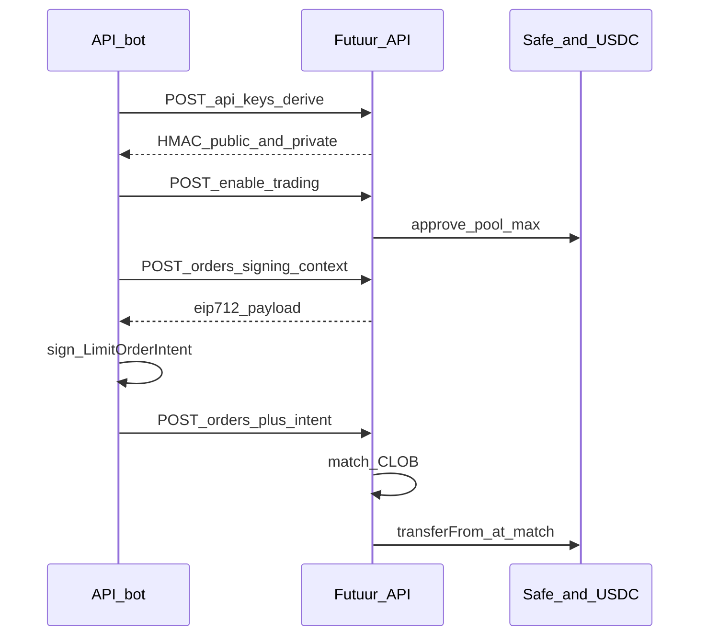

<Note>
  Phase one of on-chain trading is live on the **preview host** on Base Sepolia (chain ID `84532`). See [Environment](/environment) for the host, token, and pool addresses. Production (`https://api.futuur.com`) still uses HMAC-only ledger settlement and does not accept the fields on this page.
</Note>

Futuur settles collateral on-chain. The book still matches off-chain. Collateral (OOM or USDC) moves on-chain at match. HMAC authenticates HTTP. A wallet signature authorizes every create.

## How a bot trade works



1. [Get HMAC keys](/guides/get-api-keys) from Settings or wallet derive.
2. Register and deploy your [Safe](/api-reference/me/safe), then enable trading once per token (a standing `approve` of OOM or USDC to the pool).
3. Ask the API for a signing context, sign `LimitOrderIntent` with the **owner EOA**, then create the order. Do this one order at a time: the nonce is sequential per Safe.
4. The CLOB matches. Collateral transfers run on-chain, asynchronously, before share balances update.

See [Place an on-chain order](/guides/on-chain-first-order) for the step-by-step request flow and [End-to-end Python bot](/guides/on-chain-bot-example) for runnable code.

## Matching

The matching engine is a **CLOB** with **price, then time** priority. The best price fills first, whether it comes from another user or the platform AMM. At the same price, a resting user order fills before the AMM, and older orders fill before newer ones.

**Complementary both-buy** is a first-class match. If you bid long at 0.55 and someone else bids short at 0.45, the prices sum to 1 and the orders can match without an ask on the book.

On a **binary** event, that is Yes vs No of the same event. On an **exclusive** event with three or more markets, it is Yes vs No of the **same** market — not Yes on one market vs Yes on another. See [Conditional tokens](/concepts/conditional-tokens).

| Rule | What it means |
|---|---|
| Best price first | Your order takes the best crossing price on the book, user or AMM |
| User before AMM at a tie | At equal prices, a resting user order fills before the AMM |
| Time priority | At equal prices, the older order fills first |
| Complementary both-buy | A bid Yes and a bid No whose prices sum to ≥ 1 cross like a bid and an ask |

A filled on-chain order without a collateral `Transfer` is a failure. The API does not credit positions until collateral has moved.

## Settlement at match

Phase one moves **collateral** (OOM or USDC) and keeps share balances in the Futuur database. A later cutover mints those positions as ERC-1155 outcome tokens. Matching stays the same CLOB either way.

| Match type | Collateral (phase one) | Outcome tokens (later) |
|---|---|---|
| Bid vs ask | Bidder Safe → asker Safe (via the pool) | Transfer the filled ERC-1155 |
| Bid vs bid (both-buy) | Each user Safe → pool | Split a complete set; each trader receives their side |
| Ask vs ask (both-sell) | Pool → each user Safe | Merge a complete set back to collateral |

Settlement is **asynchronous**. Create returns before the transfers confirm, and an order can read `processing` while a match settles. Follow `settlement_status` on the order (`ready` → `settling` → `settled`) or the [`order-update`](/api-reference/websocket/channels-and-events#order-update) websocket event. See [Order lifecycle](/concepts/orders#order-lifecycle).

## Fees

Only the **taker** pays a fee. The taker is the order that arrives second and crosses a resting order. Makers pay nothing.

```
taker fee = fee rate × shares × p × (1 − p)
```

`p` is the price of the fill and the fee rate is **5%** for both `OOM` and `USDC`. The fee is highest at `p = 0.50` and falls toward zero at the extremes.

| Fill | Notional | Fee |
|---|---|---|
| 100 shares at 0.50 | 50.00 | 0.05 × 100 × 0.50 × 0.50 = 1.25 |
| 100 shares at 0.90 | 90.00 | 0.05 × 100 × 0.90 × 0.10 = 0.45 |
| 3 shares at 0.42 | 1.26 | 0.05 × 3 × 0.42 × 0.58 = 0.03654 |

- A taker **bid** pays `shares × price + fee`.
- A taker **ask** receives `shares × price − fee`.
- A resting **bid** that gets filled pays `shares × price` minus a maker reward of 80% of the taker's fee. A resting ask receives `shares × price` with no reward.

The rates are platform settings and can change. `maxUsdcRaw` in the signing context already includes the fee for a bid, so you never need to compute it to sign. After a fill, `proceeds` on the order shows the net cash of its taker fills.

## Funding, withdrawals, and payouts

| Action | What is available today |
|---|---|
| **Deposit** | Transfer the token to your Safe address on the active chain. There is no deposit endpoint for Safe balances; `POST /deposits/request/` belongs to the legacy payment-gateway flow. Read the result with `GET /me/safe-wallet/?refresh=1` or [`GET /me/balances/`](/api-reference/me/balances). On the preview host, see [Get test funds](/environment#get-test-funds). |
| **Withdraw** | `USDC` only. Send a sponsored UserOperation from your Safe whose single call is `transfer(to, amount)` on the USDC token, through the relay: sponsor, sign, submit, then read the receipt. It needs a wallet sign-in session; an API key cannot withdraw. See [Withdraw from the Safe](/api-reference/me/safe#withdraw-from-the-safe). `OOM` cannot be withdrawn. `/withdrawals/` belongs to the legacy payment-gateway flow. |
| **Resolution payout** | Automatic. When a market resolves, the pool pays each winning share 1 unit of collateral to your Safe. A canceled event refunds what you paid. A losing position pays nothing. There is no claim call. |

**Legacy balances.** When you register a Safe, your old ledger balance is migrated to it as USDC. Coins other than USD-denominated ones are converted at the stored exchange rate. The old ledger balance is debited once the transfer confirms. From then on the legacy `/withdrawals/` flow rejects `USDC` and `USD` for your account (`403 WithdrawalBalanceMigratedToSafe`): withdraw from the Safe instead.

## What the API does not have

- No endpoint returns **fills or trades**. Use the fill fields on the order (`shares_filled`, `average_price`, `proceeds`), the `order-update` websocket event, and [`GET /wagers/`](/api-reference/wagers/list) for positions.
- No endpoint returns a **single order by ID**. Filter [`GET /orders/`](/api-reference/orders/list).
- **Market orders** (`price: null`) cannot be used in on-chain currencies. Use `time_in_force: "ioc"` with a price. Send an explicit share count rather than `shares: "max"`: the signed `sharesRaw` must match the quantity that is sold.
- `PATCH /wagers/{id}/` does not sell an on-chain position. It returns `onchain_sell_requires_limit_order`. Place a signed `ask`.

## Two-layer auth

| Layer | Mechanism | Who signs | Purpose |
|---|---|---|---|
| L2 (HTTP) | HMAC-SHA512 headers `Key`, `Timestamp`, `HMAC` | HMAC **private key** | Authenticate the REST call |
| L1 (order) | EIP-712 `LimitOrderIntent` (`FutuurLimitOrder` v1) | Safe **owner EOA** | Authorize that create |

HMAC never replaces the wallet signature. Get both credentials from [Get your API keys](/guides/get-api-keys). Canceling needs HMAC only.

## What stays the same

- Events, markets, and the existing [order](/concepts/orders) and [wager](/concepts/wagers) resources
- Play money (`OOM`) and real money (`USDC`) as [currencies](/concepts/currencies)
- HMAC signing for every authenticated request — see [Authentication](/authentication)

## Not in this release

These are not part of the phase-one order flow:

- Splitting a complete set. It is [documented only](/guides/split-before-quoting). For merging, see [Merge a complete set](/guides/merge-complete-set) for its own status
- [Conditional / outcome tokens](/concepts/conditional-tokens) (ERC-1155 Yes/No positions; binaries and exclusive N≥3)
- A dedicated exchange contract (settlement uses the pool Safe; operator fills come later)
- An official TypeScript or Python SDK
- Base mainnet. Phase one runs on Base Sepolia only
