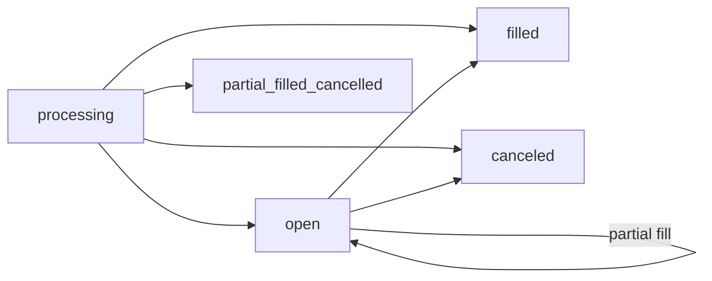

An **order** is an instruction to buy or sell shares in a market outcome. When you place an order, you specify which market you want to trade, which side (buy or sell), what position to take, how many shares, and at what price.

Orders are created via [`POST /orders/`](/api-reference/orders/create), listed via [`GET /orders/`](/api-reference/orders/list), and canceled via [`PATCH /orders/{id}/cancel/`](/api-reference/orders/cancel). You can also [cancel several orders](/api-reference/orders/batch-cancel) or [cancel everything](/api-reference/orders/cancel-all) in a single call. There is no endpoint that returns a single order by ID, and no fills or trades endpoint: filter [`GET /orders/`](/api-reference/orders/list) and read the fill fields on the order.

<Note>
  On the phase-one preview host, orders in `OOM` and `USDC` settle on-chain. Each create must carry an EIP-712 `LimitOrderIntent` signed by your Safe owner key, in addition to HMAC. Matching stays off-chain. See [On-chain trading](/concepts/on-chain-trading) and [Environment](/environment).
</Note>

## Order types

<Tabs>
  <Tab title="Limit order (gtc)">
    Set `price` and leave `time_in_force` at its default `gtc` (good till canceled). The order fills against anything that crosses it, and the remainder rests on the book until it fills or you cancel it.

    ```json
    {
      "market": "3801",
      "side": "bid",
      "position": "long",
      "shares": "10",
      "price": "0.45",
      "currency": "OOM"
    }
    ```
  </Tab>
  <Tab title="Immediate order (ioc)">
    Set `price` to the worst price you accept and `time_in_force` to `ioc` (immediate or cancel). The order fills what it can at that price or better inside the request, and the unfilled remainder is canceled. It never rests on the book and it does not match your own resting orders.

    This is how you take liquidity on-chain.

    ```json
    {
      "market": "3801",
      "side": "bid",
      "position": "long",
      "shares": "10",
      "price": "0.47",
      "time_in_force": "ioc",
      "currency": "OOM"
    }
    ```
  </Tab>
  <Tab title="Market order">
    An order with `price: null` is a market order. It executes at the best available prices.

    <Warning>
      Market orders cannot be used in `OOM` or `USDC` on the phase-one preview host. The signed intent contains a price, so a priceless order is rejected with `price_required`. Use an `ioc` order with a price instead.
    </Warning>
  </Tab>
</Tabs>

The examples show order fields only. On the preview host you add the signed-intent fields described in [Create order](/api-reference/orders/create).

## Side: bid vs ask

The `side` field specifies whether you are buying or selling shares.

| Value | Meaning |
|---|---|
| `bid` | You are **buying** shares |
| `ask` | You are **selling** shares you already hold |

## Position: long vs short

The `position` field specifies which direction you are betting.

| Value | Meaning |
|---|---|
| `long` | Betting **in favor** of the outcome — you profit if it resolves true |
| `short` | Betting **against** the outcome — you profit if it resolves false |

<Note>
  Long and short positions can both be bought (`bid`) or sold (`ask`). For example, selling a long position (`ask` + `long`) reduces your existing long exposure.
</Note>

## Price and size rules

| Rule | Value |
|---|---|
| Tick size | `0.01`. A price with more than two decimals is rejected |
| Price range | `0.01` to `0.99` |
| Minimum size | More than `0.02` shares |
| Minimum value | `0.01` in the order currency |
| Share precision on-chain | `0.01`. Send at most two decimals in `shares` |

## Matching

Orders match by **price, then time**. The best crossing price fills first, whether it belongs to another user or to the platform AMM. At the same price, a resting user order fills before the AMM, and among user orders the oldest fills first.

A bid long and a bid short on the same market whose prices sum to 1 or more also match each other, without an ask on the book. See [On-chain trading](/concepts/on-chain-trading#matching).

The taker (the order that arrives second) pays the fee. See [Fees](/concepts/on-chain-trading#fees).

## Order lifecycle

Every order starts in `processing`. What happens next depends on `time_in_force`.



| Status | Terminal | Description |
|---|---|---|
| `processing` | No | The order was accepted and is being matched, or one of its matches is settling. It is not on the book and cannot be canceled |
| `open` | No | The order rests on the book. A `gtc` order that is partly filled **stays `open`**: `shares` goes down and `shares_filled` goes up |
| `filled` | Yes | Fully filled |
| `partial_filled_cancelled` | Yes | An `ioc` order filled in part and the rest was canceled |
| `partial_filled` | Yes | An order that could not rest (a market order) stopped after a partial fill. `ioc` orders report `partial_filled_cancelled` instead |
| `canceled` | Yes | Canceled before fully filling. `shares_filled` can be above zero if part of it filled first |

How each type moves:

- **`gtc`** — create returns `processing`. Matching runs after the response. The order then becomes `open` or `filled`. Partial fills keep it `open`. It ends as `filled` or `canceled`.
- **`ioc`** — matching runs inside the create request. The order ends as `filled`, `partial_filled_cancelled`, or `canceled` (nothing filled). The create response can still show `processing` while its fills settle; read the final state from [`GET /orders/`](/api-reference/orders/list). If matching cannot finish in the request, the order is canceled and create returns `503 IOCUnavailable`.

An order leaves the book as `canceled` when you cancel it, when its event closes, or when the platform cancels a bid your Safe balance no longer covers.

### What you can cancel

| Order status | `PATCH /orders/{id}/cancel/` | Batch cancel | Cancel all |
|---|---|---|---|
| `open` | `204 No Content` | `success: true` | Listed in `canceled_order_ids` |
| `processing` | `403 LimitOrderBeingProcessing` | `success: false`, `Order is being processed.` | Listed in `processing_order_ids` |
| `filled`, `partial_filled`, `partial_filled_cancelled`, `canceled` | `404 not_found` | `success: false`, `Order not found or not cancelable.` | Ignored |

Canceling stops the unmatched remainder. A fill whose on-chain transfer has already been sent stands.

### Expiration

`expired_at` is the time after which the order no longer matches. On the preview host it is never later than the `expiry` you signed: the API lowers `expired_at` to the signed expiry. An expired order stops matching, but the API does not change its status at that moment, so cancel it if you need it to read `canceled`.

### Settlement

On the preview host, matching and settlement are separate steps. The engine matches off-chain, then moves collateral on-chain **asynchronously**. Shares are credited only after the collateral transfer succeeds; until then the order can show `processing`. If the transfer fails, the match fails and no shares change hands.

`settlement_mode` is `onchain` for these orders. `settlement_status` tracks the chain side:

| `settlement_status` | Meaning |
|---|---|
| `ready` | The intent was verified. The order can match |
| `approval_pending` | A bid is waiting for its pool allowance |
| `settling` | A match of this order is being settled on-chain |
| `settled` | The latest match settled. The order can still be `open` if it is only partly filled |
| `failed` | On-chain settlement failed |
| `none` or empty | Not an on-chain order |

To follow fills without polling, subscribe to [`order-update`](/api-reference/websocket/channels-and-events#order-update) on your private channel.

## The order object

Create and list return the same object.

| Field | Type | Description |
|---|---|---|
| `id` | integer | Order ID |
| `event` | object | The event: `id`, `title`, `slug`, `status`, `is_wagerable`, and more. In a list filtered by `event`, this is the event ID instead |
| `market` | object | The market: `id`, `title`, `price`, `status`, and more. In a list filtered by `event`, this is the market ID instead |
| `side` | string | `bid` or `ask` |
| `position` | string | `long` or `short` |
| `price` | number \| null | Limit price |
| `shares` | number | Shares still unfilled |
| `shares_requested` | number | Shares the order was created with |
| `shares_filled` | number | Shares filled so far |
| `shares_cancelled` | number | For a finished `ioc` order, the shares that were canceled. `0` otherwise |
| `average_price` | number \| null | Average fill price. `null` before any fill |
| `proceeds` | number \| null | Net cash of the fills where this order was the taker: what a bid paid or an ask received, after the fee. `null` if it has no taker fill |
| `currency` | string | `OOM`, `USDC`, `USDT`, or `USD` |
| `time_in_force` | string | `gtc` or `ioc` |
| `status` | string | See [Order lifecycle](#order-lifecycle) |
| `expired_at` | string \| null | Expiration time |
| `created` | string | Creation time |
| `settlement_mode` | string | `onchain`, `ledger`, or empty |
| `settlement_status` | string | See [Settlement](#settlement) |
| `chain_id` | integer \| null | Chain of an on-chain order |

There is no `amount` field on the order.

## Order fields reference

<AccordionGroup>
  <Accordion title="shares and amount">
    `shares` is the size of the order and is required. `amount` is an optional cross-check for the total; it does not size the order, and you can leave it out.

    On an ask, `shares` can be the string `"max"` to sell everything you hold that is not reserved by your open asks, optionally capped with `max_shares`. `"max"` cannot be relied on for `OOM` or `USDC` on the preview host: the signed `sharesRaw` must equal the resolved quantity, so send an explicit share count.
  </Accordion>
  <Accordion title="expired_at">
    Set `expired_at` to an ISO 8601 datetime to stop the order from matching after that time. See [Expiration](#expiration).

    ```json
    {
      "expired_at": "2026-12-05T23:59:00Z"
    }
    ```
  </Accordion>
  <Accordion title="cancel_conflicting_orders">
    An ask fails with `OrderBookConflictingOrders` when your open asks already reserve the shares it needs. Set `cancel_conflicting_orders` to `true` to cancel those asks and place the new one.
  </Accordion>
</AccordionGroup>

## Full order fields

| Field | Type | Description |
|---|---|---|
| `market` | integer | ID of the market (outcome) to trade |
| `side` | string | `bid` (buy) or `ask` (sell) |
| `position` | string | `long` or `short` |
| `price` | decimal \| null | Limit price `0.01`–`0.99`. `null` is a market order |
| `shares` | decimal | Number of shares |
| `currency` | string | `OOM`, `USDC`, `USDT`, or `USD` |
| `time_in_force` | string | `gtc` (default) or `ioc` |
| `expired_at` | datetime | Time after which the order no longer matches |
| `cancel_conflicting_orders` | boolean | Cancel conflicting open asks before placing |

The signed-intent fields (`chain_id`, `order_intent_signature`, `order_intent_expiry`, `order_intent_nonce`, `max_usdc_raw`) are listed in [Create order](/api-reference/orders/create).

<Warning>
  Real money orders (USDC, USDT, USD) are restricted in some countries. See [Currencies](/concepts/currencies) for details.
</Warning>
