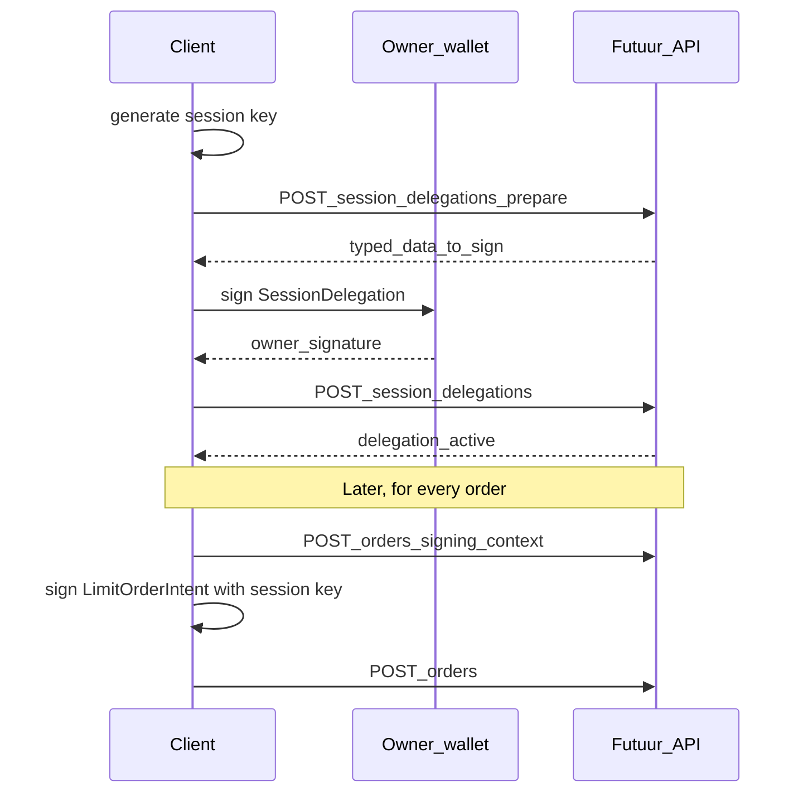

<Note>
  Session keys are coming soon. They are not available on `https://api.futuur.com`, where settlement is still HMAC-only and ledger-based. This page explains the model so you can prepare. The endpoints are documented only in the [developer guide](/guides/session-keys), and they are not live on `https://api.futuur.com`.
</Note>

A **session key** is a separate, throwaway signing key that your owner wallet authorizes once. After that, the session key signs your Web3 orders and your owner wallet is not needed for each one.

## Why session keys exist

Every Web3 order needs an EIP-712 `LimitOrderIntent` signed by the Safe owner wallet. See [On-chain trading](/concepts/on-chain-trading). In a browser or mobile wallet, that means a wallet prompt on every order.

A session key removes the prompt. You sign one `SessionDelegation` with the owner wallet. It names the session key and the limits it works within. From then on, the Futuur backend accepts `LimitOrderIntent` signatures from that key.

## How it works

1. The client generates a new key pair. The private key stays with the client.
2. The owner wallet signs one `SessionDelegation` naming the session key's address. This is the only wallet prompt.
3. The backend checks that the owner signed it and stores it.
4. For each order, the client signs the usual `LimitOrderIntent` with the session key instead of the owner wallet.
5. The backend recovers the signer. If it is the owner, the order takes the normal path. If it is a live session key of that Safe, the backend first checks the session limits.

The order request is unchanged. It is the same `POST /orders/` body, with the signature coming from the session key.

Verification happens off-chain, in the Futuur backend. No on-chain registry is involved, and a session key costs no gas.

## What a session key can do

- Sign `LimitOrderIntent` for **any market**, buys and sells.
- Work for **one currency on one chain**. The delegation names both.
- Last for a fixed period, about 30 days at the time of writing. The `expiry` field on the session is authoritative.

## What a session key cannot do

- Withdraw funds from your Safe.
- Change the owners of your Safe.
- Trade a currency or chain other than the one it was created for.
- Place an order outside its [limits](#limits).
- Outlive its `expiry`.

It also cannot raise its own limits. Futuur sets the rolling budget and the price guard, and the owner signature covers only the per-order cap.

<Warning>
  A session key is still a real signing key. Anyone who holds it and your authenticated API access can place and sell orders for your Safe, within the limits below. Treat it like a password.
</Warning>

## Lifetime and renewal

A session lasts until its `expiry`, or until you revoke it. Futuur chooses the expiry when you prepare the delegation. You cannot extend a session.

To renew, create a new session with a new key before the old one expires. You can have several live sessions at once, so the old one keeps working until its expiry or until you revoke it. A session key address can be used for one session only. After a session ends, generate a fresh key.

When a session expires or is revoked, orders it already placed stay on the book. Only new orders it signs are rejected.

## Limits

Three limits apply to orders signed by a session key. Orders signed by the owner wallet are never subject to them.

| Limit | What it checks |
|---|---|
| Per-order cap | The size of one order. For a bid it is the signed `maxUsdcRaw`. For an ask it is the share count times one currency unit |
| Rolling budget | The total size of orders the session placed in a rolling 24-hour window. The window starts at the session's first order and restarts after 24 hours |
| Price guard | The distance between the order's limit price and the market price, in either direction. The market price is the best opposing price on the book, or the last traded price when the book has none. The check is skipped when there is neither |

The limit values are environment settings. They can differ between environments and can change. The response from `prepare` reports the per-order cap as `maxMakerAmount`, in raw token units. Divide it by `10 ^ decimals` to get currency units. Futuur can later lower a limit for sessions that are already live.

An order outside a limit is rejected with one of the codes below. The session stays valid. Sign that order with the owner wallet instead.

### Session error codes

`POST /orders/` returns these as a `400` in the [on-chain error format](/errors#on-chain-order-errors-look-different). The backend checks them in this order and returns the first that fails.

| Code | Meaning |
|---|---|
| `session_revoked` | The session was revoked |
| `session_expired` | The session has passed its `expiry` |
| `session_scope_exceeded` | The order is over the per-order cap, or its currency or chain is not the one the session covers |
| `session_price_guard` | The limit price is too far from the market price |
| `session_budget_exceeded` | The session has used up its rolling budget |

A rejected order does not count against the budget. For the full list, including codes returned while you create a session, see [Errors](/errors#session-key-errors).

## Revoking a session

You can revoke a session at any time. Revoking needs your authenticated API access and no wallet signature, because it only removes power.

- By default, revoking leaves the orders the session placed on the book. They keep the expiry they were signed with.
- To cancel the session's open orders as well, revoke with `cancel_orders` set. Use this when a key may be exposed.
- Revoking twice is safe.

See [Session keys for developers](/guides/session-keys) for the request.

## Several sessions per Safe

Each browser or device can hold its own session. A Safe can have several live sessions at once. When you register a session past the limit, the backend revokes the oldest live sessions. It leaves their orders on the book.

## Security notes

- **Keep the private key secret.** Do not log it, commit it, or send it to any server, including Futuur's. Futuur never needs it. It only sees the signatures.
- **It only trades.** A session key cannot withdraw or change Safe owners. Worst case, it places orders inside the per-order cap, the rolling budget, and the price guard.
- **It needs more than the key.** To place an order, the client also needs authenticated API access to your account.
- **Revoke it if you think it leaked.** Revoke with `cancel_orders` set, then register a new session with a new key.
- **Store it encrypted.** If your client keeps the key between runs, encrypt it at rest. Delete it when the user signs out.
- **One key per client.** Do not share a session key between devices.

## How the Futuur website uses session keys

On the Futuur website, this will be automatic, with no extra screens:

- The first Web3 bet asks your wallet for one signature. That is the delegation.
- Later bets are signed in the browser with the session key. Your wallet is not involved.
- The browser keeps the key encrypted in browser storage.
- When the session is close to expiry, the next bet creates a new session.
- If you decline the signature, or an order is rejected by a limit, that bet is signed by your wallet instead.
- When you log out, the browser deletes the key and revokes the session. Your resting orders stay on the book.

## Who should use session keys

Use them when the owner wallet is interactive and a person must approve each signature: a browser wallet, a hardware wallet, or a mobile wallet.

If you trade through the API and already sign each order with your own key, a session key gains you nothing. Your program already holds the owner key, and it needs that key to sign the delegation anyway.

## Related

- [Session keys for developers](/guides/session-keys): the request flow, step by step
- [On-chain trading](/concepts/on-chain-trading): matching, settlement, and the two layers of auth
- [Place an on-chain order](/guides/on-chain-first-order): signing a `LimitOrderIntent` with the owner wallet
- [Errors](/errors#session-key-errors): every session error code
