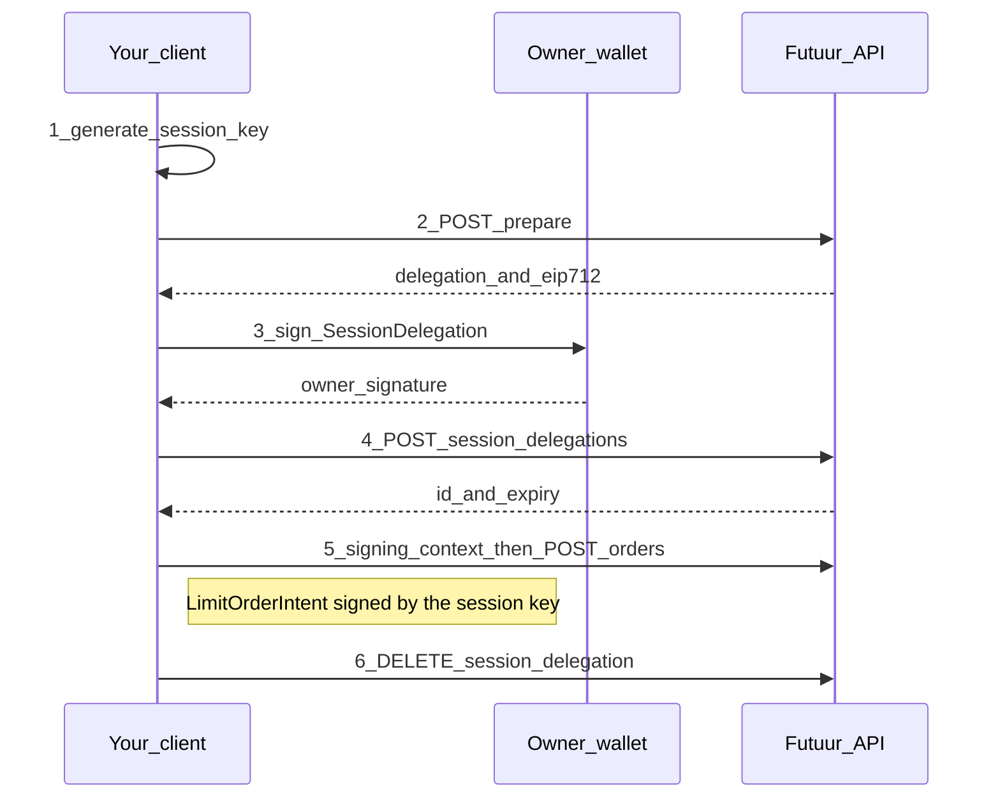

<Note>
  Session keys are coming soon and are **not live** on `https://api.futuur.com`. All paths below are relative to the API base URL, for example `/v2.0/me/session-delegations/prepare/`. Where session keys are off, every endpoint on this page returns `404`.
</Note>

A session key lets a client sign orders without asking the owner wallet each time. You sign one delegation with the owner wallet. After that, a throwaway key signs each `LimitOrderIntent`. For what a session key is and which limits apply, read [Session keys](/concepts/session-keys) first.

<Warning>
  **Most API traders do not need this.** If your program already signs every order with your own owner key, a session key gains you nothing. You need the owner key to sign the delegation, and your program already holds it. Use session keys in clients where the owner wallet is interactive: a browser wallet, a hardware wallet, or a mobile wallet where a person approves each signature. The exception is a bot that cannot hold the owner key. See [API trading keys](#api-trading-keys).
</Warning>

## Prerequisites

Everything in [Place an on-chain order](/guides/on-chain-first-order), plus:

1. A registered, deployed Safe, with trading enabled for the currency.
2. HMAC public and private keys for L2 request signing. See [Get your API keys](/guides/get-api-keys).
3. The owner wallet, available once to sign the delegation.
4. An on-chain currency (`OOM` or `USDC`). A session covers one currency on one chain.

Sign every request below with HMAC, as in [Authentication](/authentication). Send string values in JSON bodies so the signed text equals the sent text.

## The flow



## Step 1 — Generate a session key

Create a new secp256k1 key pair on the client. The address goes to the API. The private key never leaves the client.

```python python
from eth_account import Account

session = Account.create()
print(session.address)  # send this as session_key
```

Use a new key for every session. The API rejects an address that was used before, the zero address, and the addresses of your Safe and your owner wallet.

## Step 2 — Prepare the delegation

```http
POST /v2.0/me/session-delegations/prepare/
```

Writes nothing. The server picks the cap, the expiry, and the nonce, and returns the typed data to sign.

```json
{
  "chain_id": "84532",
  "currency": "OOM",
  "session_key": "0xYourSessionKeyAddress"
}
```

| Request field | Required | Notes |
|---|---|---|
| `chain_id` | Yes | Chain of your Safe |
| `currency` | Yes | An on-chain currency, `OOM` or `USDC` |
| `session_key` | Yes | Address of the key from step 1 |
| `purpose` | No | `browser` (default) or `api`. See [API trading keys](#api-trading-keys) |

The response is `200`. The values below are illustrative:

```json
{
  "delegation": {
    "safe": "0xYourSafe",
    "sessionKey": "0xYourSessionKeyAddress",
    "allMarkets": true,
    "tokenSetHash": "0x0000000000000000000000000000000000000000000000000000000000000000",
    "maxMakerAmount": "5000000000",
    "expiry": 1797552000,
    "nonce": 1,
    "decimals": 6
  },
  "eip712": {
    "domain": {
      "name": "Futuur Session Delegation",
      "version": "1",
      "chainId": 84532,
      "verifyingContract": "0xVerifyingContractFromTheResponse"
    },
    "types": {
      "EIP712Domain": [
        { "name": "name", "type": "string" },
        { "name": "version", "type": "string" },
        { "name": "chainId", "type": "uint256" },
        { "name": "verifyingContract", "type": "address" }
      ],
      "SessionDelegation": [
        { "name": "safe", "type": "address" },
        { "name": "sessionKey", "type": "address" },
        { "name": "tokenSetHash", "type": "bytes32" },
        { "name": "maxMakerAmount", "type": "uint256" },
        { "name": "expiry", "type": "uint256" },
        { "name": "nonce", "type": "uint256" }
      ]
    },
    "primaryType": "SessionDelegation",
    "message": {
      "safe": "0xYourSafe",
      "sessionKey": "0xYourSessionKeyAddress",
      "tokenSetHash": "0x0000000000000000000000000000000000000000000000000000000000000000",
      "maxMakerAmount": "5000000000",
      "expiry": 1797552000,
      "nonce": 1
    }
  }
}
```

| Response field | Meaning |
|---|---|
| `delegation.safe` | Your Safe |
| `delegation.sessionKey` | Echo of your session key address |
| `delegation.allMarkets` | `true`. The session covers every market |
| `delegation.tokenSetHash` | 32 zero bytes. It is how the typed data says "all markets" |
| `delegation.maxMakerAmount` | The per-order cap, as a string in raw token units. Divide by `10 ^ decimals` for currency units |
| `delegation.expiry` | Unix seconds when the session ends. For `purpose: "api"` it is 180 days ahead by default |
| `delegation.nonce` | Delegation nonce for your Safe. It is separate from the order nonce |
| `delegation.decimals` | Decimals of the settlement token. Display only |
| `eip712` | The typed data to sign: `domain`, `types`, `primaryType`, `message` |

Things to know about prepare:

- Prepare does not reserve the nonce. If you prepare twice and register one result, the other then fails with `session_nonce_invalid`. Prepare again.
- The cap, the expiry, and the nonce are the server's choice. Do not change them.
- The per-order cap is an environment setting. Read it from `maxMakerAmount` and do not hard-code it. The rolling budget and the price guard are not signed and are not in this response.

## Step 3 — Sign the delegation with the owner wallet

Sign `eip712` exactly as returned. This is the only time you need the owner key. In an interactive client, this is the wallet prompt.

```python python
from eth_account.messages import encode_typed_data

eip712 = prepared["eip712"]  # from step 2

signable = encode_typed_data(full_message={
    "types": eip712["types"],  # already includes EIP712Domain
    "primaryType": eip712["primaryType"],
    "domain": eip712["domain"],
    "message": eip712["message"],
})
owner_signature = owner.sign_message(signable).signature.hex()
if not owner_signature.startswith("0x"):
    owner_signature = f"0x{owner_signature}"
```

Sign with the owner key, not the session key and not the Safe address. Do not edit the message. The API rebuilds the typed data from your create request, and the signature must match it.

## Step 4 — Register the delegation

Register it soon after you prepare it.

```http
POST /v2.0/me/session-delegations/
```

```json
{
  "chain_id": "84532",
  "currency": "OOM",
  "session_key": "0xYourSessionKeyAddress",
  "max_maker_amount": "5000000000",
  "expiry": "1797552000",
  "nonce": "1",
  "owner_signature": "0x..."
}
```

| Request field | Required | Notes |
|---|---|---|
| `chain_id` | Yes | Same as in prepare |
| `currency` | Yes | Same as in prepare |
| `session_key` | Yes | Same as in prepare |
| `max_maker_amount` | Yes | String. `delegation.maxMakerAmount` from prepare |
| `expiry` | Yes | `delegation.expiry` from prepare |
| `nonce` | Yes | `delegation.nonce` from prepare |
| `owner_signature` | Yes | EIP-712 signature from step 3 |
| `purpose` | No | `browser` (default) or `api`. Same as in prepare |
| `label` | No | Name for an API trading key, up to 64 characters. Surrounding spaces are removed |

The response is `201`:

```json
{
  "id": 42,
  "session_key": "0xYourSessionKeyAddress",
  "purpose": "browser",
  "label": "",
  "created_at": "2026-11-19T10:15:00Z",
  "all_markets": true,
  "max_maker_amount": "5000000000",
  "expiry": 1797552000,
  "decimals": 6,
  "status": "active"
}
```

| Response field | Meaning |
|---|---|
| `id` | Session ID. You need it to revoke |
| `session_key` | Address of the session key |
| `purpose` | `browser` or `api` |
| `label` | Name of an API trading key. Empty for browser sessions |
| `created_at` | When the session was registered, ISO 8601 |
| `all_markets` | `true` |
| `max_maker_amount` | Per-order cap, raw token units, as a string |
| `expiry` | Unix seconds when the session ends |
| `decimals` | Decimals of the settlement token. Display only |
| `status` | `active`, `expired`, or `revoked` |

If you register a browser session past the limit of live browser sessions for your Safe, the oldest one is revoked. Its orders stay on the book. API trading keys are never revoked this way. See [API trading keys](#api-trading-keys).

To check a session later, or to find out if a stored key is still live:

```http
GET /v2.0/me/session-delegations/active/?currency=OOM&session_key=0xYourSessionKeyAddress
```

It returns `200` with the object above, or `204` with no body when that key has no live session. `chain_id` is optional and defaults to the active chain.

## Step 5 — Place orders signed by the session key

Order creation is unchanged. Follow [Place an on-chain order](/guides/on-chain-first-order): call signing-context, sign the `eip712` it returns, and send `POST /v2.0/orders/` with the same body. The one difference is the signer. Sign with the **session key** instead of the owner wallet. The snippet uses the helpers from the [example script](#example-script) below.

```python python
context = post("/orders/signing-context/", order).json()
signature = sign_typed_data(session, context["eip712"])  # the session key signs

body = {
    **order,
    "chain_id": str(context["chainId"]),
    "order_intent_signature": signature,
    "order_intent_expiry": str(context["expiry"]),
    "order_intent_nonce": str(context["nonce"]),
    "max_usdc_raw": str(context["maxUsdcRaw"]),
}
created = post("/orders/", body)
```

Keep these in mind:

- `ownerAddress` in the signing-context response is still your owner wallet. When a session key signs, you do not compare it with the signer.
- The order nonce is one counter per Safe, shared with owner-signed orders. Run signing-context, sign, and create one after another.
- An order keeps the expiry you signed. It stays on the book after the session expires or is revoked.
- The order must stay inside the session's limits. See the next step.

## Handle rejections

When an order falls outside the session, `POST /orders/` returns a `400` in the [on-chain error format](/errors#on-chain-order-errors-look-different), with one of these codes:

| Code | Meaning | What to do |
|---|---|---|
| `session_revoked` | The session was revoked | Register a new session, or sign with the owner wallet |
| `session_expired` | The session has passed its `expiry` | Register a new session, or sign with the owner wallet |
| `session_scope_exceeded` | Over the per-order cap, or a currency or chain the session does not cover | Sign this order with the owner wallet |
| `session_price_guard` | The limit price is too far from the market price | Move the price, or sign with the owner wallet |
| `session_budget_exceeded` | The rolling budget is used up | Sign this order with the owner wallet, or wait for the window to restart |

For the limit codes (`session_scope_exceeded`, `session_price_guard`, `session_budget_exceeded`), the session stays valid. Fetch a new signing context and sign the same order with the owner key. A rejected order does not use the session budget.

For `session_revoked` and `session_expired`, discard the stored key and register a new session. You can fall back to the owner wallet meanwhile.

The price guard compares your limit price with the best opposing price on the book. A resting order priced far from the market is rejected, in either direction. This also applies to a resting bid far below the best ask.

The errors you can get while creating a session are listed in [Errors](/errors#session-key-errors).

## Step 6 — Revoke the session

```http
DELETE /v2.0/me/session-delegations/{id}/
DELETE /v2.0/me/session-delegations/{id}/?cancel_orders=1
```

| Query parameter | Notes |
|---|---|
| `cancel_orders` | Optional, default `false`. Also cancels the open orders this session signed. Use it when a key may be exposed |

The response is `204` with no body. No wallet signature is needed. Revoking is idempotent. An unknown ID, or one that is not yours, returns `404`.

By default, revoking leaves the session's resting orders on the book. Revoke when the user signs out, or when the key may be exposed. Delete the private key from the client at the same time.

## API trading keys

An API trading key is a session delegation with `purpose` set to `api`. It lets a bot trade without the owner wallet key, for example when you log in with email or Magic and cannot export the wallet key. For the model, see [Session keys](/concepts/session-keys#api-trading-keys).

Most users create a key in the web app, under **Settings** → **API** → **Trading keys**. You can also register one yourself with steps 1 to 4 above, with these changes:

- Send `"purpose": "api"` in both prepare and create.
- Optionally send `label` in create, up to 64 characters.
- The owner wallet still signs the `SessionDelegation`. There is no way around that signature.

The expiry is 180 days ahead by default. A Safe can hold up to 5 live API trading keys. They are counted apart from browser sessions, and browser sessions never revoke them. Registering a sixth fails with `api_trading_key_limit`. Revoke one first.

The bot authenticates with its normal HMAC pair from **Settings** → **API keys**. Do not call `POST /api-keys/derive/` with a trading key, because derive needs the owner signature. For each order, the bot calls signing-context and signs the returned `eip712` unchanged with the trading key, as in step 5. The `safeAddress` in that typed data stays your Safe. Do not put the session address in it.

List your live API trading keys:

```http
GET /v2.0/me/session-delegations/?purpose=api&chain_id=84532&currency=OOM
```

| Query parameter | Notes |
|---|---|
| `currency` | Required |
| `purpose` | `browser` or `api`. Defaults to `api` |
| `chain_id` | Optional. Defaults to the active chain |

It returns `200` with an array of the session object from step 4, newest first. It lists only keys that are not revoked and not expired. Use `label` and `created_at` to tell keys apart.

Revoke a key with `DELETE /v2.0/me/session-delegations/{id}/`, as in [step 6](#step-6--revoke-the-session). Add `?cancel_orders=1` to cancel its open orders as well. After a revoke, the next order the key signs fails with `session_revoked`. The limits and rejection codes are the same as for browser sessions.

## Example script

This script registers a session key, places one order signed by the session key, falls back to the owner key if a session limit rejects it, and revokes the session. It repeats the HMAC and error helpers from [End-to-end Python bot](/guides/on-chain-bot-example). It revokes with `cancel_orders=1`, so nothing rests on the book afterwards. In a real client, the owner signature in step 3 comes from the user's wallet and not from a key in the script.

```bash
pip install requests eth-account
export FUTUUR_API_BASE=https://...      # API base URL, ending in /v2.0
export FUTUUR_HMAC_PUBLIC_KEY=...
export FUTUUR_HMAC_PRIVATE_KEY=...
export FUTUUR_OWNER_KEY=0x...           # owner EOA private key. Never commit it
export FUTUUR_MARKET_ID=3801
export FUTUUR_PRICE=0.45                # close to the market: the price guard rejects far prices
python session_demo.py
```

```python session_demo.py
"""Session key demo: prepare -> owner signs -> register -> order signed by the session key -> revoke."""
import hashlib
import hmac
import os
import sys
import time
from urllib.parse import urlencode

import requests
from eth_account import Account
from eth_account.messages import encode_typed_data

BASE = os.environ["FUTUUR_API_BASE"]
PUBLIC_KEY = os.environ["FUTUUR_HMAC_PUBLIC_KEY"]
PRIVATE_KEY = os.environ["FUTUUR_HMAC_PRIVATE_KEY"]
CHAIN_ID = "84532"
CURRENCY = "OOM"

owner = Account.from_key(os.environ["FUTUUR_OWNER_KEY"])
ORDER = {
    "market": os.environ["FUTUUR_MARKET_ID"],
    "side": "bid",
    "position": "long",
    "price": os.environ.get("FUTUUR_PRICE", "0.45"),
    "shares": "10",
    "currency": CURRENCY,
    "time_in_force": "gtc",
}
LIMIT_CODES = {"session_scope_exceeded", "session_price_guard", "session_budget_exceeded"}
DOMAIN_TYPE = [
    {"name": "name", "type": "string"},
    {"name": "version", "type": "string"},
    {"name": "chainId", "type": "uint256"},
    {"name": "verifyingContract", "type": "address"},
]


def hmac_headers(params=None):
    timestamp = str(int(time.time()))
    to_sign = {**(params or {}), "Key": PUBLIC_KEY, "Timestamp": timestamp}
    message = urlencode(sorted(to_sign.items()))
    digest = hmac.new(PRIVATE_KEY.encode(), message.encode(), hashlib.sha512).hexdigest()
    return {"Key": PUBLIC_KEY, "Timestamp": timestamp, "HMAC": digest}


def post(path, body):
    return requests.post(f"{BASE}{path}", json=body, headers=hmac_headers(body))


def onchain_code(response):
    """Code of an on-chain 400: the detail of the entry whose attr is "code"."""
    try:
        errors = response.json().get("errors", [])
    except ValueError:
        return None
    return next((e["detail"] for e in errors if e.get("attr") == "code"), None)


def sign_typed_data(account, eip712):
    """EIP-712 signature as a 0x-prefixed hex string. Works for prepare and signing-context."""
    signable = encode_typed_data(full_message={
        "types": {"EIP712Domain": DOMAIN_TYPE, **eip712["types"]},
        "primaryType": eip712["primaryType"],
        "domain": eip712["domain"],
        "message": eip712["message"],
    })
    signature = account.sign_message(signable).signature.hex()
    return signature if signature.startswith("0x") else f"0x{signature}"


# --- 1-4. Generate a key, prepare, sign with the owner (once), register ---

def register_session():
    session = Account.create()
    prepared = post("/me/session-delegations/prepare/", {
        "chain_id": CHAIN_ID,
        "currency": CURRENCY,
        "session_key": session.address,
    })
    if prepared.status_code == 404:
        sys.exit("Session keys are not available on this host.")
    prepared.raise_for_status()
    prepared = prepared.json()
    delegation = prepared["delegation"]
    assert delegation["sessionKey"].lower() == session.address.lower()

    created = post("/me/session-delegations/", {
        "chain_id": CHAIN_ID,
        "currency": CURRENCY,
        "session_key": session.address,
        "max_maker_amount": delegation["maxMakerAmount"],
        "expiry": str(delegation["expiry"]),
        "nonce": str(delegation["nonce"]),
        "owner_signature": sign_typed_data(owner, prepared["eip712"]),  # the only owner prompt
    })
    if created.status_code != 201:
        sys.exit(f"Register failed: {created.status_code} {onchain_code(created)} {created.text}")
    return session, created.json()


# --- 5. Signing context -> sign -> create. One at a time per Safe. ---

def place_order(signer):
    context = post("/orders/signing-context/", ORDER)
    context.raise_for_status()
    context = context.json()
    body = {
        **ORDER,
        "chain_id": str(context["chainId"]),
        "order_intent_signature": sign_typed_data(signer, context["eip712"]),
        "order_intent_expiry": str(context["expiry"]),
        "order_intent_nonce": str(context["nonce"]),
        "max_usdc_raw": str(context["maxUsdcRaw"]),
    }
    return post("/orders/", body)


if __name__ == "__main__":
    session, delegation = register_session()
    print("session", delegation["id"], delegation["status"], "expires", delegation["expiry"])
    try:
        created = place_order(session)  # signed by the session key
        if created.status_code == 400 and onchain_code(created) in LIMIT_CODES:
            print("session limit hit:", onchain_code(created), "- signing with the owner key")
            created = place_order(owner)
        if created.status_code != 201:
            sys.exit(f"Create failed: {created.status_code} {onchain_code(created)} {created.text}")
        print("created", created.json()["id"], created.json()["status"])
    finally:
        # --- 6. Revoke. cancel_orders=1 also cancels the open orders this session signed. ---
        params = {"cancel_orders": "1"}
        response = requests.delete(
            f"{BASE}/me/session-delegations/{delegation['id']}/",
            params=params, headers=hmac_headers(params),
        )
        print("revoked" if response.status_code == 204 else f"revoke failed: {response.status_code}")
```
