This page explains the basics of Futuur’s most important feature: making predictions. Please read on to learn how to express your views in the form of bets, put your knowledge to the test, and profit from your forecasting skills.

## How do I place a bet?

### Select real-money or play-money markets

Once you [create your account](/help/create-your-account) and log into it, you should [select whether you want to browse play-money markets or real-money markets](/help/understanding-currencies). In the examples below, we will use play-money markets.

Once you find the market you are interested in, click on it and to arrive at the market interface.

<Tip>
  It is also possible to place bets and sell positions directly from Futuur’s feed, without entering the market details page. Although more practical and fast, we recommend this feature only for markets whose rules and details you have already read and understood.
</Tip>

### Read the market details

Take a moment to understand the elements in the market interface:

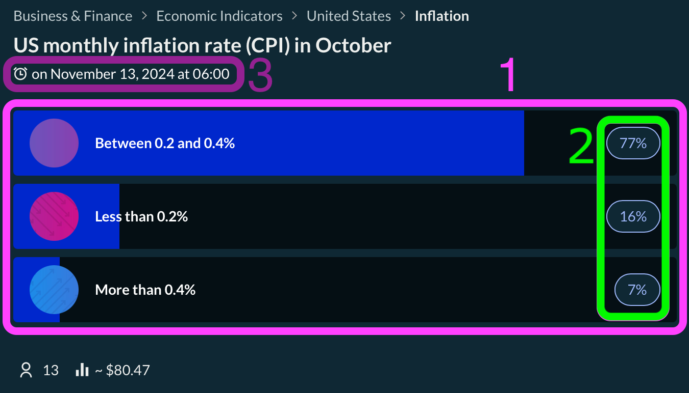

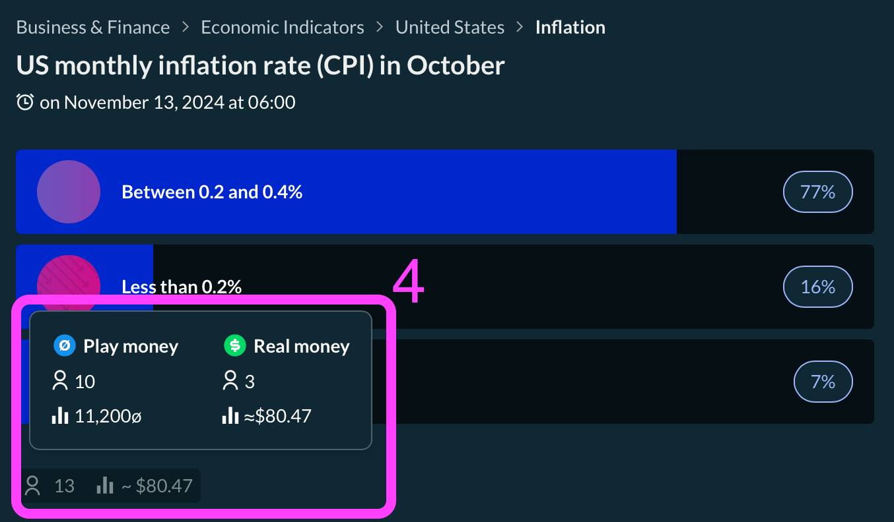

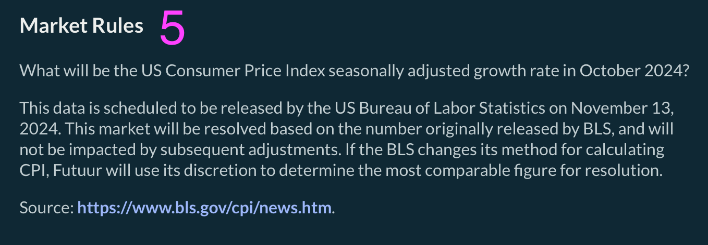

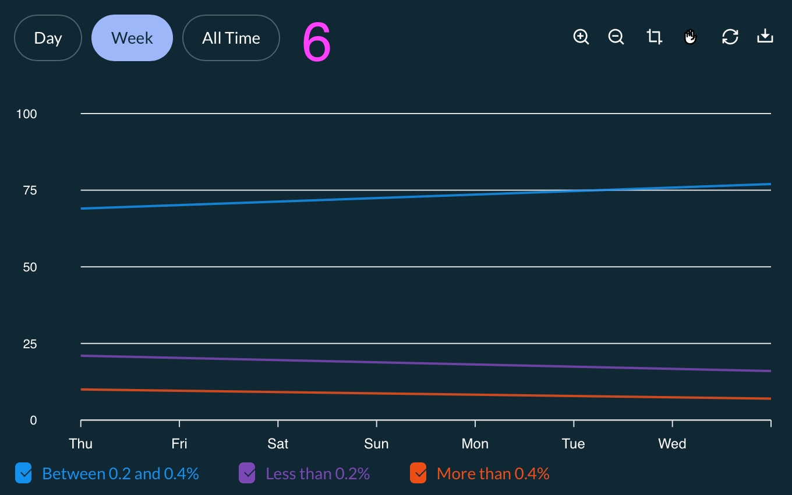

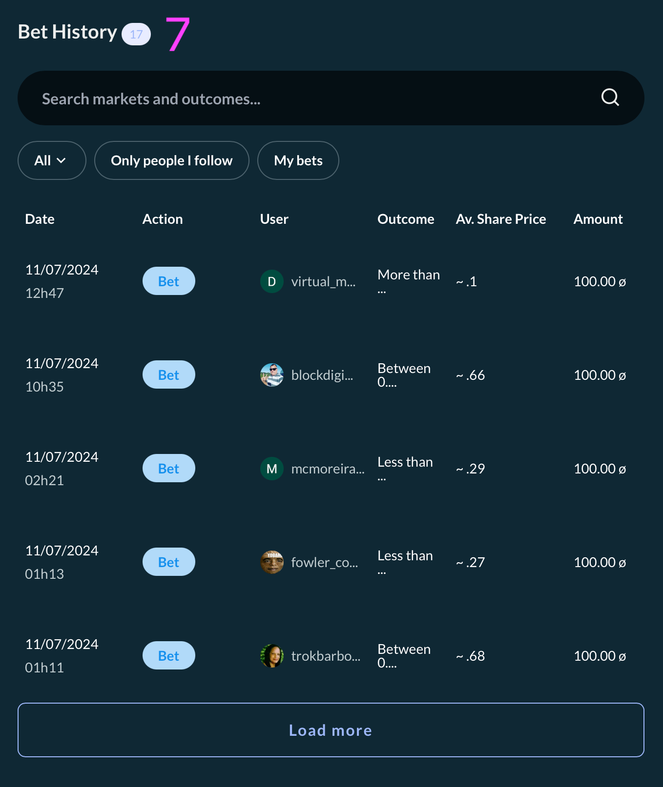

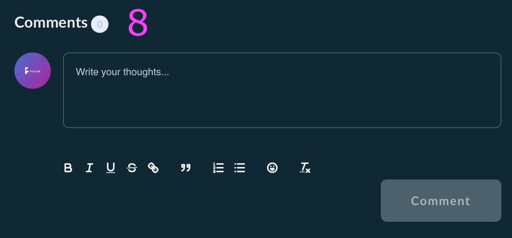

1. OUTCOMES: The possible outcomes for the event the market is trying to predict. You must pick one in order to place a bet.
2. PRICE PER SHARE: The price that was paid to acquire 1 share of a given outcome in the most recent transaction on that market. At the moment the market is resolved, users who hold shares of the winning outcome will be rewarded with 1 Oom for each share they hold. Shares from the loosing outcome will be worth 0 at that moment, so users holding shares of the loosing outcomes will loose everything they spent buying these shares. 
   Please pay close attention to these prices as they can fluctuate in real time depending on market activity. Prices can also progressively increase the more you buy shares. In the example above, the most recent price to buy 1 share of outcome “Yes” was 0.77 Oom. However, if you buy, for example, 100 shares in the market, it is possible that the price of the 100th share you buy is higher than the price for the 1st share. The magnitude of the price movements is determined by the market's [Order Book](/help/order-book) and Futuur’s [Automated Market Maker](/help/automated-market-maker) (AMM). As more bets occur and more people participate in the market, prices will become less volatile. 
   Futuur also charges a fee on top of the price per share on the moment of purchase (learn more [here](/help/betting-and-trading)).
3. BET END DATE: The moment the market will close for new bets and sales.
4. MARKET STATS: quick summary how many users have already bet on it, and the cumulative amount of resources they invested in it.
5. MARKET RULES: This sections lays out the detailed rules Futuur must observe to determine which of the listed outcomes should be the winner at market resolution. Each market has its particular set of rules, so make sure you read them thoroughly before placing your bet.
6. PROBABILITY GRAPH: the historical evolution of each particular outcome’s likelihood of becoming the winner in the market.
7. BET HISTORY: A list from recent bets from all other forecasters who participated in the market.
8. COMMENTS: A section where you can engage in discussions with fellow forecasters on the subjects related to this market. Oftentimes, when needed, Futuur’s team provides clarifications on market rules in this section when needed

### Place your Bet

Select the outcome you want to bet on, and head to the Place Bet modal. Make sure you understand the information displayed in the modal before clicking the “Bet” button:

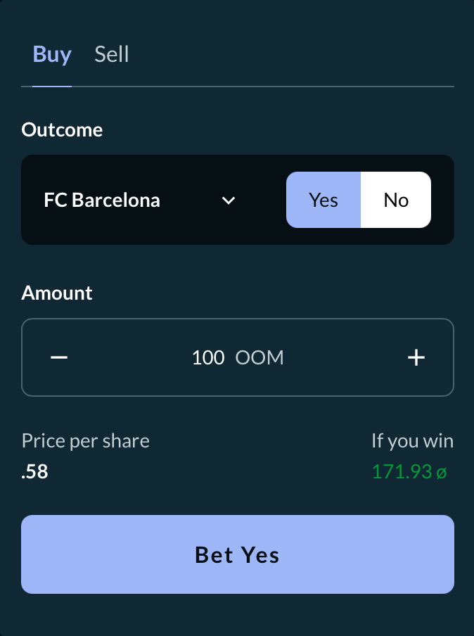

- **OUTCOME**: the outcome you want to bet on. You can place a "Yes" bet on an individual outcome (betting it will happen) or a "No" bet on that same outcome (betting it won't happen), independently of the other outcomes in the market.
- **AVERAGE PRICE / SHARE**: the average price per share taking into account the amount of shares you are buying. In this example, on average, you would pay approximately 0.58 Oom per share. This number already includes Futuur’s purchase fee.
- BET AMOUNT: the total amount of Ooms you will spend to place your bet.
- IF YOU WIN: The total amount of Ooms you will receive if your prediction is correct. 
  (In other words, that represents the total amount of shares your are buying. The number is calculated dividing the Bet Amount by the Average Price / Share.)

After clicking on the “Bet” button, your wager will become visible on both on the Market Page and your [Portfolio on Futuur](https://futuur.com/a):

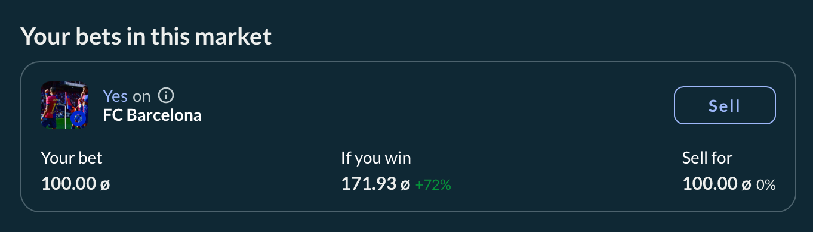

<Tip>
  If instead of placing a bet right away you prefer to place a Limit Order, you can simply select “Limit” instead of “Market” at the top right toggle of the betting modal, and fill in the order parameters before clicking on “Place Order”.
</Tip>

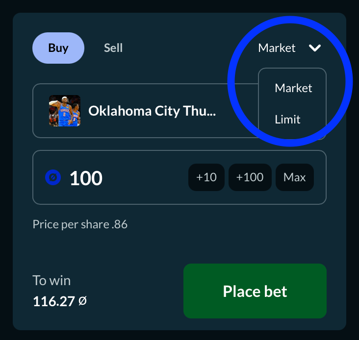

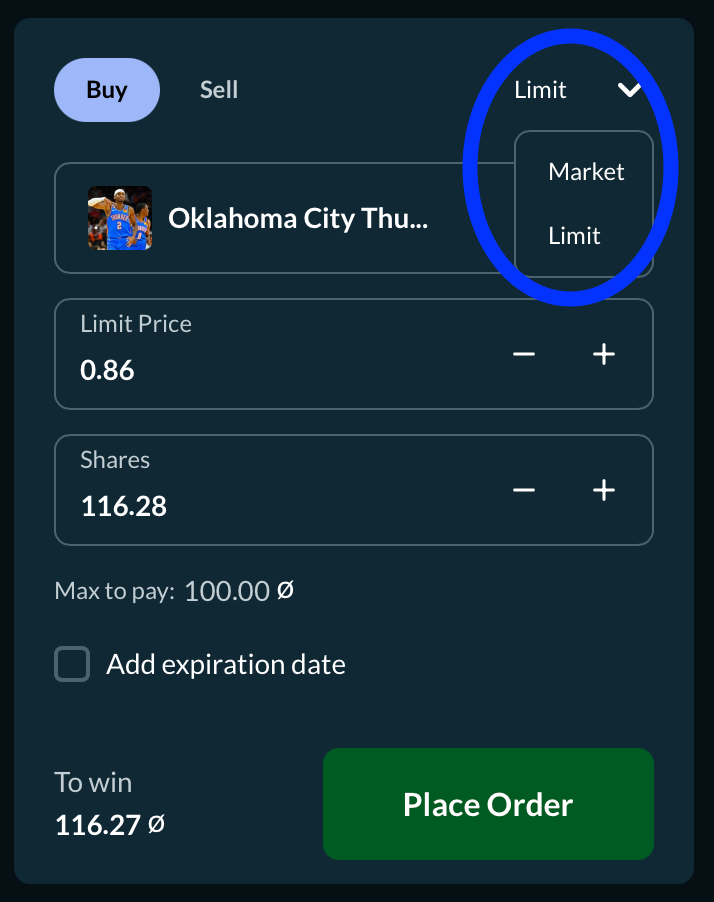

Please read our article about the [Order Book](/help/order-book) for more information on [Limit Orders](/help/order-book), and take advantage of precise, no-slippage trading.

### Betting with real money (cryptocurrencies)

The process for betting with real money is very similar to [betting with play money](/help/betting-and-trading).

On top of creating an account and logging in, you must also [confirm you email address](/help/create-your-account) and [make at least one deposit onto your wallet](/help/deposits-and-withdrawals).

Once you have funds in your wallet, start by selecting real-money markets, as well as clicking on the currency you want to use.

Just like with play money, you should then browse the site looking for the markets you want to place bets on. Market pages in real money have basically the same layout, information, and logic as markets in Ooms.

It is entirely up to you to decide which of our accepted currencies you want to use in a real-money market, as all currencies are put in the same liquidity pool. Just remember that your rewards are fixed in the original currency, regardless of future price fluctuations between currencies.

Please read more about our multi-currency approach in the [Understanding Currencies](/help/understanding-currencies) section of our Help Center.

## How can I bet FOR or AGAINST an outcome?

When trading in prediction markets, you have two fundamental ways to express your view on any outcome: betting FOR it (taking a "Yes" position, expressing you believe that outcome will happen) or betting AGAINST it (taking a "No" position, expressing that you think that outcome will not happen). While both approaches allow you to profit from your predictions, they work differently and come with distinct characteristics.

Most prediction markets on Futuur are binary, offering just two possible outcomes. In these cases, betting for or against an outcome is pretty straightforward: you either take a "Yes" or "No" position in that market.

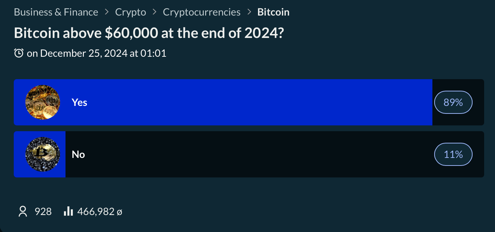

However, some markets feature multiple possible outcomes. In these cases, each outcome functions as if it were its own binary market within the larger structure. You can bet for or against any specific outcome separately.

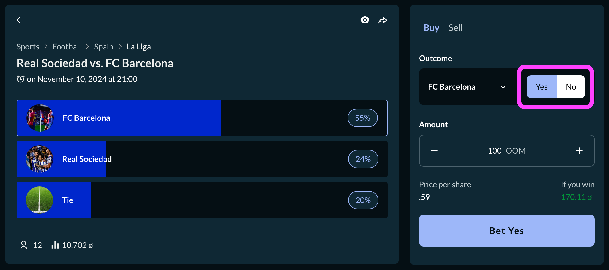

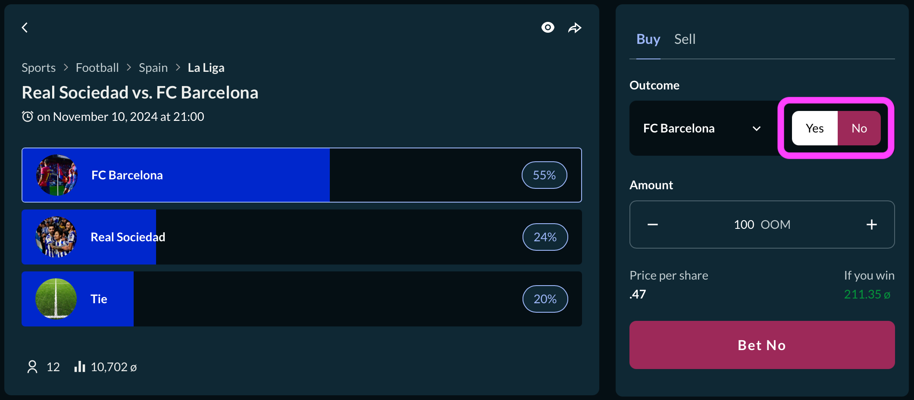

In the market above, for example, you have multiple options to place your bet, such as:

- To predict that FC Barcelona will win, place a “Yes” bet on FC Barcelona
- To predict that FC Barcelona will NOT will (regardless of whether Real Sociedad wins it's a tie) place a “No” bet on FC Barcelona.
- If you have a specific prediction about a tie or Real Sociedad winning, place a "Yes" bet on either of those outcomes.

Election markets provide another good example. You might not be sure who will win, but you might be confident about who won't win. In this case, you can place a "No" bet on that candidate without having to predict the actual winner.

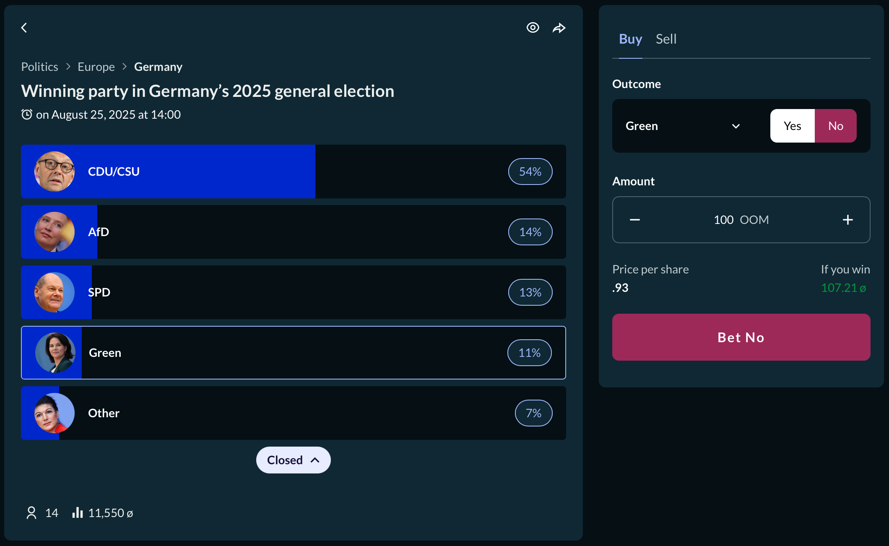

The choice between betting for or against an outcome involves careful consideration of risk and potential returns. While betting against an underdog (placing a "No" bet on a low-probability outcome) might seem safe, these bets typically offer lower payouts compared to correctly predicting the winning outcome with a "Yes" bet.

<Tip>
  Don't forget: prediction markets reward accurate predictions. The more specific they get, the better the insight they provide about the future. Always take your time to weight your options and ultimately express your most rational, well-thought understanding of the future when it comes to betting for or against an outcome.
</Tip>

## When does a market close and get resolved?

It’s important to distinguish between two important dates in each of Futuur’s markets:

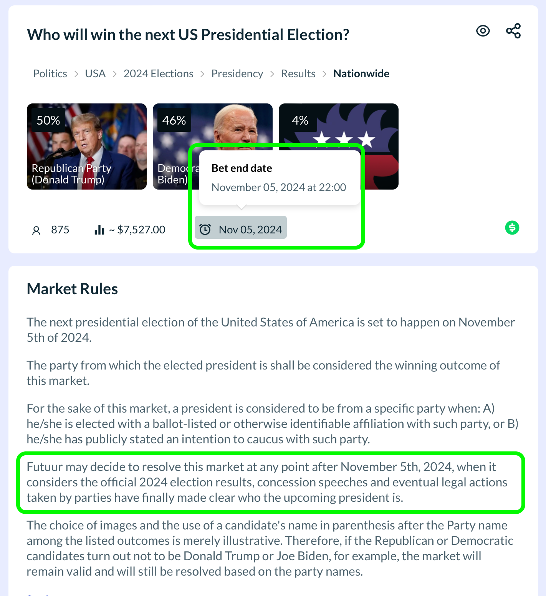

1. “Bet End Date”: That marks the moment in which the market will close. From that moment on, users will no longer be allowed to place bets or sell positions, having their wagers effectively frozen in place until the market gets resolved and pays out the rewards for those who bet on the correct outcome. The Bet End Date does not correspond to the moment payouts are distributed.
2. Market resolution date: the moment in which the market is effectively resolved and payouts are distributed.

In the example above, we see a market that will close for new activity on November 5th, 2024, at 22:00 UTC. The efective market resolution may take much longer, though, as the counting of the votes and legal developments to determine who wins the US presidential election may last for several days after the votes are cast.

There are cases in which a markets Bet End Date and its resolution dates differ very slightly, such as in a football game, in which the market normally closes when the game begins, and gets resolved shortly after the game ends. In other cases, the time between these two events may be quite larger, as we wait for real world events to confirm which outcome should be considered the winner in a market.

Lastly, Futuur has the right to alter the Bet End Date of a market when it considers that to be reasonable, without harming the fairness of the market. That is not unusual to happen with economic indicators, for example. If a country pushes back by a week the date for releasing a report about inflation, for instance, there is no harm in extending the Bet End Date for the market that tries to predict that country’s inflation rate.

## How do prices change over time?

The initial prices for all outcomes in a market are initially set by Futuur’s team. But once markets are open for bets the price dynamics are entirely determined by the users, as they buy and sell shares in the markets, or place new Limit Orders in the Order Book.

As more people bet on a certain outcome the price of that outcome tends to increase, while the price for alternative outcomes decreases.

Alternatively, selling shares from an outcome tends to make its price drop, increasing the price of the other outcomes.

The magnitude of the price movements is determined by a combination of the market's Order Book and Futuur’s [Automated Market Maker](/help/automated-market-maker) (AMM). As more bets occur and more people participate in the market, prices will become less volatile.

## Can I sell my position before the market closes?

Yes. You don’t have to wait until the moment a market is resolved to receive cash in your market returns. You can do it at any time before the market closes for bets.

When you place a bet on Futuur, you begin to see two prices for your wager:

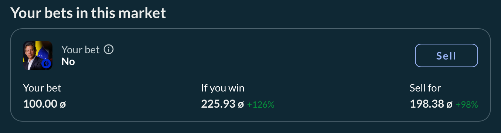

1. **“If you win”** : the amount you will receive if your prediction is correct. This amount is determined at the moment you place your bet, and does not change over time. When the market is resolved, you either receive it all (if your prediction is correct) or lose the whole amount you bet.
2. **“Sell for”** : the amount you will receive if you sell your position right now, at the current market price. This amount is subject to variation at all times. As forecasters place their bets and limit orders on the market, the prices for each outcome can increase or decrease, and you always have the option to sell your position at the current market price while the market is still open.
3. Alternatively, if you think the current price is not good enough, but you have a clear idea of the price at which you would like to sell your position for, you can place a Limit Order at your desired price.

Ex.: In the example above, if the user stayed in the market through the time of resolution, their bet of 100 ø would either generate a profit of 125.93 ø (in case their prediction was correct), or a loss of 100 ø (if the prediction was incorrect). However, at that particular moment in time, as more people placed bets on that same outcome as that user, the current price of that outcome had suffered a considerable increase due to market activity. Due to that price increase, the user now has the option to “Sell for” 198.38 ø, banking a profit of 98.38 ø, and eliminating the risk of losing 100 ø in the event of having their prediction proven wrong.

Alternatively, the user could think 98.38 ø is not enough of a profit to justify selling now, but maybe 110 ø would be. If that is the case, the best possibility would be to open a limit order to sell all of his 225.93 shares at the price of 0.93ø/share, giving him a total of 210 ø in return. The current market price may not be at 0.93 ø/share now, but if it reaches that point, the order will be executed and the user would ensure a profit of 110 ø.

The decision to leave a market before it closes may be justified for several reasons, ranging from the wish to minimize potential losses on the light of new information from the real word, to a desire to prioritize instant liquidity over long term bets. Regardless of the reasoning of each particular forecaster, the possibility of changing positions in a market before it closes is a way to ensure that Futuur always has the best, more reliable estimates of the likelihood of any event taking place in the real world.

<Tip>
  Since November 2024, you are no longer required to sell you entire position to make a trade.

  You can choose between selling all your shares of an outcome, or editing the amount you are willing to sell at that moment. Once you enter the amount of shares you want to sell, you'll see the price for which that partial sale can be executed.

  Likewise, with Limit Orders, you can always determine the amount of shares you want to sell at each price.
</Tip>

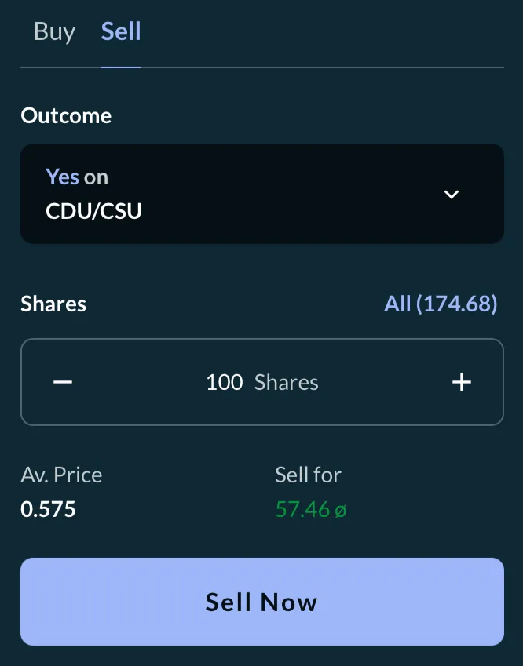

## Are markets always liquid?

Usually, yes, unless prices are at the extremes.

Every trade on Futuur is matched in the market’s [Order Book](/help/order-book). Futuur’s [Automated Market Maker (AMM)](/help/automated-market-maker) normally keeps buy and sell orders in that book, so you can usually buy or sell a position right away without waiting for another user to accept your offer.

This is not a guarantee. The AMM’s orders have a limited size, and liquidity may be limited when prices are at the extremes. If there is not enough in the book to fill your order, the part that cannot be matched is cancelled. You can always place a limit order at the price you want and wait for someone to take it.

## Can I bet on a sports market while the game is in progress?

Usually no. Futuur usually closes sports markets for bets a few minutes before a match starts.

However, there are some cases in which users are allowed to update their bets on a sporting event — such as the Super Bowl — while the game is still under way. Such cases will normally be marked as “live” on Futuur’s feed, signaling that in-game betting is available for those markets.

## How long does it take for a market to be resolved?

Some markets on Futuur — mainly those related to sports matches — are created and resolved automatically through a data provider that is checked at regular intervals. In these cases, markets tend to be resolved within a maximum of 12 hours after the match ends.

The other portion of markets is created and resolved manually by our editorial team. In these cases, although the team tends to be quite fast, the time between the real-world event and the market resolution may vary significantly, especially on weekends. If you believe a real-world event implies the resolution of an open market on Futuur, please don't hesitate to inform us through the page [https://futuur.com/i/feedback/contact](https://futuur.com/i/feedback/contact), and we will be happy to prioritize the evaluation of that market.

## Why does the price increase as I raise my bet?

The prices for which each amount of shares is sold is determined by the market's Order Book, which is built by users themselves as they place [Market Orders](/help/order-book) and [Limit Orders](/help/order-book). At any point, there is only a limited number of shares available at each given price. If you try to buy more shares than what's currently available at a specific price, your order will be filled by moving up the order book and buying shares from the next available ask price, which is higher than the one you have just cleared.

As more bets occur and more people place their Limit Orders, prices will become less volatile, allowing for bigger bets and bigger potential returns.

Futuur's [Automated Market Maker (AMM)](/help/automated-market-maker) also places orders in the [Order Book](/help/order-book). Its prices get worse the more you buy or sell, to limit its risk exposure. If the book is empty, a market order cannot be filled; you can place a limit order instead.

## Is there a minimum or maximum amount to bet?

The minimum amount to bet on Futuur markets using real money is 1 USD. There is no minimum bet using Ooms. The maximum bet is determined on a market-by-market basis, and will increase with market liquidity. That is, the more bets are made in a market, the more liquid it becomes, allowing for higher maximum bets.

## Are there fees for betting on a market?

Yes, but only when a user executes an existing order in the Order Book — that is, when the user acts as a **taker**.

Taker fees are calculated with the same formula on every market:

$$
fees = 0.05 \times C \times P \times (1 - P)
$$

- **P** = price of a share (e.g. 50 cents = 0.5)
- **C** = number of contracts

Fees are highest when **P = 0.50** and decrease symmetrically as the price approaches 0 or 1.

Real-money fees are settled in **USDC**. Play-money fees are settled in **Ooms**.

### Example Fee Table (100 contracts)

| Price (P) | Contracts (C) | Total Fee |   | Price (P) | Contracts (C) | Total Fee |
| --- | --- | --- | --- | --- | --- | --- |
| \$0.01 | 100 | \$0.0495 |   | \$0.55 | 100 | \$1.2375 |
| \$0.05 | 100 | \$0.2375 |   | \$0.60 | 100 | \$1.2 |
| \$0.10 | 100 | \$0.45 |   | \$0.65 | 100 | \$1.1375 |
| \$0.15 | 100 | \$0.6375 |   | \$0.70 | 100 | \$1.05 |
| \$0.20 | 100 | \$0.8 |   | \$0.75 | 100 | \$0.9375 |
| \$0.25 | 100 | \$0.9375 |   | \$0.80 | 100 | \$0.8 |
| \$0.30 | 100 | \$1.05 |   | \$0.85 | 100 | \$0.6375 |
| \$0.35 | 100 | \$1.1375 |   | \$0.90 | 100 | \$0.45 |
| \$0.40 | 100 | \$1.2 |   | \$0.95 | 100 | \$0.2375 |
| \$0.45 | 100 | \$1.2375 |   | \$0.99 | 100 | \$0.0495 |
| **\$0.50** | **100** | **\$1.25 ← max** |   |   |   |   |

> 📌 **P = 0.50** is the maximum fee point. Values above are in USD for real money markets and apply identically in Ooms for play money.

As part of Futuur's Market Maker Rebate Program, **80% of the taker fee** goes to the maker as a rebate — as a purchase discount (buy side) or balance credit (sell side). [Click here](/help/rebates) to learn more about the program.
