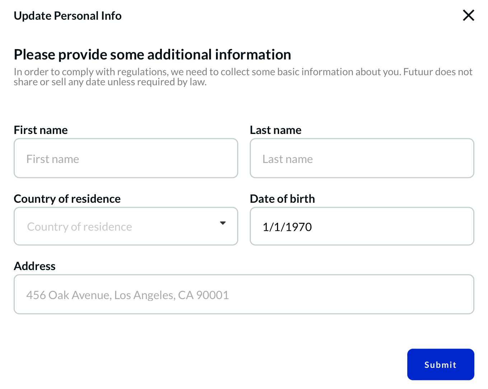
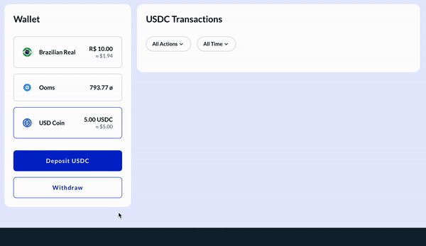
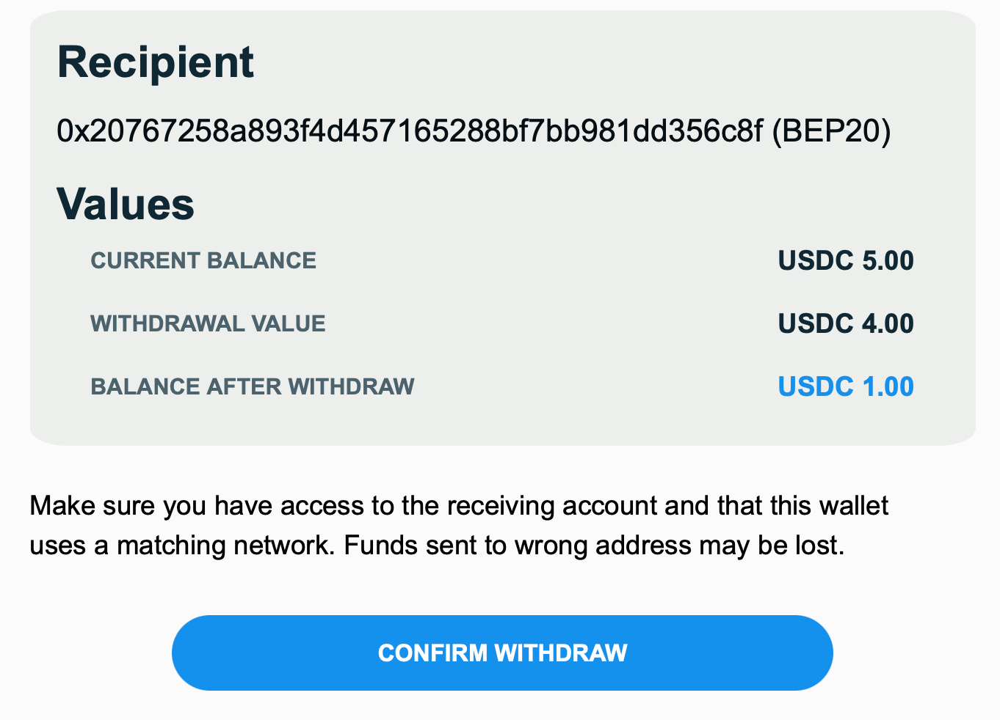
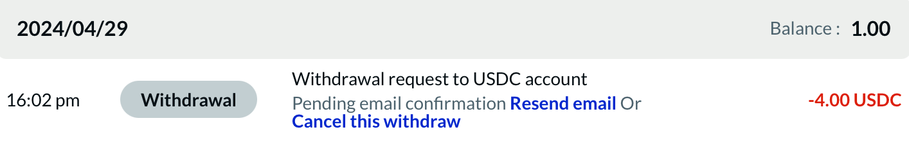

This page is dedicated to the processes, fees, limits, and rules for depositing and withdrawing real money from Futuur. Please read on if you want to use the platform to profit from your forecasts as you put more skin in the game.

## How do I make a deposit?

Once you [create your account](/help/create-your-account) and [verify your email address](/help/create-your-account), you can make your first real-money deposit. To do so, select “Real Money” in the currency selector, and click to “Deposit”.

{/* TODO: new screen recording needed. The old one (01.gif, April 2024) shows the previous deposit screen. */}

### Update your personal information

If this is your first time making a deposit, you will be prompted to update your personal information.

Fill up the form, making sure you are not using Futuur on a jurisdiction where real-money betting is prohibited (check the list of restricted countries [here](/help/license-and-jurisdiction)). Once you complete the form, click on “Submit”.

### Choose the network and send USDC

Deposits are made in **USDC**. (If you do not own any cryptocurrencies yet, check [this section](/help/understanding-currencies) of our Help Center to learn where to get them.)

{/* TODO: new screen recording needed. The old one (03.gif, April 2024) shows a currency selector that no longer exists. */}

**1. Choose the network.** Futuur shows the networks you can use to send USDC. One is already selected for you, and the network with the lowest fee is marked “Cheapest”. Pick the network you will send from and click **Continue**.

**2. Send USDC to your address.** The next screen shows your personal Futuur deposit address for that network, as a QR code and as text. Click **Copy Address** and paste it as the destination in your own wallet or exchange, or scan the QR code if your wallet supports it. If you picked the wrong network, click **Change network** to go back.

It is **absolutely essential** that the network you select on Futuur is the same network you select when you send the funds from your wallet or exchange.

<Warning>
  Send only USDC, and only on the network shown on the deposit screen. If you send another token, or use a different network from the one you selected, your funds may be lost. This is how blockchain networks work, and Futuur cannot reverse a transfer.

  Please double-check the network on both ends before you send your funds to Futuur.

  If you have already sent funds on the wrong network, write to [support@futuur.com](mailto:support@futuur.com) with the transaction ID, the network you used and the amount. We will look into it, but we cannot promise that the funds can be recovered.
</Warning>

<Tip>
  Remember that different cryptocurrencies, networks and wallets charge different fees for transferring crypto. Please compare your options before setting up your transfer.

  Futuur does not charge any fees for receiving funds. To check our withdrawal fees, please refer to [this section](/help/deposits-and-withdrawals).
</Tip>

## How long does it take for a deposit to be completed?

Deposits are usually credited within minutes of being confirmed on the network. How long the confirmation takes depends on the network you chose, not on Futuur.

We email you when the funds arrive, and you can safely close the deposit window while you wait. Please keep Futuur in your list of safe senders, and check your spam folder if you don’t hear from us.

## Is there a minimum amount for deposits?

There is no deposit minimum. However, to avoid fraudulent and spam transactions, any transfer below 0.01 USDC is treated as spam and is not credited to your account.

## Is there a maximum amount for deposits?

There is no maximum amount for deposits on Futuur. However, if your cumulative lifetime deposits exceed \$2000 USD equivalent, Futuur reserves the right to require proof of identity and address from real-money forecasters as part of its legally mandated KYC (Know Your Customer) requirements. Hey, we don’t make the rules!

## How do I withdraw from my wallet?

Head to you wallet on Futuur at [https://futuur.com/p/wallet](https://futuur.com/p/wallet), and select the currency you want to withdraw on the left side. Click “Withdraw” and fill up the information for each kind of withdrawal.

### Initiate the request

Enter the amount you want to withdraw, select the network you want to use (pay attention to the fees for using each network, as described [here](/help/deposits-and-withdrawals)), and provide the address where you’d like to receive the funds. Please note that this should be your public wallet address for the requested cryptocurrency, and that it should be compatible with the network you selected.

<Warning>
  Futuur cannot control funds sent to the wrong address, so make sure to double-check that both the address and selected network are correct.
</Warning>

### Confirm the request

For security reasons, after clicking “Send”, you will receive an email asking you to confirm the withdrawal. Please log into your email to open that message, check the information and approve the request by clicking on the “Confirm Withdrawal” button in the message.

You have 48 hours to confirm the withdrawal request. After that, it will be automatically canceled and you’ll have to initiate a new one.

If you want to make changes to a request you have already initiated, please head back to your wallet, find the withdrawal request, and click to “Cancel this withdrawal”.

### Wait for your funds to arrive

Futuur will manually review all confirmed requests within 24 hours, and send them to the network for processing. You will be notified when our review process is over and should receive your funds shortly.

## How long does it take for a withdrawal to be completed?

Currently, we manually review all withdrawal requests, generally within 24 hours. Once reviewed and approved, the funds will be sent to your indicated address and should arrive in less than 30 minutes. The actual time taken for the arrival of the money depends on the processing speed of the network, not on Futuur.

## Is there a minimum amount for withdrawals?

The minimum withdrawal amount depends on the network you choose.

### Minimum withdrawals for cryptocurrencies

| Currency | Network | Minimum Withdrawal Amount |
| --- | --- | --- |
| USDC | Ethereum (ERC20) | 10 USDC |
| USDC | BNB Smart Chain (BEP20) | 1 USDC |
| USDC | Polygon | 1 USDC |
| USDC | Solana | 1 USDC |

## Is there a maximum amount for withdrawals?

There is no maximum amount for withdrawals on Futuur. However, if your cumulative lifetime withdrawal exceed \$2000 USD equivalent, Futuur reserves the right to require proof of identity and address from real-money forecasters as part of its legally mandated KYC (Know Your Customer) requirements. Hey, we don’t make the rules!

## What fees are involved in withdrawing from Futuur?

### Fees for withdrawing crypto

| Currency | Network | Withdrawal Fee |
| --- | --- | --- |
| USDC | Ethereum (ERC20) | 5 USDC |
| USDC | BNB Smart Chain (BEP20) | No fee |
| USDC | Polygon | No fee |
| USDC | Solana | No fee |

To save on withdrawal fees, we recommend choosing a lower-fee option.

<Tip>
  Although it is possible to choose different networks for depositing and withdrawing the same currency, we strongly recommend using the same network at both moments. Sticking to a single network for all your Futuur activities with a specific currency can speed up the processing time for your deposits and withdrawals of that currency.
</Tip>

## Can I withdraw Ooms? Can I convert Ooms into any other currency?

No, and no. Ooms are like reputation points, they represent your skill as a forecaster. The only way to win more Ooms is to make better predictions. 🙂
