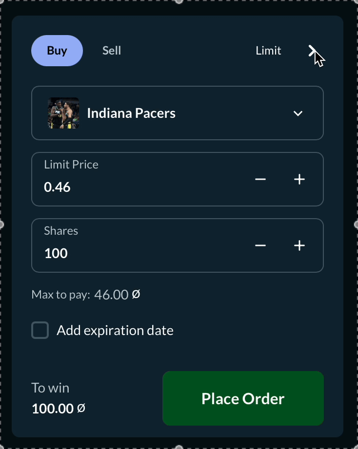
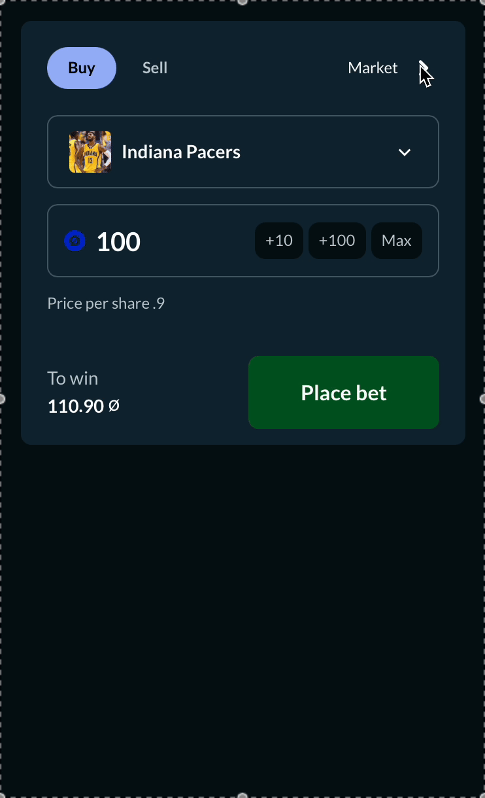

Read on to learn how trading works on Futuur. Every trade happens in a market’s **order book**. Futuur’s Automated Market Maker (AMM) takes part in that book like any other trader, by posting its own buy and sell orders.

## What is an Order Book?

An **order book** is a live ledger of **buy** and **sell** intentions for a market. It's the most traditional approach to several well-stablished structures where trades take place, such as:

- **Stock exchanges:** electronic order books are used to match millions of trades per second. When you place a limit order for Apple stock at \$180, for example, it’s queued in the order book until a seller agrees.
- **Crypto exchanges:** rely on the same mechanism to pair bids and asks for Bitcoin, Ethereum, and thousands of tokens.
- **Forex desks** and **commodity futures** markets: also run on order books, providing a transparent view of demand and supply across global trading desks.

Wherever buyers and sellers need to meet in real time, the order book is the digital bulletin board that shows **who is willing to trade at which price** and lets matching engines pair them off efficiently. Each row in Futuur's order book is composed of:

| Column | Meaning |
| --- | --- |
| Trade | **Bids** = someone wants to buy at that price. **Asks** = someone wants to sell at that price. |
| **Price** | The price at which 1 share of that outcome is listed |
| Shares | How many shares are offered at that price. |
| Amount | The total cumulative price of all shares listed up to that price. |

Orders are ranked so the *best bid* (highest buy price) and *best ask* (lowest sell price) sit close to each other. Together they tell you **where traders think the “true” price is**.

> In the example above:
>
> - Best bid = offers 7.08 ø to buy 15.4 shares of “Indiana Pacers” at 0.46 ø per share
> - Best ask = demands 5.58ø to sell 11.4 shares of “Indiana Pacers” at 0.49ø per share
>
> For buyers:
>
> - Anyone placing a *market buy order* of up to 5.58 ø will get their order entirely filled at 0.49ø/share.
> - Anyone placing a *market buy order* of up to 15.93 ø will get part of their order filled at 0.49ø/share (5.58ø in total), and the rest filled at 0.5ø/share.
> - Anyone placing a *market buy order* of up to 37.13 ø will get part of their order filled at 0.49ø/share (5.58ø in total), part filled at 0.5ø/share (15.93ø - 5.58ø = 10.35ø in total), and the rest filled at 0.53ø/share.
> - And so on until either the order is completely filled, or the order book runs out of Asks.
>
> For sellers:
>
> - Anyone placing a *market sell order* of up to 7.08 ø will get their order entirely filled at 0.46ø/share.
> - Anyone placing a *market sell order* of up to 8.75 ø will get part of their order filled at 0.46ø/share (7.08ø in total), and the rest filled at 0.44ø/share
> - Anyone placing a *market sell order* of up to 14.21 ø will get part of their order filled at 0.46ø/share (7.08ø in total), part filled at 0.44ø/share (8.75ø - 7.08ø = 1.67ø in total), and the rest filled at 0.43ø/share
> - And so on until either the order is completely filled, or the order book runs out of Bids.

## How do the Order Book and the AMM work together?

There is one order book per market, and every trade is a match between two orders in it.

Futuur’s [Automated Market Maker (AMM)](/help/automated-market-maker) is an account run by Futuur that places its own buy and sell orders in the book, at several prices. To you they look like any other order. Often they are what you trade against when no other user has an order at a better price.

When you send an order:

1. **The matching engine looks at the orders on the other side of the book**, best price first.
2. **At the same price, another user’s order is filled before the AMM’s.** Among users, the older order is filled first.
3. **Your order is filled against those orders, at their posted prices,** until it is complete or there is nothing left that matches.
4. **The order book and the market’s prices are updated.**

**What this means for you**

- You always trade at prices that are visible in the book. There is no separate, hidden price.
- You can add your own orders to the book and wait for someone to take them (see Limit Orders below).
- The AMM does not promise to fill any order of any size. It only fills what its own orders in the book cover.

## What is a Market Order?

A **market order** says: *“Fill me* ***now*** *at the best prices available.”*

- **How it fills:** it takes the best-priced orders in the book first, then the next best, and so on. The more you buy, the higher your average price can be.
- **It never waits in the book.** Whatever cannot be matched right away is cancelled, and you keep the money or shares for that part.
- **Use when:** speed is more important than an exact price.

Example:

You submit a market order of 30ø to buy shares of “Indiana Pacers”. The best Ask is 0.49ø/share, with 5.58ø available at that price, so the first 5.58ø is filled there. The next 10.35ø is filled at 0.50ø/share, and the remaining 14.07ø at 0.53ø/share. Your average price is somewhere between 0.49ø and 0.53ø.

If your order were bigger than everything on offer in the book, the part that could not be matched would be cancelled.

## What is a Limit Order?

A **limit order** lets you dictate the *exact* price you want. You will *never* be filled at a worse price.

- **Stays in the book by default:** your limit order stays live until it is filled, you cancel it, or the market closes for betting. Orders still open when a market closes are cancelled.
- **Custom expiry:** you can set a date and time after which the unfilled part of the order is cancelled automatically.
- **Partial fills:** Your order can fill in chunks over time as matches appear.

## What is a Spread?

The **spread** = *best ask* − *best bid*.

- **Tight spread** (e.g., 0.01 ¢) → high liquidity, strong agreement on price.
- **Wide spread** (e.g., 15 ¢) → thinner market, more uncertainty.

Traders tighten spreads by posting limit orders inside the gap. As spreads shrink, it costs less to trade and forecasts become sharper.

## How do I place a bet using the Order Book?

1. **Open any market** and select the outcome you want to bet on.
2. Select **Market** or **Limit** at the top‑right toggle.
3. **Enter quantity** (and price if limit).
4. *(Optional)* Set **expiration date** for limit orders.
5. **Review** the **average price per share** (if market) or the **maximum to pay/minimum to receive** (if limit).
6. Click **Place Bet** (if market) or **Place Order** (if limit).
7. Track your active bets and open orders in the “Your bets in this market” section. You can cancel or modify limit orders anytime before they are matched by another user.

Example of a market order:

Example of a limit order:

## What happens if the Order Book is empty? Can I still trade?

It depends on the kind of order.

- **Market orders** need orders on the other side of the book. If there are none, your market order is cancelled and nothing is charged. If there are some, but not enough, the part that matches is filled and the rest is cancelled.
- **Limit orders** always work: your order goes into the book and waits until someone takes it, you cancel it, it expires, or the market closes.

The AMM normally keeps buy and sell orders in the book, so there is usually something to trade against. This is not guaranteed. The AMM’s orders have a limited size, and Futuur can reduce or remove them on any market.

If a market order does not fill, or fills at a worse price than you expected, place a limit order at the price you want instead.
