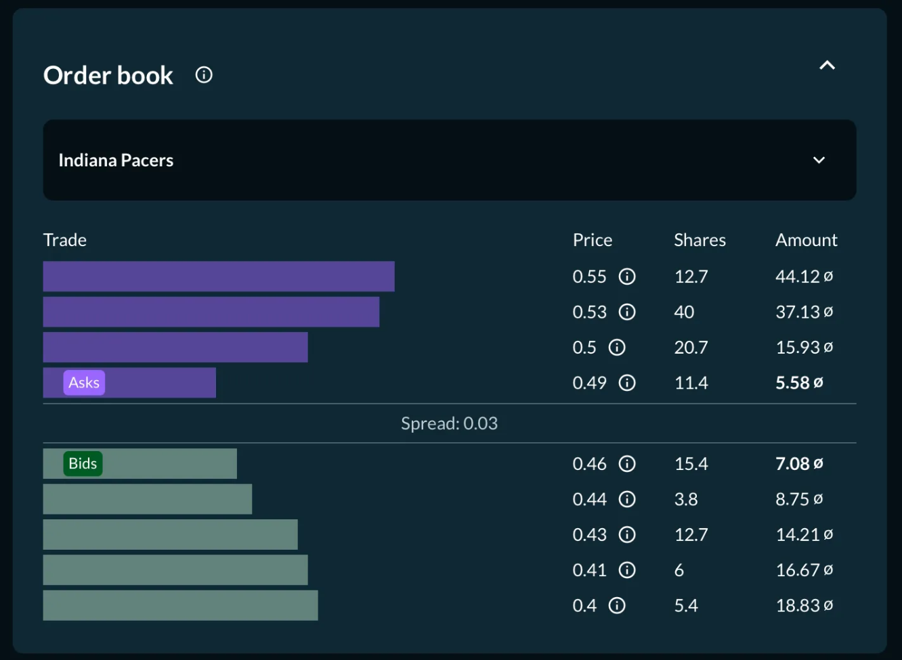

Read on to learn more about Futuur’s trading engine. Here we explain how the **Order Book + AMM hybrid approach** works, why it matters, and how you can use it.

## What is an Order Book?

An **order book** is a live ledger of **buy** and **sell** intentions for a market. It's the most traditional approach to several well-stablished structures where trades take place, such as:

- **Stock exchanges:** electronic order books are used to match millions of trades per second. When you place a limit order for Apple stock at \$180, for example, it’s queued in the order book until a seller agrees.
- **Crypto exchanges:** rely on the same mechanism to pair bids and asks for Bitcoin, Ethereum, and thousands of tokens.
- **Forex desks** and **commodity futures** markets: also run on order books, providing a transparent view of demand and supply across global trading desks.

Wherever buyers and sellers need to meet in real time, the order book is the digital bulletin board that shows **who is willing to trade at which price** and lets matching engines pair them off efficiently. Each row in Futuur's order book is composed of:

| Column | Meaning |
| --- | --- |
| Trade | **Bids** = someone wants to buy at that price. **Asks** = someone wants to sell at that price. |
| **Price** | The price at which 1 share of that outcome is listed |
| Shares | How many shares are offered at that price. |
| Amount | The total cumulative price of all shares listed up to that price. |

Orders are ranked so the *best bid* (highest buy price) and *best ask* (lowest sell price) sit close to each other. Together they tell you **where traders think the “true” price is**.

> In the example above:
>
> - Best bid = offers 7.08 ø to buy 15.4 shares of “Indiana Pacers” at 0.46 ø per share
> - Best ask = demands 5.58ø to sell 11.4 shares of “Indiana Pacers” at 0.49ø per share
>
> For buyers:
>
> - Anyone placing a *market buy order* of up to 5.58 ø will get their order entirely filled at 0.49ø/share.
> - Anyone placing a *market buy order* of up to 15.93 ø will get part of their order filled at 0.49ø/share (5.58ø in total), and the rest filled at 0.5ø/share.
> - Anyone placing a *market buy order* of up to 37.13 ø will get part of their order filled at 0.49ø/share (5.58ø in total), part filled at 0.5ø/share (15.93ø - 5.58ø = 10.35ø in total), and the rest filled at 0.53ø/share.
> - And so on until either the order is completely filled, or the order book runs out of Asks.
>
> For sellers:
>
> - Anyone placing a *market sell order* of up to 7.08 ø will get their order entirely filled at 0.46ø/share.
> - Anyone placing a *market sell order* of up to 8.75 ø will get part of their order filled at 0.46ø/share (7.08ø in total), and the rest filled at 0.44ø/share
> - Anyone placing a *market sell order* of up to 14.21 ø will get part of their order filled at 0.46ø/share (7.08ø in total), part filled at 0.44ø/share (8.75ø - 7.08ø = 1.67ø in total), and the rest filled at 0.43ø/share
> - And so on until either the order is completely filled, or the order book runs out of Bids.

## How does Futuur’s hybrid Order Book + AMM work?

Futuur now combines the precision of a traditional order book with the always-on liquidity of an Automated Market Maker (AMM).

1. **You submit a trade** (market order).

2. **Matching engine scans the order book**:

   *If there are matching orders, they fill first—at exactly the posted prices.*

3. **Fallback to AMM**: Any unfilled remainder goes to the AMM, which quotes a price from its curve and completes the trade instantly.

4. **Pool balances update** and the published order book refreshes.

**Why it’s powerful**

*✓ Zero‑slippage trades* when the book has depth.

*✓ Guaranteed execution* when it doesn’t.

*✓ Traders can choose the style (precision vs. speed) that fits each moment.*

## What is a Market Order?

A **market order** says: *“Fill me* ***now*** *at the best price you can get.”*

- **Route:** Matches the current order book first.
- **AMM safety‑net:** Any remainder is filled by the AMM.
- **Use when:** Speed is more important than an exact price.

Example:

You submit a market order of 100ø to buy shares of “Indiana Pacers”. The total amount for Asks in the book is 44.12ø. You take those 44.12ø. The AMM then fills the remaining 55.88ø at prices that start where the Order Book stopped (0.55ø/share) and get progressively higher, depending on pool depth.

## What is a Limit Order?

A **limit order** lets you dictate the *exact* price you want. You will *never* be filled at a worse price.

- **Good‑til‑Expired (GTE):** By default, your limit order stays live until the market resolves or you cancel it.
- **Custom expiry:** Use the dropdown to set a date/time after which the order cancels automatically.
- **Partial fills:** Your order can fill in chunks over time as matches appear.

## What is a Spread?

The **spread** = *best ask* − *best bid*.

- **Tight spread** (e.g., 0.01 ¢) → high liquidity, strong agreement on price.
- **Wide spread** (e.g., 15 ¢) → thinner market, more uncertainty.

Traders tighten spreads by posting limit orders inside the gap. As spreads shrink, it costs less to trade and forecasts become sharper.

## How do I place a bet using the Order Book?

1. **Open any market** and select the outcome you want to bet on.
2. Select **Market** or **Limit** at the top‑right toggle.
3. **Enter quantity** (and price if limit).
4. *(Optional)* Set **expiration date** for limit orders.
5. **Review** the **average price per share** (if market) or the **maximum to pay/minimum to receive** (if limit).
6. Click **Place Bet** (if market) or **Place Order** (if limit).
7. Track your active bets and open orders in the “Your bets in this market” section. You can cancel or modify limit orders anytime before they are matched by another user.

Example of a market order:

Example of a limit order:

## What happens if the Order Book is empty? Can I still trade?

Absolutely. If the book shows no bids or asks that match your quantity/price, the AMM **steps in automatically**:

- **Always quotes a price** based on current pool balances.
- **Executes 100 % of your market order** immediately.
- **Limit orders** remain in the book until a counterparty arrives *or* the expiry hits.

In practice, this means you will **never get stuck**—even in brand‑new or low‑traffic markets. The AMM keeps trading alive; the order book keeps trading efficient.
