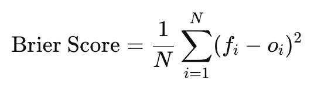
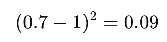
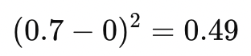

Futuur did not invent Prediction Markets — but we surely made them better and more accessible to everyone.

This section explains the basic ideas, principles, and concepts related to prediction markets in general. Please read on to understand their goals, features, and building blocks, before you dive into Futuur to put it all into practice.

## What is a prediction market?

A prediction market is a forecasting tool that uses the principles of a financial market to aggregate information and predict the likelihood of future events.

In a prediction market, participants trade contracts or shares whose payouts are tied to the outcome of an event in the future. The prices of these shares act as crowdsourced predictions, reflecting the collective wisdom and beliefs of all the traders in the market about the likelihood of different outcomes occurring.

The key idea is that prediction markets leverage the wisdom of crowds and incentives for truthful revelation to produce accurate forecasts. When the event resolves, traders holding shares of the realized outcome receive payouts, while shares of other outcomes become worthless. This incentivizes traders to obtain accurate information and make well-informed trades, as they profit from precise predictions.

## How do prediction markets work?

In a prediction market, traders buy shares of outcomes they think are more likely, and sell shares of outcomes they deem less probable. As they trade based on their own information and incentives, the share prices fluctuate dynamically according to market forces of supply and demand. The resulting equilibrium prices represent the aggregated beliefs and information of all participants about the probabilities of the various outcomes.

Here's a general overview of how it works:

### Market setup

A prediction market is created with one or more outcomes related to a future event. For example, a market may be set up to predict the winner of an upcoming election, with outcomes like "Candidate A wins" or "Candidate B wins."

### Initial prices

The market starts with initial prices or probabilities assigned to each outcome, usually based on an initial assessment or prediction. These initial prices may be set by the market organizers or determined by an automated market maker mechanism.

### Trading

Participants in the market can buy or sell shares representing the different outcomes. When a participant buys shares of a particular outcome, they are essentially betting that this outcome will occur. Conversely, selling shares of an outcome implies a belief that the outcome is less likely to happen.

### Price adjustment

As participants trade shares, the prices of the different outcomes adjust dynamically based on the supply and demand for each outcome. If more people are buying shares of a particular outcome, the price of that outcome will rise, reflecting an increased collective belief that it will occur. Conversely, if more people are selling shares of an outcome, its price will fall.

### Market equilibrium

The market continues to trade until it reaches an equilibrium state, where the prices of the different outcomes reflect the collective wisdom or prediction of all the participants in the market.

### Outcome resolution

Once the actual outcome is known (e.g., after the election), the market is resolved. Shares of the outcome that occurred are bought back at the price of 1 (or 100%), while shares of the other outcomes become worthless.

The key principle behind prediction markets is that the trading activity of many participants, each with their own information and beliefs, can collectively aggregate dispersed information and provide accurate predictions about future events.

## How is the price or probability of an outcome determined in a prediction market?

In a prediction market, there are two main approaches to determining the prices or probabilities of different outcomes: the [Order Book](/help/order-book) approach and the [Automated Market Maker](/help/automated-market-maker) (AMM) approach. Both aim to incentivize truthful information revelation and aggregate dispersed beliefs into market prices that can provide accurate probability estimates for future outcomes. Futuur uses a hybrid approach that has the AMM as a fallback mechanism to markets where the Order Book fails to ensure instant trades.

### Order Book Approach

This approach is similar to traditional financial markets, where buyers and sellers submit orders to an order book, and prices are determined by the intersection of supply and demand.

- Participants submit buy and sell orders for shares representing different outcomes.
- An order book aggregates these buy and sell orders.
- The market price for each outcome is determined by the highest buy order and the lowest sell order that can be matched in the order book.
- As more orders come in, prices adjust dynamically based on the supply and demand for each outcome.
- The resulting prices represent the market's collectively traded probabilities for the outcomes.

### Automated Market Maker (AMM) Approach

In this approach, there is a pre-defined automated pricing mechanism or algorithm that determines the prices of outcomes based on the trading activity, rather than an order book.

- The market maker sets an initial pricing curve or function that relates the prices of outcomes to their trading volumes or quantities.
- As participants buy or sell shares of outcomes, the AMM adjusts the prices according to the pre-defined pricing function.
- The more shares of an outcome are bought, the higher its price goes, reflecting increased demand and belief in that outcome occurring.
- Conversely, selling shares of an outcome decreases its price, indicating a lower perceived probability.
- The AMM ensures that the prices of all outcomes always sum to 1 (or 100%), representing a proper probability distribution.

The order book approach is more decentralized and reflects direct participant trading, while the AMM approach relies on a centralized automated pricing mechanism.

### How are shares calculated with Futuur's Automated Market Maker (AMM)?

The shares are calculated considering investment and probability. The calculation is based on a liquidity-sensitive automated market maker (AMM) model, designed to adapt the share prices based on the market parameters dynamically.

Here’s a simplified version of the calculation using the cost function approach:

1. Investment: The amount of money you want to invest.
2. Probability: The likelihood of the outcome you are betting on.
3. Cost Function (CF): A mathematical function that determines the cost based on the number of shares in each outcome.

For two outcomes, if you have Outcome 1 ($o1$) with 100 shares and Outcome 2 ($o2$) with 110 shares, and you want to purchase 20 more shares of $o2$, the amount you need to pay is calculated using the cost function as follows:

$$
\text{Amount} = CF(100, 110) - CF(100, 130)
$$

This means you calculate the cost function for the initial shares and subtract the cost function for the new total shares after purchasing.

The cost function (CF) is typically defined as:

$$
CF(q_1, q_2) = b \cdot \log\left(e^{\frac{q_1}{b}} + e^{\frac{q_2}{b}}\right)
$$

where $q_1$ and $q_2$ are the quantities of the two outcomes, and $b$ is a constant that adjusts the price sensitivity to the quantity of shares.

For more detailed information on the mathematical model and algorithms used please refer to our AMM Help Center section or the [paper on liquidity-sensitive AMM](https://www.cs.cmu.edu/~sandholm/liquidity-sensitive%20automated%20market%20maker.teac.pdf).

## How is prediction accuracy measured in prediction markets?

Prediction accuracy in a prediction market is about how well the market’s collective predictions align with the actual outcomes. Several methods are used to evaluate this accuracy:

### Brier Score

This measures the accuracy of probabilistic predictions. It calculates the average squared difference between the predicted probabilities and the actual outcomes. A lower Brier Score indicates higher prediction accuracy. For example, if a market predicts there is a 70% chance of an event happening and it does happen, the score will be lower, reflecting high accuracy.

### Calibration

This assesses whether the predicted probabilities reflect the true likelihood of outcomes. For instance, if events predicted to happen with 70% probability actually occur 70% of the time over many instances, the predictions are well-calibrated.

### Resolution

This measures how well the market differentiates between events that do and do not occur. A market with high resolution gives distinct probabilities that correspond well to the actual outcomes.

## What is the Brier Score?

The Brier Score is a specific metric used to measure the accuracy of probabilistic predictions in prediction markets. Here's how it works in more detail:

### Calculation

The Brier Score calculates the average squared difference between the predicted probabilities and the actual outcomes. It is given by the formula:

where:

*N* is the number of predictions.

𝑓𝑖 is the predicted probability of the event occurring.

𝑜𝑖 is the actual outcome (1 if the event occurs, 0 if it does not).

### Interpretation

The Brier Score ranges from 0 to 1, where 0 indicates perfect accuracy (all predictions are correct) and 1 indicates the worst possible accuracy (all predictions are incorrect). A lower Brier Score indicates higher prediction accuracy.

Example: Suppose a market predicts there is a 70% chance of rain tomorrow, and it does rain. The prediction error for this single event would be:

If it doesn't rain, the error would be:

By averaging these errors over many predictions, the Brier Score gives a comprehensive measure of accuracy.

## What are typical Brier Score values for good, bad, and excellent predictions?

Here is a table that helps interpret different Brier Score values:

| Brier Score Range | Prediction Quality | Description |
| --- | --- | --- |
| Below 0.1 | Excellent | Predictions are very close to the actual outcomes. |
| Between 0.1 and 0.15 | Very Good | Predictions are generally accurate with minor discrepancies. |
| Between 0.15 and 0.2 | Good | Predictions are reasonably accurate but with some errors. |
| Above 0.2 | Poor | Predictions are significantly inaccurate. |

## What factors can affect prediction accuracy in markets?

Several factors can influence the accuracy of predictions in a market:

### Information Availability

The quality and timeliness of information available to participants are crucial. The more relevant and up-to-date the information, the more accurate the predictions tend to be. For instance, if new information about an upcoming election is released, the market can quickly adjust its predictions to reflect this.

### Participant Diversity

A diverse group of participants brings a wide range of perspectives and knowledge. This diversity helps to balance biases and leads to more accurate collective predictions. For example, having participants from different geographical regions can provide varied insights into global events.

### Market Liquidity

Higher liquidity, meaning more active buying and selling of shares, allows for better price discovery. When there are more transactions, the prices (predicted probabilities) reflect the true likelihood of events more accurately. Low liquidity can lead to volatility and less reliable predictions.

## How can participants improve their prediction accuracy?

Participants can improve their prediction accuracy by adopting several strategies:

- **Staying Informed:** Keeping up with the latest news and developments related to the events they are predicting. Reliable and timely information is key to making accurate predictions.
- **Considering Multiple Sources**: Looking at a variety of information sources to get a well-rounded view. This helps to avoid the bias that can come from relying on a single source.
- **Being Aware of Biases:** Recognizing and mitigating personal biases that might affect judgment. For instance, emotional decisions or overconfidence can lead to inaccurate predictions.
- **Engaging with Others:** Discussing predictions and insights with other market participants. This can provide new perspectives and help refine individual predictions. Collaborative environments often lead to better outcomes due to the collective intelligence of the group.

## Are there any limitations to prediction market accuracy?

Yes, prediction markets have some limitations that can affect their accuracy:

### Herd Behavior

Sometimes, participants might follow the crowd rather than making independent decisions. This can lead to inaccurate predictions if the crowd is wrong.

### Information Asymmetry

Some participants might have access to more or better information than others, creating an imbalance. This can make the market predictions less fair and less accurate for those without the same information.

### Market Manipulation

Individuals or groups might attempt to influence market prices for personal gain, which can distort the predictions. For example, someone might spread false information to affect the market’s outcome in their favor.

By understanding these factors and limitations, participants can better navigate prediction markets and contribute to more accurate forecasting.
