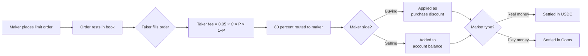

> 💡 **Futuur rewards liquidity providers on every market — instantly and automatically.** When a taker fills your resting order, **80% of the taker fee** is returned to you as a maker rebate.

## At a Glance

| Feature | Details |
| --- | --- |
| Rebate share | **80% of the taker fee** |
| Payment timing | **Instant** — at the moment the match happens |
| Buy makers | Applied as a **discount on the purchase** |
| Sell makers | Added as **value to the account balance** |
| Settlement asset | **USDC** (real money) · **Ooms** (play money) |
| Portfolio display | Unified in **USD** (real money) · **Ooms** (play money) |
| Per-transaction display | Actual asset used — **USDC** or **Ooms** |
| Who is eligible | Everyone — no application, no volume threshold |

## Why Maker Rebates?

Deeper liquidity benefits everyone: **tighter spreads**, **lower price impact**, **more reliable fills**, and **resilience during volatility**. Maker rebates incentivize consistent, competitive quoting so the whole market gets better.

## How It Works

When a taker fills your resting order, **80% of the taker fee** is credited to you instantly — no waiting, no batch, no application.

### The Match Flow

## Where You Can See Your Rebates

| Surface | Scope | Currency display |
| --- | --- | --- |
| **My Positions** → Transactions tab | Per-market · attached to the originating trade | Actual asset — **USDC** or **Ooms** |
| **Portfolio** | Aggregated summary across all markets | **USD** (real money) · **Ooms** (play money) |
| **Wallet** | Account-wide ledger · each rebate as its own entry | Actual asset — **USDC** or **Ooms** |

> ℹ️ **Rule of thumb:** the Portfolio unifies real money under **USD** for a single summary view; everywhere else, the actual asset is shown.

## Eligibility

- ✅ **All markets** — political, sports, crypto, or any other category
- ✅ **Everyone** — no volume thresholds, no application, no whitelisting
- ✅ **Real money and play money** — same rules, different currency (USDC vs Ooms)

> 🎯 **How to earn:** place a limit order that rests in the book and gets filled by a taker. That's it.

## Fee Structure

Taker fees are calculated with the same formula on every market:

$$
fees = 0.05 \times C \times P \times (1 - P)
$$

- **P** = price of a share (e.g. 50 cents = 0.5)
- **C** = number of contracts

Fees peak at **P = 0.50** and decrease symmetrically toward 0 and 1. **80% of the taker fee** goes to the maker as a rebate — as a purchase discount (buy side) or balance credit (sell side). Real money fees settle in **USDC**; play money fees settle in **Ooms**.

### Example Fee Table (100 contracts)

| Price (P) | Contracts (C) | Total Fee |   | Price (P) | Contracts (C) | Total Fee |
| --- | --- | --- | --- | --- | --- | --- |
| \$0.01 | 100 | \$0.0495 |   | \$0.55 | 100 | \$1.2375 |
| \$0.05 | 100 | \$0.2375 |   | \$0.60 | 100 | \$1.2 |
| \$0.10 | 100 | \$0.45 |   | \$0.65 | 100 | \$1.1375 |
| \$0.15 | 100 | \$0.6375 |   | \$0.70 | 100 | \$1.05 |
| \$0.20 | 100 | \$0.8 |   | \$0.75 | 100 | \$0.9375 |
| \$0.25 | 100 | \$0.9375 |   | \$0.80 | 100 | \$0.8 |
| \$0.30 | 100 | \$1.05 |   | \$0.85 | 100 | \$0.6375 |
| \$0.35 | 100 | \$1.1375 |   | \$0.90 | 100 | \$0.45 |
| \$0.40 | 100 | \$1.2 |   | \$0.95 | 100 | \$0.2375 |
| \$0.45 | 100 | \$1.2375 |   | \$0.99 | 100 | \$0.0495 |
| **\$0.50** | **100** | **\$1.25 ← max** |   |   |   |   |

> 📌 **P = 0.50** is the maximum fee point. Values above are in USD for real money markets and apply identically in Ooms for play money.
