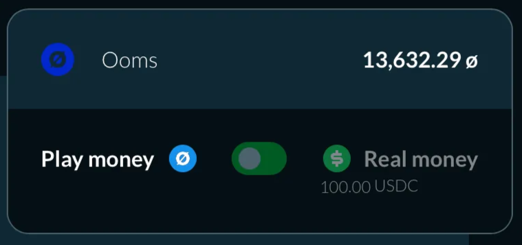
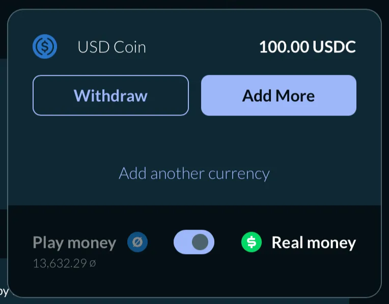

Futuur has a unique approach to the use of multiple currencies in its markets. We host markets that function simultaneously with both play money (Ooms) and real money (cryptocurrencies). Please read on to understand how they work and which one is the best for you.

## What are Ooms?

Ooms are Futuur’s play-money currency, represented by the symbol ø. All forecasters start their journey on Futuur with 10,000ø, which they can use to bet in our play-money markets. Ooms measure the accuracy of your predictions over time, and as you build your balance in Ooms, you grow your reputation as a forecaster.

## What's the difference between play money (Ooms) and real money (crypto)?

Play money and real money serve different purposes on Futuur.

**Play-Money:**

Ooms serve as an indicator of your **reputation as a forecaster**, your social capital. That is why they cannot be sold, bought, deposited, withdrawn, or converted into any other currency. Everyone starts their journey with the same amount of Ooms (10,000), and the growth or decline in their balances can only be attributed to how successful they have been in their forecasts. The incentives to use Futuur with play money are mostly related to:

- Proving how good you are at forecasting
- Competing with friends and fellow forecasters
- Having fun
- Getting used to the platform
- Building a market consensus that is not affected by how wealthy each market participant is

**Real Money:**

Real money, on the other hand, offers you the possibility to make actual money from your forecasts. Everyone starts their journey on Futuur with 0 balance in real money, so their initial allocation is entirely up to how much they want to deposit in their wallets. Once you make your first deposit of [any of the currencies we currently accept](/help/understanding-currencies), you can use it to place bets into any of our real-money markets and be rewarded for correct forecasts in the same currency you used for your bet.

The dynamics of participating in real-money markets (placing bets, selling positions, receiving payments once the markets are resolved, etc) are the same as in play-money markets. The fundamental difference is that the money you make betting with real money can be withdrawn from Futuur at any point for you to use in your life.

Therefore, on top of the fun, social components of play-money markets, the incentives to use Futuur with real money are also related to:

- Being financially rewarded for your activity as a forecaster
- Getting insight from people who put actual money on the line, and have more than their reputation to lose if they’re not honest and rational in their forecasting activity

## How do I select between play money and real money?

Simply click on the Account Balance in the header at the top of the screen and change the toggle between Play-Money and Real Money.

If you already have a balance in any real-money currency and want to use it for your forecasts, don’t forget to select which currency you want to use at that time.

## Are market prices the same for play money and real money?

No. Our play-money markets operate independently from our real-money markets, which means that they generate potentially different forecasts.

For savvy traders, a difference between the two may indicate an arbitrage opportunity!

## Do all real money currencies participate in the same liquidity pool?

Yes, independent of the currency used, all real-money currencies are combined in the same liquidity pool for each single real-money market. So if you are betting in USD Coin (USDC) and someone else bets in any other real-money currency in the same market, both bets will impact the prices and increase overall liquidity in that particular market.

## Am I exposed to volatility risk?

No. When you bet in a given currency, your return is locked in that currency. For instance, if you bet 10 USDC at 0.50/share, and your prediction is right, you'll earn 20 USDC when the market resolves, even if the price of USDC has fluctuated relative to other currencies in the meantime.

## Which currencies do you accept?

Futuur supports real-money deposits and withdrawals in following cryptocurrencies:

**Cryptocurrencies:**

- USD Coin (USDC)

For more information on how to make a crypto deposit on Futuur, please visit the [Deposits and Withdrawals](/help/deposits-and-withdrawals) section of our Help Center or contact Futuur support at [support@futuur.com](mailto:support@futuur.com).

## I do not own any cryptocurrency. Where can I get them?

Welcome to the wonderful world of crypto! Cryptocurrencies built using blockchain technology offer a novel way to store and transfer value without the need for an intermediary. To purchase USDC or other crypto assets, we recommend using a reputable exchange that operates in your jurisdiction.

Some of such exchanges are: **[Binance](https://www.binance.com/)**, **[Coinbase](https://www.coinbase.com/)**, **[CEX.IO](https://cex.io/)**, **[Kraken](https://www.kraken.com/)**, **[Foxbit](https://foxbit.com.br/)**, and **[Mercado Bitcoin](https://www.mercadobitcoin.com.br/).**

## Can anyone use real money on Futuur?

No. Dues to restrictions in our gaming license and from our payment service provider, forecasters from some regions of the world are not allowed to use real money on Futuur.

Please refer to the [Legal section of our Help Center](/help/license-and-jurisdiction) to understand which jurisdictions are not allowed the use of each kind of currency on Futuur.
