Esta página explica o básico do recurso mais importante da Futuur: fazer previsões. Continue lendo para aprender como expressar suas opiniões na forma de apostas, colocar seu conhecimento à prova e lucrar com suas habilidades de previsão.

## Como faço uma aposta?

Depois de [criar sua conta](/pt-br/help/create-your-account) e fazer login, você deve [selecionar se deseja navegar nos mercados de dinheiro de jogo, ou nos mercados de dinheiro real](/pt-br/help/understanding-currencies). Nos exemplos abaixo, usaremos mercados de dinheiro fictício.

Quando encontrar o mercado que lhe interessa, clique nele para acessar a interface do mercado.

<Tip>
  Também é possível fazer apostas e vender posições diretamente pelo feed da Futuur, sem acessar a página de detalhes do mercado. Embora mais prático e rápido, recomendamos essa função apenas para mercados cujas regras e detalhes você já leu e entendeu.
</Tip>

### Leia os detalhes do mercado

Reserve um momento para entender os elementos da interface do mercado:

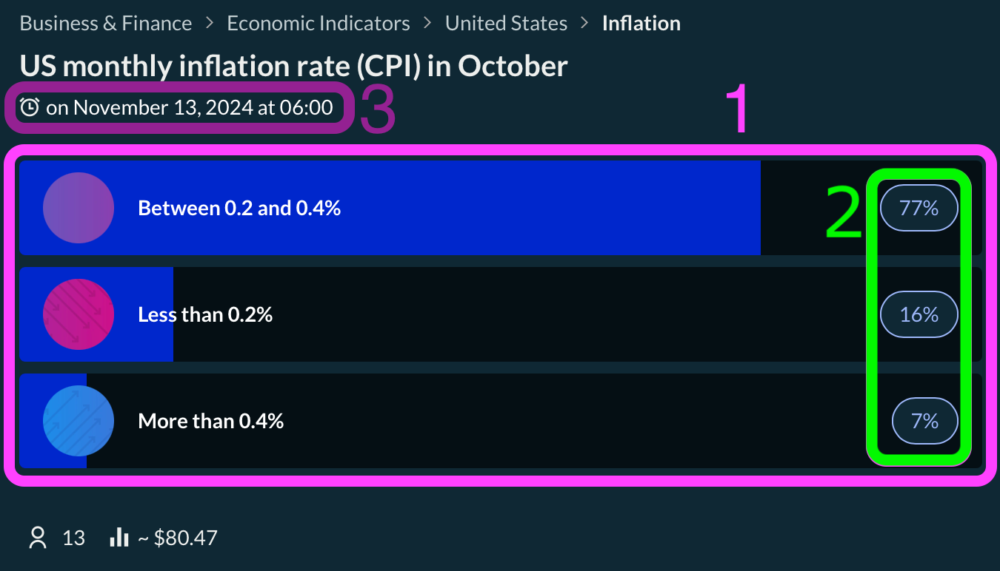

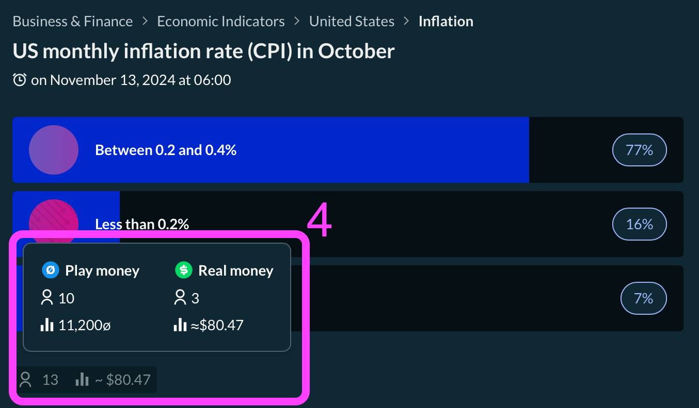

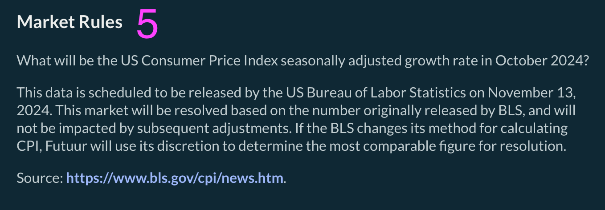

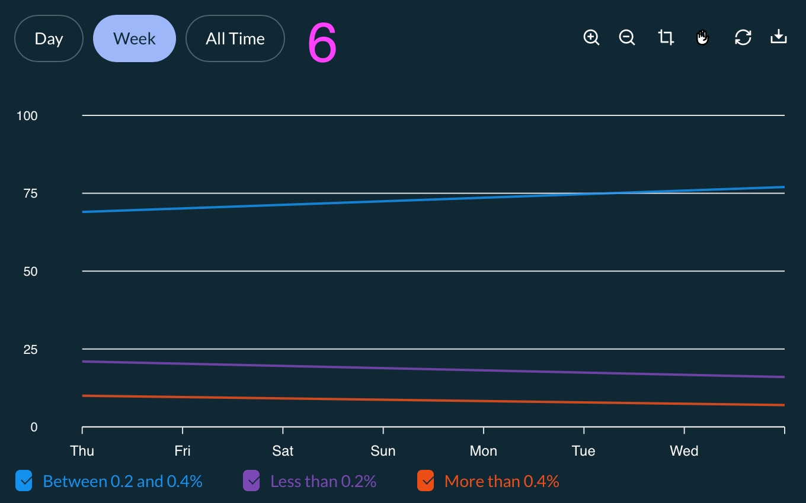

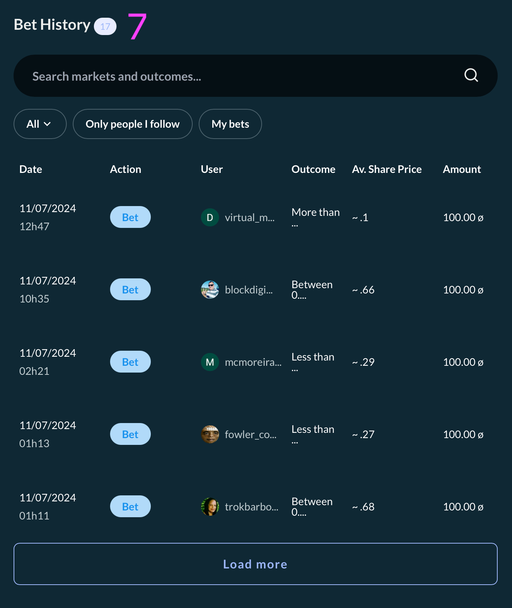

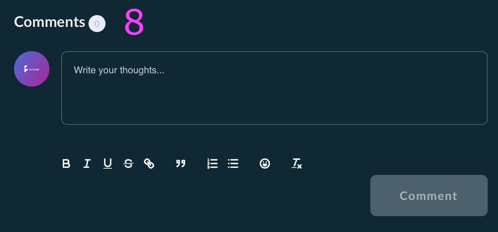

1. RESULTADOS: Os possíveis resultados para o evento que o mercado está tentando prever. Você deve escolher um para fazer uma aposta.
2. PREÇO POR SHARE: O preço que foi pago para adquirir 1 share de um determinado resultado ma transação mais recente do mercado. No momento em que o mercado é resolvido, os usuários que possuem shares do resultado vencedor serão recompensados com 1 Oom para cada share que possuírem. As shares do resultado perdedor valerão 0 naquele momento, então os usuários que possuírem shares dos resultados perdedores perderão tudo o que gastaram comprando essas shares. 
   Preste muita atenção a esses preços, pois eles podem flutuar em tempo real, dependendo da atividade do mercado. Os preços também podem aumentar progressivamente à medida que você compra shares. No exemplo acima, o preço mais recente para a compra de 1 share do resultado "Sim" foi de 0,77 Oom. No entanto, se você comprar, por exemplo, 100 shares no mercado, é possível que o preço da 100ª share que você compra seja maior do que o preço da 1ª share. A magnitude dos movimentos de preço é determinada pelo [Livros de Ordens](/pt-br/help/order-book) do mercado e pelo [Formador de Mercado Automatizado](/pt-br/help/automated-market-maker) (AMM) da Futuur. À medida que mais apostas ocorrem e mais pessoas participam do mercado, os preços se tornam menos voláteis. 
   A Futuur também cobra uma taxa sobre o preço por share no momento da compra (saiba mais [aqui](/pt-br/help/betting-and-trading)).
3. DATA LIMITE PARA APOSTAS: O momento em que o mercado fechará para novas apostas e vendas.
4. ESTATÍSTICAS DO MERCADO: Resumo rápido de quantos usuários já apostaram e o valor acumulado de recursos que eles investiram.
5. REGRAS DO MERCADO: Esta seção apresenta as regras detalhadas que a Futuur deve observar para determinar qual dos resultados listados deve ser o vencedor no momento de resolver o mercado. Cada mercado tem seu conjunto particular de regras, então certifique-se de lê-las cuidadosamente antes de fazer sua aposta.
6. GRÁFICO DE PROBABILIDADE: A evolução histórica da probabilidade de cada resultado específico se tornar o vencedor no mercado.
7. HISTÓRICO DE APOSTAS: Uma lista das apostas recentes de todos os outros previsores que participaram do mercado.
8. COMENTÁRIOS: Onde você pode participar de discussões com outros previsores sobre os assuntos relacionados a este mercado. Muitas vezes, quando necessário, a equipe da Futuur fornece esclarecimentos sobre as regras do mercado nesta seção.

### Faça sua Aposta

Selecione o resultado no qual deseja apostar e vá até o modal de Fazer Aposta. Certifique-se de entender as informações exibidas no modal antes de clicar no botão “Apostar”:

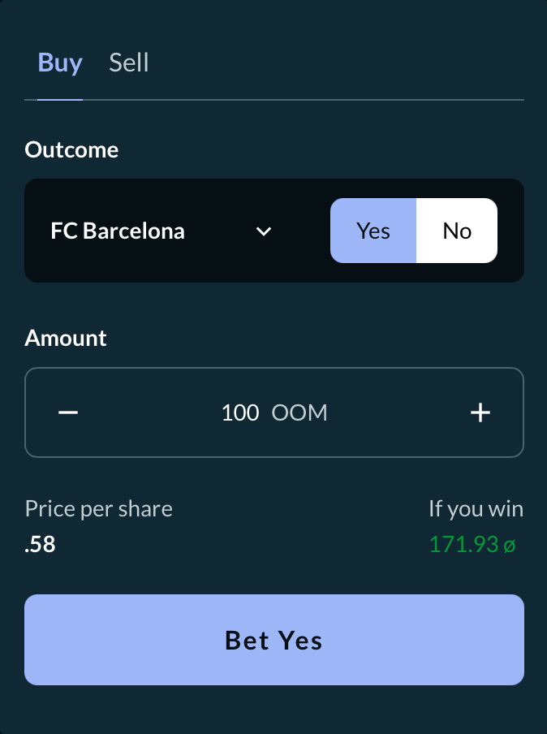

- **RESULTADO**: O resultado no qual deseja apostar. Você pode fazer uma aposta "Sim" em um resultado específico (apostando que ele acontecerá) ou uma aposta "Não" nesse mesmo resultado (apostando que ele não acontecerá), independentemente dos outros resultados no mercado.
- **PREÇO MÉDIO / AÇÃO**: O preço médio por ação levando em conta a quantidade de ações que você está comprando. Neste exemplo, em média, você pagaria aproximadamente 0,58 Oom por ação. Esse valor já inclui a taxa de compra da Futuur.
- **VALOR DA APOSTA**: O valor total de Ooms que você gastará para fazer sua aposta.
  - **SE VOCÊ GANHAR**: O valor total de Ooms que você receberá se sua previsão estiver correta. (Em outras palavras, representa o total de ações que você está comprando. O número é calculado dividindo o Valor da Aposta pelo Preço Médio / Ação.

Após clicar no botão “Apostar”, sua aposta ficará visível tanto na Página do Mercado quanto em seu

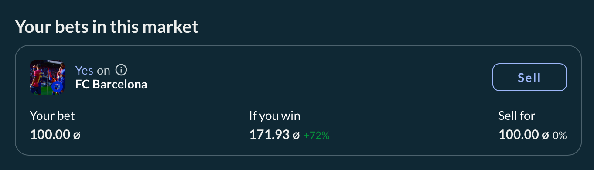

<Tip>
  Se, ao invés de fazer uma aposta diretamente você preferir criar uma [Ordem Limitada](/pt-br/help/order-book), é só escolher a opção “Limite” ao invés de “Mercado” no seletor que fica no canto superior direito da aba de apostas, e inserir os parâmetros da sua ordem antes de clicar em “Colocar Ordem”
</Tip>

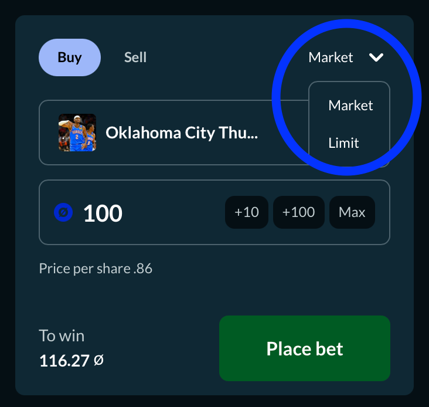

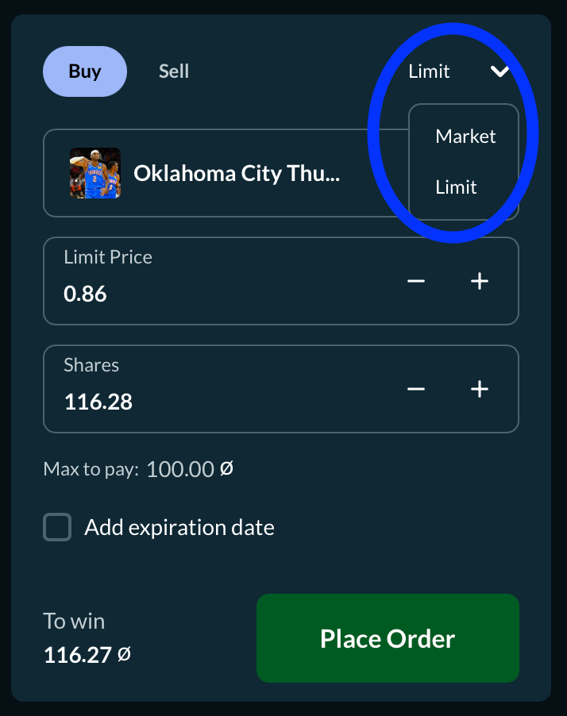

Por favor leia nosso artigo sobre o [Livro de Ordens](/pt-br/help/order-book) para mais informações sobre [Ordens Limitadas](/pt-br/help/order-book), e aproveita negociações mais precisas e sem distorções de preço.

### Apostando com dinheiro real (criptomoedas)

O processo para apostar com dinheiro real é muito semelhante ao de [apostar com dinheiro de jogo](/pt-br/help/betting-and-trading).

Além de criar uma conta e fazer login, você também deve [confirmar seu endereço de e-mail](/pt-br/help/create-your-account) e [fazer pelo menos um depósito na sua carteira](/pt-br/help/deposits-and-withdrawals).

Depois de ter fundos na sua carteira, comece selecionando mercados de dinheiro real, além de clicar na moeda que deseja usar.

Assim como com dinheiro fictício, você deve navegar pelo site procurando os mercados em que deseja apostar. As páginas dos mercados de dinheiro real têm basicamente o mesmo layout, informações e lógica que os mercados em Ooms.

Cabe inteiramente a você decidir qual, dentre as nossas moedas aceitas, você deseja usar em um mercado de dinheiro real, pois todas as moedas são colocadas no mesmo pool de liquidez. Apenas lembre-se de que suas recompensas são fixadas na moeda original, independentemente de futuras flutuações de preços entre as moedas.

Leia mais sobre nossa abordagem de múltiplas moedas na seção [Multi Moedas na Futuur](/pt-br/help/understanding-currencies), da nossa Central de Ajuda.

## Qual a diferença entre apostar A FAVOR ou CONTRA um resultado?

Ao negociar em mercados de previsão, você tem duas maneiras fundamentais de expressar sua opinião sobre qualquer resultado: apostando A FAVOR dele (assumindo uma posição de "Sim", indicando que acredita que o resultado ocorrerá) ou apostando CONTRA ele (assumindo uma posição de "Não", indicando que acha que o resultado não acontecerá). Embora ambas as abordagens permitam que você lucre com suas previsões, elas funcionam de maneira diferente e apresentam características distintas.

A maioria dos mercados de previsão na Futuur é binária, oferecendo apenas dois resultados possíveis. Nesses casos, apostar a favor ou contra um resultado é bem direto: você assume uma posição de "Sim" ou "Não" nesse mercado.

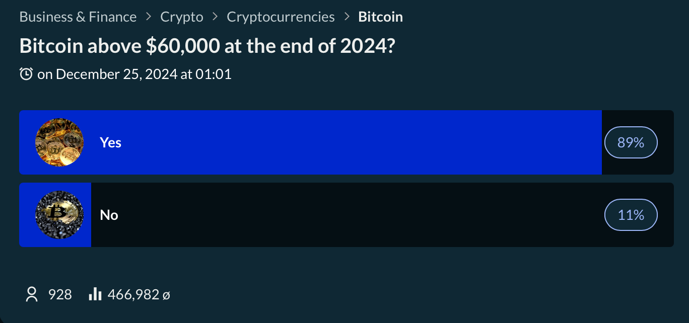

No entanto, alguns mercados apresentam múltiplos resultados possíveis. Nesses casos, cada resultado funciona como se fosse seu próprio mercado binário dentro da estrutura maior. Você pode apostar a favor ou contra qualquer resultado específico separadamente.

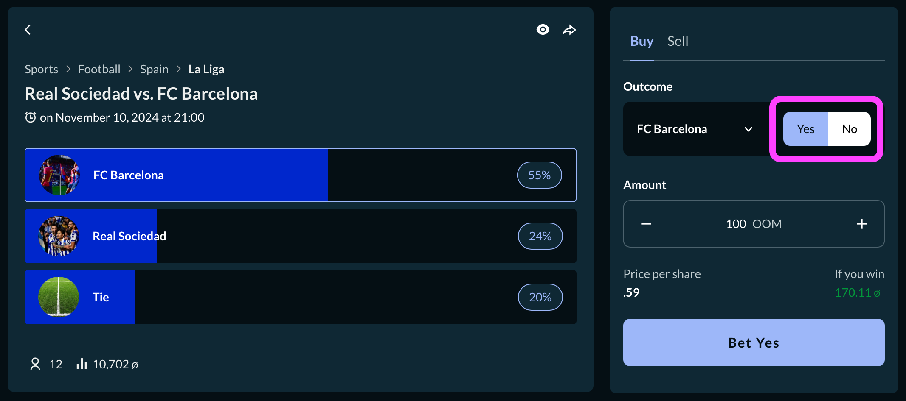

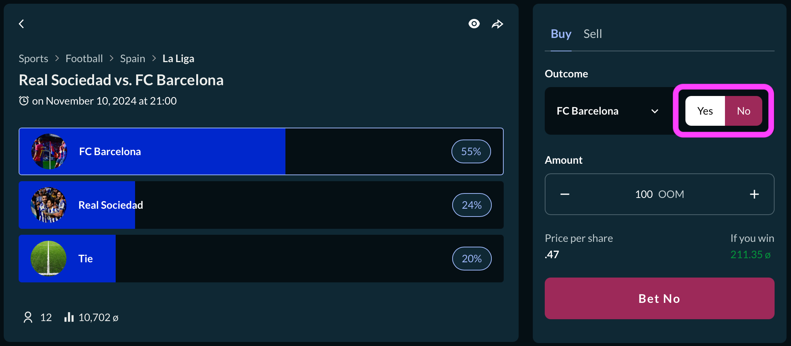

No mercado acima, por exemplo, você tem várias opções para fazer sua aposta, como:

- Para prever que o FC Barcelona vencerá, faça uma aposta "Sim" no FC Barcelona.
- Para prever que o FC Barcelona NÃO vencerá (independentemente de ser o Real Sociedad que ganha ou se for empate), faça uma aposta "Não" no FC Barcelona.
- Se você tem uma previsão específica sobre um empate ou a vitória do Real Sociedad, faça uma aposta "Sim" em um desses resultados.

Mercados de eleição oferecem outro bom exemplo. Você pode não ter certeza de quem ganhará, mas pode estar confiante sobre quem não ganhará. Nesse caso, você pode fazer uma aposta "Não" nesse candidato sem precisar prever o vencedor real.

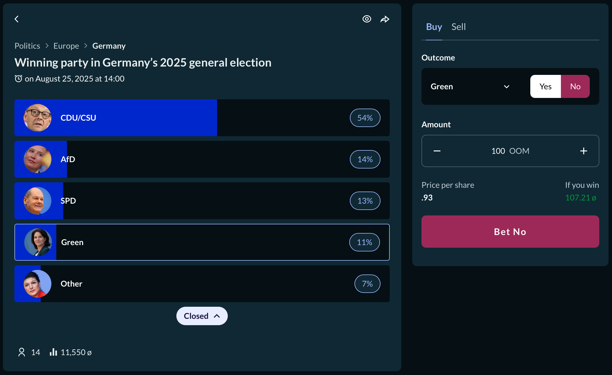

A escolha entre apostar a favor ou contra um resultado envolve uma consideração cuidadosa do risco e dos retornos potenciais. Embora apostar contra um azarão (fazendo uma aposta "Não" em um resultado de baixa probabilidade) possa parecer seguro, essas apostas geralmente oferecem retornos menores em comparação com prever corretamente o resultado vencedor com uma aposta "Sim".

<Tip>
  Não se esqueça: os mercados de previsão recompensam previsões precisas. Quanto mais específicas elas são, melhor é a visão que elas fornecem sobre o futuro. Reserve sempre um tempo para ponderar suas opções e, por fim, expresse seu entendimento mais racional e bem-pensado sobre o futuro ao decidir se vai apostar a favor ou contra um resultado.
</Tip>

## Quando um mercado fecha e é resolvido?

É importante distinguir entre duas datas importantes em cada um dos mercados da Futuur:

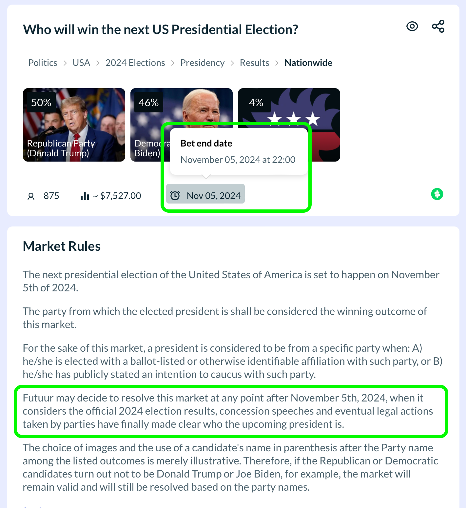

1. "Data Limite para Apostas": Marca o momento em que o mercado fechará. A partir desse momento, os usuários não poderão mais fazer apostas ou vender posições, tendo suas apostas efetivamente congeladas até que o mercado seja resolvido e distribua as recompensas para aqueles que apostaram no resultado correto. A Data Limite Para Apostas não corresponde ao momento em que os pagamentos são distribuídos.
2. Data de Resolução do Mercado: o momento em que o mercado é efetivamente resolvido e os pagamentos são distribuídos.

No exemplo acima, vemos um mercado que fechará para novas apostas em 5 de novembro de 2024, às 22:00 UTC. No entanto, a resolução efetiva do mercado pode demorar muito mais, pois a contagem dos votos e os desenvolvimentos legais para determinar quem vence a eleição presidencial dos EUA podem durar vários dias após a votação.

Existem casos em que a Data Limite Para Apostas e as datas de resolução de um mercado diferem muito pouco, como em um jogo de futebol, no qual o mercado normalmente fecha quando o jogo começa e é resolvido logo após o jogo terminar. Em outros casos, o tempo entre esses dois eventos pode ser bem maior, enquanto aguardamos eventos do mundo real para confirmar qual resultado deve ser considerado o vencedor de um mercado.

Por fim, a Futuur tem o direito de alterar a Data de Encerramento das Apostas de um mercado quando considerar razoável, sem prejudicar a justiça do mercado. Isso não é incomum acontecer com indicadores econômicos, por exemplo. Se um país adiar por uma semana a data de divulgação de um relatório sobre inflação, por exemplo, não há problema em estender a Data Limite Para Apostas no mercado que tenta prever a taxa de inflação daquele país.

## Como os preços mudam ao longo do tempo?

Os preços iniciais para todos os resultados em um mercado são definidos inicialmente pela equipe da Futuur. Mas, uma vez que os mercados estão abertos para apostas, a dinâmica de preços é inteiramente determinada pelos usuários, à medida que compram e vendem ações nos mercados ou criam ordens limitadas no [Livro de Ordens](/pt-br/help/order-book).

À medida que mais pessoas apostam em um determinado resultado, o preço desse resultado tende a aumentar, enquanto o preço dos resultados alternativos diminui.

Alternativamente, vender shares de um resultado tende a fazer seu preço cair, aumentando o preço dos outros resultados.

A magnitude dos movimentos de preços é determinada por uma combinação entre o Livro de Ordens do mercado e o [Formador de Mercado Automatizado](/pt-br/help/automated-market-maker) (AMM) da Futuur. À medida que mais apostas ocorrem e mais pessoas participam do mercado, os preços se tornam menos voláteis.

## Posso vender minha posição antes do mercado fechar?

Sim. Você não precisa esperar até o momento em que um mercado é resolvido para ganhar dinheiro por sua participação no mercado. Você pode fazer isso a qualquer momento antes do mercado fechar para apostas.

Quando você faz uma aposta na Futuur, você começa a ver dois preços para sua aposta:

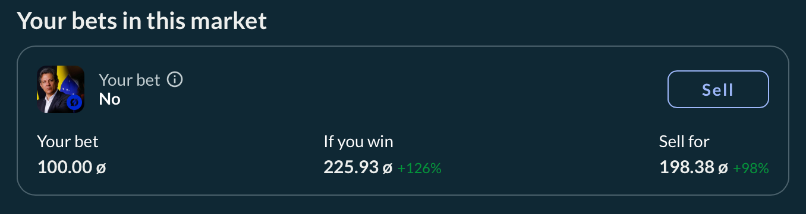

1. **"Se você ganhar"**: o valor que você receberá se sua previsão estiver correta. Este valor é determinado no momento em que você faz sua aposta e não muda ao longo do tempo. Quando o mercado é resolvido, você recebe tudo (se sua previsão estiver correta) ou perde todo o valor que apostou.
2. **"Vender por"**: o valor que você receberá se vender sua posição agora. Este valor está sujeito a variação o tempo todo. À medida que os previsores fazem suas apostas e ordens limitadas no mercado, os preços de cada alternativa podem aumentar ou diminuir, e você tem sempre a opção de vender sua posição pelo preço de mercado atual enquanto o mercado ainda está aberto.
3. Alternativamente, se você considerar que o preço atual não é bom o bastante, mas tiver uma ideia clara do valor pelo qual gostaria de vender sua posição, poderá criar uma **Ordem Limite** no preço desejado.

Ex.: No exemplo acima, se o usuário permanecesse no mercado até a resolução, sua aposta de 100 ø geraria um lucro de 125,93 ø (caso a previsão estivesse correta) ou uma perda de 100 ø (caso estivesse errada). Entretanto, como mais pessoas passaram a apostar no mesmo resultado, o preço desse resultado subiu consideravelmente. Com esse aumento, o usuário agora pode **“Vender por”** 198,38 ø, embolsando um lucro de 98,38 ø e eliminando o risco de perder 100 ø se a previsão se mostrar incorreta.

Alternativamente, o usuário pode achar que 98,38 ø não são lucro suficiente e preferir vender por 110 ø. Nesse caso, a melhor estratégia é abrir uma **ordem limite** para vender todas as 225,93 shares ao preço de 0,93 ø/share, recebendo 210 ø no total. O preço atual talvez ainda não esteja em 0,93 ø/share, mas, quando chegar lá, a ordem será executada e o usuário garantirá um lucro de 110 ø.

Sair de um mercado antes do fechamento pode fazer sentido por vários motivos — desde reduzir perdas potenciais à luz de novas informações até priorizar liquidez imediata em vez de manter apostas de longo prazo. Seja qual for o motivo de cada apostador, a possibilidade de alterar posições antes do encerramento ajuda a Futuur a manter estimativas mais atualizadas e confiáveis sobre a probabilidade de qualquer evento no mundo real.

<Tip>
  Desde novembro de 2024, não é mais necessário vender o valor total da posição numa venda.

  Agora você pode escolher entre vender todas as suas shares de um resultado, ou editar a quantidade que está disposto a vender naquele momento, realizando apenas uma venda parcial. Após inserir a quantidade de shares que deseja vender, você verá o preço pelo qual a venda parcial pode ser executada.

  Da mesma forma, com as Ordens Limitas você pode sempre determinar a quantidade de shares que deseja vender a cada preço.
</Tip>

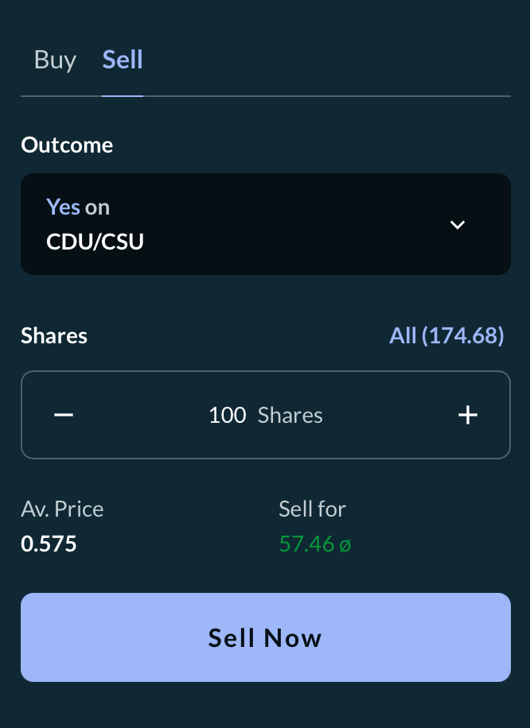

## Os mercados têm sempre liquidez?

Geralmente sim, a menos que os preços estejam nos extremos.

A Futuur usa um AMM (Automated Market Maker) que fornece liquidez instantânea para todos os mercados, permitindo comprar ou vender uma posição a praticamente qualquer momento, sem precisar esperar que alguém aceite sua oferta como em uma bolsa tradicional.

Na prática, o AMM quase sempre consegue garantir liquidez para você sair da sua posição, a exceção fica por conta dos extremos, onde a liquidez pode ser limitada.

## Posso apostar em um mercado esportivo enquanto o jogo está em andamento?

Normalmente, não. A Futuur geralmente fecha os mercados esportivos para apostas alguns minutos antes de uma partida começar.

No entanto, há alguns casos em que os usuários podem atualizar suas apostas em um evento esportivo — como o Super Bowl — enquanto o jogo ainda está em andamento. Esses casos normalmente são marcados como "ao vivo" no feed da Futuur, sinalizando que apostas em tempo real estão disponíveis para esses mercados.

## Quanto tempo leva para um mercado ser resolvido?

Uma parte dos mercados na Futuur – principalmente os que dizem respeito a partidas esportivas – são criados e resolvidos automaticamente a partir de um provedor de dados que é consultado em intervalos regulares. Nesses casos, os mercados tendem a ser resolvidos em, no máximo, 12h após o fim da partida.

A outra parte dos mercados são criados e resolvidos manualmente por nosso time de editores. Nesses casos, embora nossa equipe tenda a ser bastante ágil, o tempo entre a ocorrência do evento no mundo real e a resolução do mercado pode variar significativamente, especialmente nos fins de semana. Se você acredita que um evento do mundo real implica na resolução de um mercado aberto na Futuur, não hesite em nos informar através da página [https://futuur.com/i/feedback/contact](https://futuur.com/i/feedback/contact) e será um prazer priorizar a avaliação desse mercado.

## Por que o preço aumenta à medida que aumento minha aposta?

Os preços a que cada quantidade de shares é negociada são definidos prioritariamente pelo **Livro de Ordens** do mercado, construído pelos próprios usuários quando inserem [Ordens a Mercado](/pt-br/help/order-book) e [Ordens Limitadas](/pt-br/help/order-book). Em qualquer momento, há apenas um número limitado de shares disponíveis em cada preço. Se você tentar comprar mais shares do que as atualmente listadas nesse preço, sua ordem avançará no livro, adquirindo cotas no próximo preço de venda (ask) disponível, que é mais alto que o preço recém‐consumido.

Conforme mais apostas são feitas e mais Ordens Limitadas são adicionadas, os preços tornam-se menos voláteis, permitindo apostas maiores e potenciais retornos mais altos.

Se o [Livro de Ordens](/pt-br/help/order-book) de um mercado estiver vazio em determinado momento, a dinâmica de preços passa a ser determinada pelo [Formador de Preços Automático](/pt-br/help/automated-market-maker) da Futuur, que cobra um preço progressivamente maior quanto maior for o valor apostado, limitando a exposição ao risco.

## Existe um valor mínimo ou máximo para apostar?

O valor mínimo para fazer uma aposta em dinheiro real na Futuur é o equivalente a 1 USD (um dólar americano). Não há valor mínimo para apostar em Ooms. A aposta máxima é determinada com base em cada mercado e aumentará com a liquidez do mercado. Ou seja, quanto mais apostas forem feitas em um mercado, mais líquido ele se torna, permitindo apostas máximas mais altas.

## Existem taxas para apostar em um mercado?

Sim, mas apenas quando um usuário executa uma ordem já existente no Livro de Ordens — ou seja, quando o usuário atua como **taker**.

A taxa do taker é calculada pela mesma fórmula em todos os mercados:

$$
taxa=0,05×C×P×(1−P)
$$

- **P** = preço da share (ex.: 50 centavos = 0,5)
- **C** = número de contratos

A taxa é máxima quando P = 0,50 e diminui simetricamente em direção a 0 e 1. Em mercados de dinheiro real, a liquidação é em USDC; em mercados de dinheiro fictício, em Ooms.

### Exemplo de tabela de taxas (100 contratos)

| Preço (P) | Contratos (C) | Taxa total | Price (P) | Contracts (C) | Total Fee |
| --- | --- | --- | --- | --- | --- |
| \$0.01 | 100 | \$0.0495 | \$0.55 | 100 | \$1.2375 |
| \$0.05 | 100 | \$0.2375 | \$0.60 | 100 | \$1.2 |
| \$0.10 | 100 | \$0.45 | \$0.65 | 100 | \$1.1375 |
| \$0.15 | 100 | \$0.6375 | \$0.70 | 100 | \$1.05 |
| \$0.20 | 100 | \$0.8 | \$0.75 | 100 | \$0.9375 |
| \$0.25 | 100 | \$0.9375 | \$0.80 | 100 | \$0.8 |
| \$0.30 | 100 | \$1.05 | \$0.85 | 100 | \$0.6375 |
| \$0.35 | 100 | \$1.1375 | \$0.90 | 100 | \$0.45 |
| \$0.40 | 100 | \$1.2 | \$0.95 | 100 | \$0.2375 |
| \$0.45 | 100 | \$1.2375 | \$0.99 | 100 | \$0.0495 |
| **\$0.50** | **100** | **\$1.25 ← máx** |   |   |   |

> 📌 P = 0,50 é o ponto de taxa máxima. Os valores acima estão em USD para mercados de dinheiro real e se aplicam de forma idêntica em Ooms nos mercados de dinheiro fictício.

Como parte do Programa de Market Maker Rebate, 80% da taxa do taker vai para o maker como rebate — seja como desconto na compra (quando se trata de executar uma ordem de compra) ou como crédito no saldo (quando foi executada uma ordem de venda). [Clique aqui](/pt-br/help/rebates) para saber mais sobre o programa.
