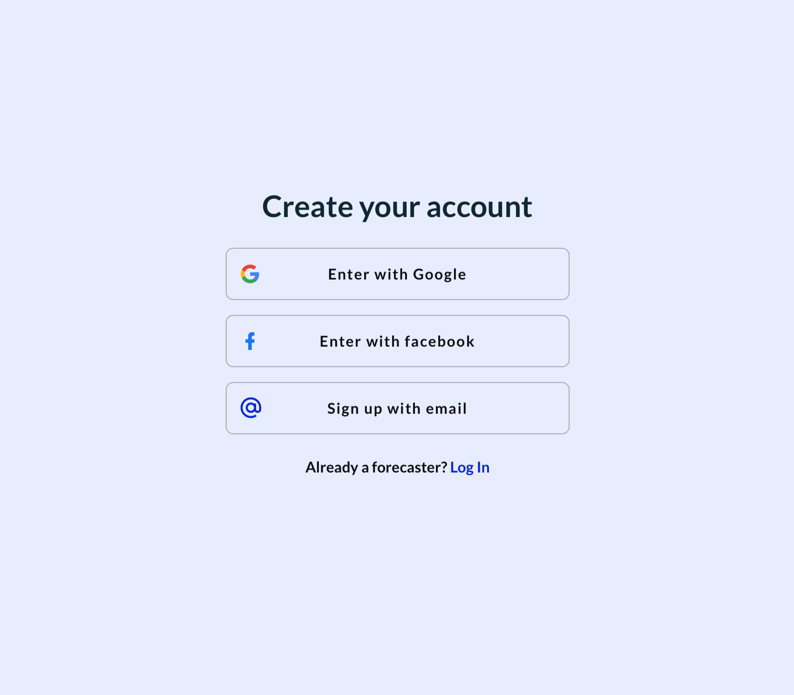
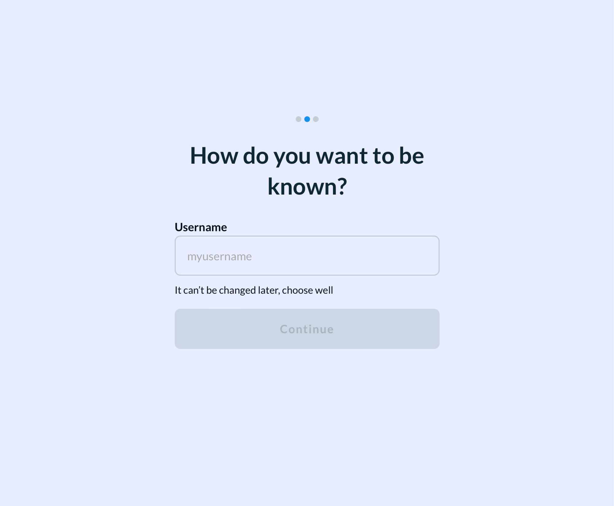
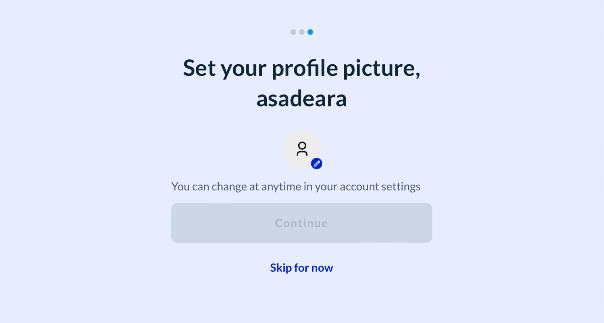
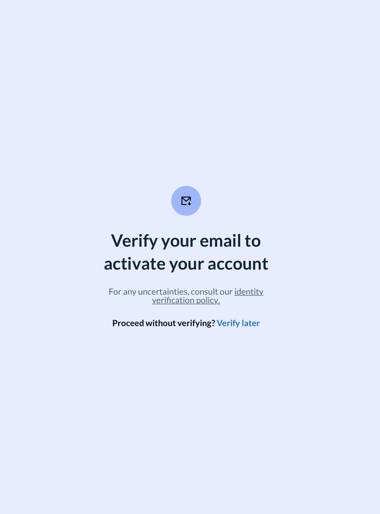
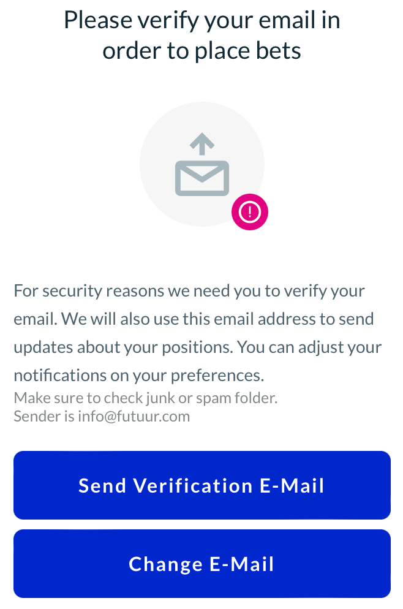
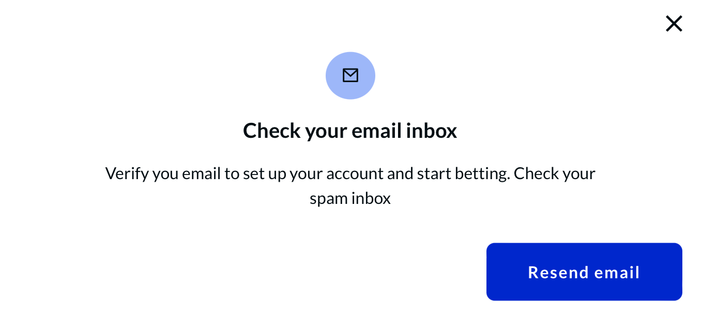

Por favor, continue lendo para obter orientações sobre o processo de criação de uma conta na Futuur usando qualquer uma das nossas opções de login.

## Como criar uma conta na Futuur?

Comece acessando [https://futuur.com/l/register](https://futuur.com/l/register) e escolhendo seu método de registro.

### Selecione seu método de registro

Você pode criar sua conta de três formas:

- Associando sua conta do Google à Futuur
- Associando sua conta do Facebook à Futuur
- Inserindo seu e-mail e escolhendo uma senha

Se você optar por se inscrever com e-mail, sua senha deve ter pelo menos 8 caracteres e incluir letras e números.

### Escolha seu nome de usuário

Reserve um tempo para escolher bem, pois seu nome de usuário será público na Futuur e será refletido na URL do seu perfil.

Se você escolher um nome de usuário como “tom”, por exemplo, seu perfil na Futuur será hospedado em [https://futuur.com/tom](https://futuur.com/tom), tornando-o fácil de compartilhar com seus amigos.

Você não pode mudar seu nome de usuário depois de selecioná-lo. Se cometer um erro nesse processo, entre em contato com [support@futuur.com](mailto:support@futuur.com) para que nossa equipe possa ajudá-lo.

### Defina sua foto de perfil

Seu perfil fica muito melhor com uma foto, certo? Escolha sua foto favorita e deixe-a brilhar!

Sua foto de perfil não precisa mostrar seu rosto, e esta não é uma etapa obrigatória.

Se preferir, você pode pular esta etapa e ir diretamente para os mercados.

Agora você está pronto para explorar os mercados na Futuur e fazer apostas com dinheiro de jogo (Ooms).

### Confirme seu endereço de e-mail

Independentemente do método de registro que você escolheu, você deve confirmar seu endereço de e-mail para usar todos os recursos da Futuur.

Você não poderá usar dinheiro real na Futuur (seja para fazer depósitos, apostas, vender posições ou sacar fundos) até que confirme seu endereço de e-mail.

Se você decidir pular esta etapa por enquanto e ir diretamente para o feed de mercados, só poderá interagir com mercados usando dinheiro de jogo (Ooms).

Para confirmar seu endereço de e-mail, acesse sua caixa de entrada e clique no link dentro da mensagem que você recebeu da Futuur.

Se não encontrar a mensagem na sua caixa de entrada, confira sua pasta de Spam ou entre em contato com [support@futuur.com](mailto:support@futuur.com).

## Posso confirmar meu endereço de e-mail mais tarde?

Se você decidiu pular o processo de confirmação no momento em que criou sua conta, você tem 24 horas para concluí-lo clicando no link enviado para sua caixa de entrada. Após esse prazo expirar, você pode solicitar que a mensagem de verificação seja enviada novamente para sua caixa de entrada.

Para retomar o processo de verificação, basta tentar fazer um depósito ou uma aposta em dinheiro real, e você verá uma das seguintes mensagens:

## Posso mudar meu endereço de e-mail depois de concluir o registro?

Se você não tiver mais acesso ao endereço de e-mail informado quando criou sua conta — ou se o digitou incorretamente durante a criação da conta —, acesse sua [página de Configurações de Conta](https://futuur.com/a/settings), clique na opção para [Atualizar Endereço de E-mail](https://futuur.com/p/email-update) e retome o processo de verificação com seu endereço atualizado.
