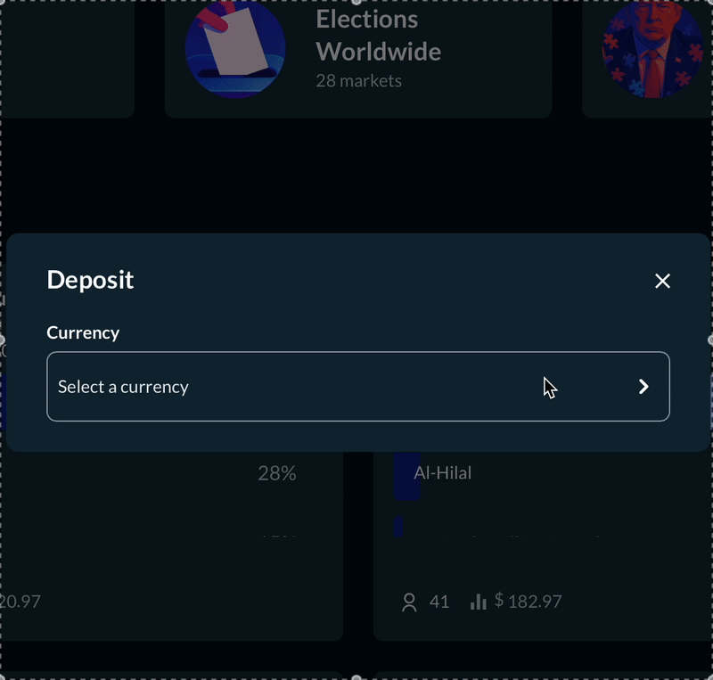

Esta página é dedicada aos processos, taxas, limites e regras para depositar e sacar dinheiro real da Futuur. Leia mais se você deseja usar a plataforma para lucrar com suas previsões.

## Como faço um depósito?

Uma vez que você [crie sua conta](/pt-br/help/create-your-account) e [verifique seu endereço de e-mail](/pt-br/help/create-your-account), você pode fazer seu primeiro depósito em dinheiro real. Para isso, selecione “Dinheiro Real” no seletor de moeda e clique em “Depositar”.

### Complete suas informações pessoais

Se esta for a primeira vez que você faz um depósito, será necessário completar suas informações pessoais.

Preencha o formulário, certificando-se de que não está usando a Futuur em uma jurisdição onde as apostas em dinheiro real são proibidas (verifique a lista de países restritos [aqui](/pt-br/help/license-and-jurisdiction)). Depois de completar o formulário, clique em “Enviar”.

### Escolha a moeda e siga os passos para depositar

Comece selecionando qual moeda deseja depositar. (Se você ainda não possui criptomoedas, consulte [esta seção](/pt-br/help/understanding-currencies) da nossa Central de Ajuda para saber onde obtê-las)

Você também deve selecionar a rede que deseja usar para a transferência. É **absolutamente essencial** que a rede que você selecionar para receber seus fundos na Futuur seja a mesma rede que você seleciona no momento de transferir os fundos de sua carteira cripto fora da Futuur.

<Warning>
  Se você selecionar redes diferentes nas duas pontas da transação, seus fundos podem ser perdidos para sempre na blockchain. Isso não é uma falha ou bug na arquitetura da Futuur, mas uma característica das redes blockchain usadas para transferir criptoativos.

  Por favor, certifique-se de verificar as redes em ambas as pontas antes de enviar seus fundos para a Futuur.
</Warning>

Após selecionar sua moeda e rede, você verá o endereço para o qual deve enviar seus fundos. Copie e cole-o como o endereço de destino ao configurar a transferência.

Se sua carteira permitir transferências usando um código QR, você pode escanear o código QR à esquerda ao preparar sua transferência.

<Tip>
  Lembre-se de que diferentes criptomoedas, redes e carteiras cobram taxas diferentes para transferir cripto. Por favor, compare suas opções antes de configurar sua transferência.

  A Futuur não cobra nenhuma taxa para receber fundos. Para verificar nossas taxas de saque, consulte [esta seção](/pt-br/help/deposits-and-withdrawals).
</Tip>

## Quanto tempo leva para um depósito ser concluído?

Diferentes moedas levam tempos diferentes para chegar à sua carteira. Você sempre será notificado por e-mail quando os fundos chegarem à sua carteira, então, por favor, certifique-se de manter a Futuur na sua lista de endereços seguros e verifique sua pasta de spam se não receber notícias nossas.

De modo geral, os depósitos em cripto levam de 10 a 30 minutos para chegar à sua conta, dependendo da criptomoeda utilizada.

## Existe um valor mínimo para depósitos?

Não há valor mínimo para depósitos. No entanto, para evitar transações fraudulentas e de spam, qualquer transferência que esteja abaixo do equivalente a 0,01 Euro será rejeitada.

## Existe um valor máximo para depósitos?

Não há valor máximo para depósitos na Futuur. No entanto, se seus depósitos acumulados ao longo da vida excederem o equivalente a \$2.000 USD, a Futuur se reserva o direito de exigir prova de identidade e endereço dos previsores que utilizam dinheiro real como parte dos requisitos KYC (Conheça seu Cliente) legalmente exigidos. Desculpe, nós não fazemos as regras!

## Como faço para sacar da minha carteira?

Vá para sua carteira na Futuur em [https://futuur.com/p/wallet](https://futuur.com/p/wallet) e selecione a moeda que deseja sacar no lado esquerdo. Clique em “Sacar” e preencha as informações para cada tipo de saque.

### Inicie o pedido

Insira o valor que deseja sacar, selecione a rede que deseja usar (preste atenção nas taxas para usar cada rede, conforme descrito [aqui](/pt-br/help/deposits-and-withdrawals)) e forneça o endereço onde gostaria de receber os fundos. Observe que este deve ser o endereço público da sua carteira para a criptomoeda solicitada e que deve ser compatível com a rede selecionada.

<Warning>
  A Futuur não pode controlar fundos enviados para o endereço errado, então certifique-se de verificar duas vezes se o endereço e a rede selecionada estão corretos.
</Warning>

### Confirme o pedido

Por motivos de segurança, após clicar em “Enviar”, você receberá um e-mail pedindo para confirmar o saque. Por favor, confira a sua caixa de entrada para abrir a mensagem, verificar as informações e aprovar o pedido clicando no botão “Confirmar Saque”.

Você tem 48 horas para confirmar o pedido de saque. Depois disso, ele será automaticamente cancelado e você terá que iniciar um novo pedido.

Se você quiser fazer alterações em um pedido que já iniciou, volte à sua carteira, encontre o pedido de saque e clique em “Cancelar este saque”. Depois disso, aguarde 30 minutos antes de iniciar um novo pedido.

### Aguarde a chegada dos seus fundos

A Futuur revisará manualmente todos os pedidos confirmados dentro de 24 horas e os enviará para a rede para processamento. Você será notificado quando nosso processo de revisão terminar e deverá receber seus fundos em breve.

## Quanto tempo leva para um saque ser concluído?

Atualmente, revisamos manualmente todas as solicitações de saque, geralmente dentro de 24 horas. Uma vez revisada e aprovada, seus fundos serão enviados para o endereço indicado e devem chegar em menos de 30 minutos. O tempo real para a chegada do dinheiro depende da velocidade de processamento da rede, não da Futuur.

## Existe um valor mínimo para saques?

O valor mínimo de saque varia de acordo com a moeda sendo sacada.

### Saques mínimos para criptomoedas

| Moeda | Rede | Valor Mínimo de Saque |
| --- | --- | --- |
| USDC | ERC20 | 10 USDC |
| USDC | Binance Smart Chain (BEP20) | 0.00015 USDC |
| USDC | Polygon | 1 USDC |
| USDC | Solana | 1 USDC |

## Existe um valor máximo para saques?

Não há valor máximo para saques na Futuur. No entanto, se seus saques acumulados ao longo da vida excederem o equivalente a \$2.000 USD, a Futuur se reserva o direito de exigir prova de identidade e endereço dos previsores que utilizam dinheiro real como parte dos requisitos KYC (Know Your Customer) legalmente exigidos. Desculpe, nós não fazemos as regras!

## Quais taxas estão envolvidas nos saques da Futuur?

### Taxas para sacar cripto

| Moeda | Rede | Taxa de Saque |
| --- | --- | --- |
| USDC | ERC20 | 5 USDC |
| USDC | Binance Smart Chain (BEP20) | 0.000075 USDC |
| USDC | Polygon | Sem taxa |
| USDC | Solana | Sem taxa |

Para economizar nas taxas de saque, recomendamos escolher uma opção com taxa mais baixa.

<Tip>
  Embora seja possível escolher redes diferentes no momento de depositar e de sacar a mesma moeda, recomendamos fortemente usar a mesma rede em ambos os momentos. Manter uma única rede para todas as suas atividades na Futuur com uma moeda específica pode acelerar o tempo de processamento dos seus depósitos e saques dessa moeda.
</Tip>

## Posso sacar Ooms? Posso converter Ooms em outra moeda?

Não, e não. Ooms são como pontos de reputação, eles representam sua habilidade como previsor. A única maneira de ganhar mais Ooms é fazendo previsões melhores. 🙂
