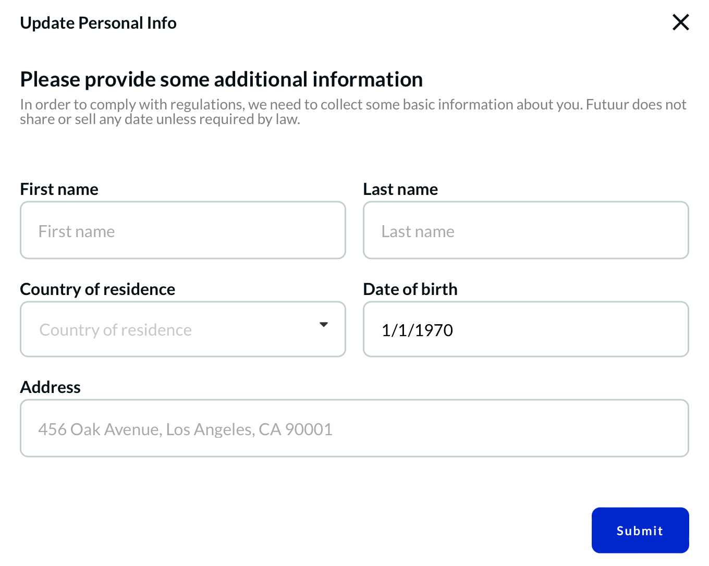
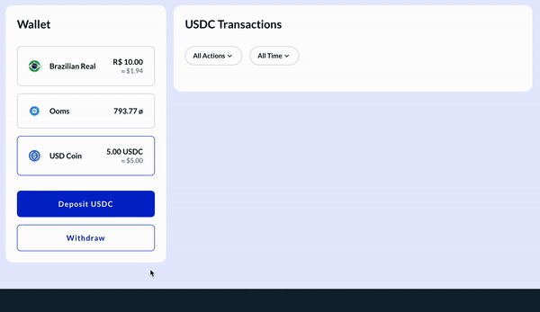
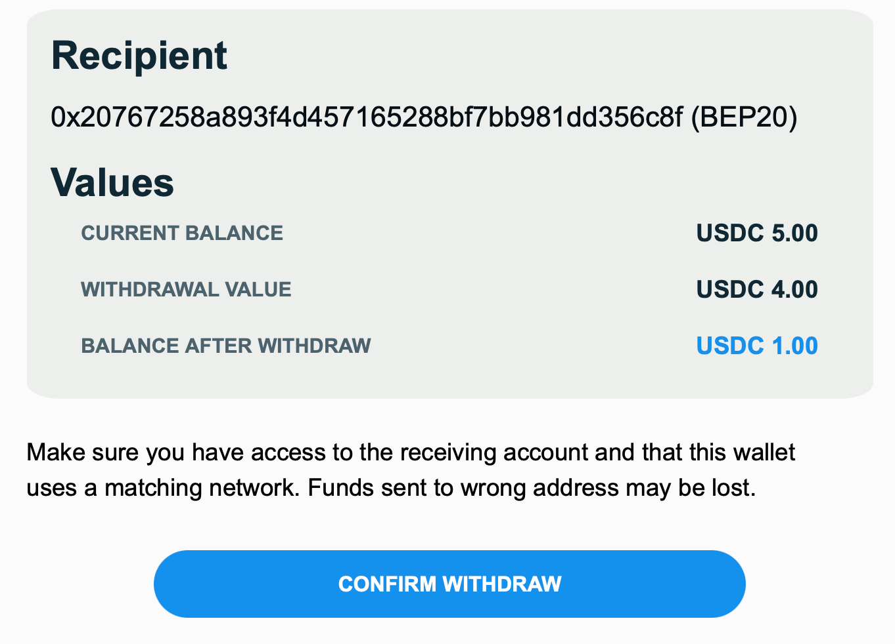
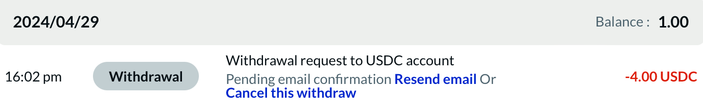

Esta página é dedicada aos processos, taxas, limites e regras para depositar e sacar dinheiro real da Futuur. Leia mais se você deseja usar a plataforma para lucrar com suas previsões.

## Como faço um depósito?

Uma vez que você [crie sua conta](/pt-br/help/create-your-account) e [verifique seu endereço de e-mail](/pt-br/help/create-your-account), você pode fazer seu primeiro depósito em dinheiro real. Para isso, selecione “Dinheiro Real” no seletor de moeda e clique em “Depositar”.

{/* TODO: é preciso gravar a tela de novo. A gravação antiga (01.gif, abril de 2024) mostra a tela de depósito anterior. */}

### Complete suas informações pessoais

Se esta for a primeira vez que você faz um depósito, será necessário completar suas informações pessoais.

Preencha o formulário, certificando-se de que não está usando a Futuur em uma jurisdição onde as apostas em dinheiro real são proibidas (verifique a lista de países restritos [aqui](/pt-br/help/license-and-jurisdiction)). Depois de completar o formulário, clique em “Enviar”.

### Escolha a rede e envie USDC

Os depósitos são feitos em **USDC**. (Se você ainda não possui criptomoedas, consulte [esta seção](/pt-br/help/understanding-currencies) da nossa Central de Ajuda para saber onde obtê-las.)

{/* TODO: é preciso gravar a tela de novo. A gravação antiga (03.gif, abril de 2024) mostra um seletor de moedas que não existe mais. */}

**1. Escolha a rede.** A Futuur mostra as redes que você pode usar para enviar USDC. Uma delas já vem selecionada, e a rede com a menor taxa aparece marcada como “Mais barato”. Escolha a rede a partir da qual você vai enviar e clique em **Continuar**.

**2. Envie USDC para o seu endereço.** A tela seguinte mostra o seu endereço pessoal de depósito na Futuur para essa rede, em código QR e em texto. Clique em **Copiar Endereço** e cole-o como destino na sua carteira ou corretora, ou escaneie o código QR se a sua carteira permitir. Se você escolheu a rede errada, clique em **Trocar rede** para voltar.

É **absolutamente essencial** que a rede selecionada na Futuur seja a mesma rede que você seleciona ao enviar os fundos da sua carteira ou corretora.

<Warning>
  Envie apenas USDC, e apenas pela rede mostrada na tela de depósito. Se você enviar outro token, ou usar uma rede diferente da selecionada, seus fundos podem ser perdidos. É assim que as redes blockchain funcionam, e a Futuur não consegue reverter uma transferência.

  Por favor, confira a rede nas duas pontas antes de enviar seus fundos para a Futuur.

  Se você já enviou fundos pela rede errada, escreva para [support@futuur.com](mailto:support@futuur.com) com o ID da transação, a rede usada e o valor. Vamos analisar o caso, mas não podemos prometer que os fundos serão recuperados.
</Warning>

<Tip>
  Lembre-se de que diferentes criptomoedas, redes e carteiras cobram taxas diferentes para transferir cripto. Por favor, compare suas opções antes de configurar sua transferência.

  A Futuur não cobra nenhuma taxa para receber fundos. Para verificar nossas taxas de saque, consulte [esta seção](/pt-br/help/deposits-and-withdrawals).
</Tip>

## Quanto tempo leva para um depósito ser concluído?

Os depósitos normalmente são creditados poucos minutos depois de confirmados na rede. O tempo de confirmação depende da rede escolhida, não da Futuur.

Avisamos você por e-mail quando os fundos chegarem, e você pode fechar a janela de depósito enquanto espera. Mantenha a Futuur na sua lista de remetentes seguros e verifique sua pasta de spam se não receber notícias nossas.

## Existe um valor mínimo para depósitos?

Não há valor mínimo para depósitos. No entanto, para evitar transações fraudulentas e de spam, qualquer transferência abaixo de 0,01 USDC é tratada como spam e não é creditada na sua conta.

## Existe um valor máximo para depósitos?

Não há valor máximo para depósitos na Futuur. No entanto, se seus depósitos acumulados ao longo da vida excederem o equivalente a \$2.000 USD, a Futuur se reserva o direito de exigir prova de identidade e endereço dos previsores que utilizam dinheiro real como parte dos requisitos KYC (Conheça seu Cliente) legalmente exigidos. Desculpe, nós não fazemos as regras!

## Como faço para sacar da minha carteira?

Vá para sua carteira na Futuur em [https://futuur.com/p/wallet](https://futuur.com/p/wallet) e selecione a moeda que deseja sacar no lado esquerdo. Clique em “Sacar” e preencha as informações para cada tipo de saque.

### Inicie o pedido

Insira o valor que deseja sacar, selecione a rede que deseja usar (preste atenção nas taxas para usar cada rede, conforme descrito [aqui](/pt-br/help/deposits-and-withdrawals)) e forneça o endereço onde gostaria de receber os fundos. Observe que este deve ser o endereço público da sua carteira para a criptomoeda solicitada e que deve ser compatível com a rede selecionada.

<Warning>
  A Futuur não pode controlar fundos enviados para o endereço errado, então certifique-se de verificar duas vezes se o endereço e a rede selecionada estão corretos.
</Warning>

### Confirme o pedido

Por motivos de segurança, após clicar em “Enviar”, você receberá um e-mail pedindo para confirmar o saque. Por favor, confira a sua caixa de entrada para abrir a mensagem, verificar as informações e aprovar o pedido clicando no botão “Confirmar Saque”.

Você tem 48 horas para confirmar o pedido de saque. Depois disso, ele será automaticamente cancelado e você terá que iniciar um novo pedido.

Se você quiser fazer alterações em um pedido que já iniciou, volte à sua carteira, encontre o pedido de saque e clique em “Cancelar este saque”.

### Aguarde a chegada dos seus fundos

A Futuur revisará manualmente todos os pedidos confirmados dentro de 24 horas e os enviará para a rede para processamento. Você será notificado quando nosso processo de revisão terminar e deverá receber seus fundos em breve.

## Quanto tempo leva para um saque ser concluído?

Atualmente, revisamos manualmente todas as solicitações de saque, geralmente dentro de 24 horas. Uma vez revisada e aprovada, seus fundos serão enviados para o endereço indicado e devem chegar em menos de 30 minutos. O tempo real para a chegada do dinheiro depende da velocidade de processamento da rede, não da Futuur.

## Existe um valor mínimo para saques?

O valor mínimo de saque depende da rede escolhida.

### Saques mínimos para criptomoedas

| Moeda | Rede | Valor Mínimo de Saque |
| --- | --- | --- |
| USDC | Ethereum (ERC20) | 10 USDC |
| USDC | BNB Smart Chain (BEP20) | 1 USDC |
| USDC | Polygon | 1 USDC |
| USDC | Solana | 1 USDC |

## Existe um valor máximo para saques?

Não há valor máximo para saques na Futuur. No entanto, se seus saques acumulados ao longo da vida excederem o equivalente a \$2.000 USD, a Futuur se reserva o direito de exigir prova de identidade e endereço dos previsores que utilizam dinheiro real como parte dos requisitos KYC (Know Your Customer) legalmente exigidos. Desculpe, nós não fazemos as regras!

## Quais taxas estão envolvidas nos saques da Futuur?

### Taxas para sacar cripto

| Moeda | Rede | Taxa de Saque |
| --- | --- | --- |
| USDC | Ethereum (ERC20) | 5 USDC |
| USDC | BNB Smart Chain (BEP20) | Sem taxa |
| USDC | Polygon | Sem taxa |
| USDC | Solana | Sem taxa |

Para economizar nas taxas de saque, recomendamos escolher uma opção com taxa mais baixa.

<Tip>
  Embora seja possível escolher redes diferentes no momento de depositar e de sacar a mesma moeda, recomendamos fortemente usar a mesma rede em ambos os momentos. Manter uma única rede para todas as suas atividades na Futuur com uma moeda específica pode acelerar o tempo de processamento dos seus depósitos e saques dessa moeda.
</Tip>

## Posso sacar Ooms? Posso converter Ooms em outra moeda?

Não, e não. Ooms são como pontos de reputação, eles representam sua habilidade como previsor. A única maneira de ganhar mais Ooms é fazendo previsões melhores. 🙂
