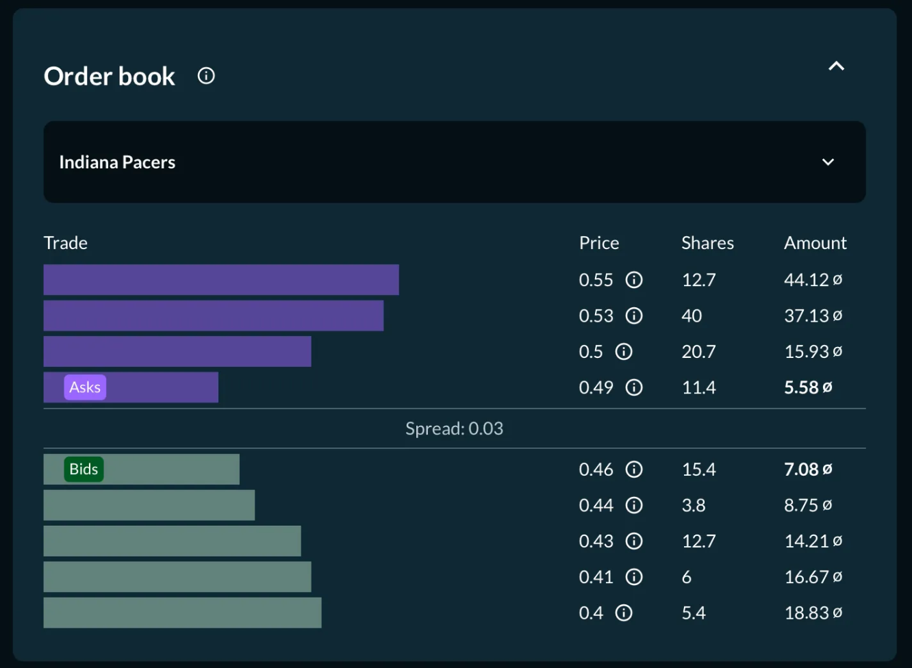
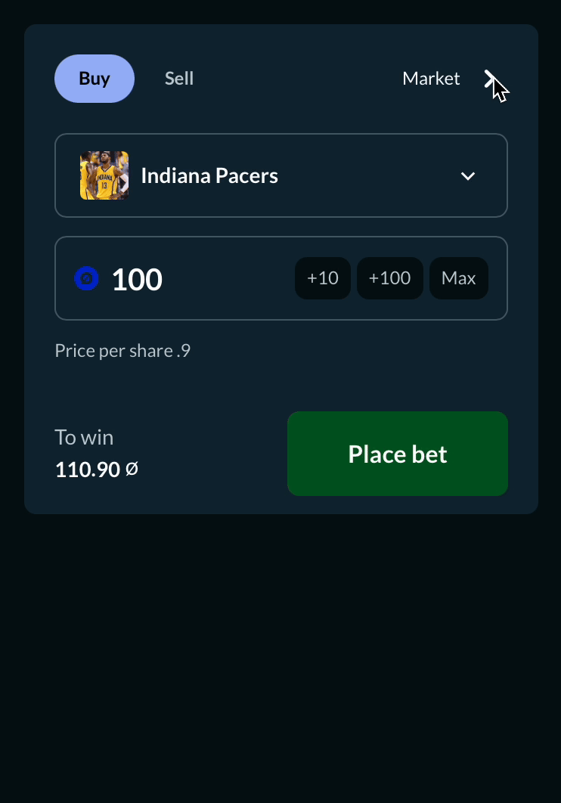

Saiba tudo sobre o novo motor de negociação da Futuur. Aqui mostramos como funciona a abordagem híbrida **Livro de Ordens + [Formador de Preços Automatizado (Automated Market Maker, ou AMM)](/pt-br/help/automated-market-maker)**, por que ela é importante e como você pode aproveitá‑la.

## O que é um Livro de Ordens?

Um **livro de ordens** é um registro em tempo real das intenções de **compra** e **venda** de um mercado. É o formato mais tradicional usado em estruturas já consolidadas de negociação, como:

- **Bolsas de valores:** livros de ordens eletrônicos casam milhões de operações por segundo. Quando você lança uma ordem limitada para comprar ações da Apple a US\$ 180, por exemplo, ela fica na fila até que um vendedor aceite.
- **Corretoras de cripto:** utilizam o mesmo mecanismo para casar ofertas (bids) e pedidos (asks) de Bitcoin, Ethereum e milhares de tokens.
- **Mercado cambial (Forex)** e **futuros de commodities:** também rodam sobre livros de ordens, fornecendo transparência de oferta e demanda em mesas de trading globais.

Sempre que compradores e vendedores precisam se encontrar em tempo real, o livro de ordens é o quadro de avisos digital que mostra **quem está disposto a negociar a qual preço** e permite ao motor de casamentos uni‑los de forma eficiente. Cada linha do livro de ordens da Futuur é composta por:

| Coluna | Significado |
| --- | --- |
| **Tipo de Ordem (Trade)** | **Ofertas de Compra (Bids)** = alguém quer comprar nesse preço. **Ofertas de Venda (Asks)** = alguém quer vender nesse preço. |
| **Preço (Price)** | Preço pelo qual 1 cota desse resultado está listada |
| Cotas (Shares) | Quantidade de shares oferecidas a esse preço |
| **Montante (Amount)** | Valor total da soma de todas as shares listadas até esse preço |

As ordens são ranqueadas para que o *melhor bid* (maior preço de compra) e o *melhor ask* (menor preço de venda) fiquem próximos. Juntos, eles indicam **onde os traders enxergam o “preço justo”**.

> No exemplo acima:
>
> - **Melhor bid** = oferta de 7,08 ø para comprar 15,4 shares de “Indiana Pacers” a 0,46 ø por share.
> - **Melhor ask** = pedido de 5,58 ø para vender 11,4 shares de “Indiana Pacers” a 0,49 ø por share.
>
> **Para compradores:**
>
> - Qualquer *ordem a mercado* de até 5,58 ø será executada integralmente a 0,49 ø/share.
> - Uma ordem de até 15,93 ø será parcialmente executada a 0,49 ø/share (5,58 ø no total) e o restante a 0,50 ø/share.
> - Uma ordem de até 37,13 ø será executada em três níveis de preço: 0,49 ø/share (5,58 ø), 0,50 ø/share (10,35 ø) e 0,53 ø/share (restante).
> - E assim por diante, até que a ordem seja totalmente executada ou não existam mais Asks.
>
> **Para vendedores:**
>
> - Uma *ordem de venda a mercado* de até 7,08 ø será executada integralmente a 0,46 ø/share.
> - Uma ordem de até 8,75 ø será parcialmente executada a 0,46 ø/share (7,08 ø no total) e o restante a 0,44 ø/share.
> - Uma ordem de até 14,21 ø será executada em três níveis de preço: 0,46 ø/share (7,08 ø), 0,44 ø/share (1,67 ø) e 0,43 ø/share (restante).
> - E assim por diante, até que a ordem seja totalmente executada ou não existam mais Bids.

## Como funciona o modelo híbrido Livro de Ordens + AMM da Futuur?

A Futuur agora combina a precisão de um livro de ordens tradicional com a liquidez contínua de um **[Automated Market Maker (AMM)](/pt-br/help/automated-market-maker)**.

1. **Você envia uma ordem** (geralmente *a mercado*).

2. O **motor de casamentos verifica o livro de ordens**:

   *Se houver ordens compatíveis, elas são executadas primeiro — exatamente nos preços listados.*

3. **Fallback para o AMM:** qualquer quantidade restante é enviada ao AMM, que cota um preço de acordo com a curva e completa a transação instantaneamente.

4. **Os saldos do pool são atualizados** e o livro de ordens é atualizado para o público.

**Por que isso é poderoso?**

*✓ Negociações sem slippage* quando o livro tem profundidade.

*✓ Execução garantida* quando não há contraparte.

✓ O trader escolhe entre precisão (ordem limitada) e velocidade (ordem a mercado) conforme a necessidade.

## O que é uma Ordem a Mercado?

Uma **ordem a mercado** diz: *“Execute* ***agora*** *pelo melhor preço disponível.”*

- **Roteiro:** consome primeiro o livro de ordens.
- **Rede de segurança AMM:** qualquer saldo remanescente é executado pelo AMM.
- **Use quando:** rapidez é mais importante que preço exato.

**Exemplo:**

Você envia uma ordem a mercado de 100 ø para comprar shares de “Indiana Pacers”. No Livro de Ordens há Asks somando 44,12 ø. Esses 44,12 ø são executados aos preços exibidos. O AMM então preenche os 55,88 ø restantes a partir de 0,55 ø/share, subindo progressivamente conforme a profundidade do pool.

## O que é uma Ordem Limite?

Uma **ordem limite** permite que você defina o preço *exato* que deseja. Ela *nunca* será executada a um preço pior.

- **Good‑til‑Expired (GTE):** por padrão, sua ordem fica viva até o mercado se encerrar ou você cancelá‑la.
- **Expiração personalizada:** defina data/hora para cancelar a ordem automaticamente se não for casada.
- **Execução parcial:** sua ordem pode ser preenchida em partes, conforme surgem contrapartes.

## O que é o Spread?

**Spread** = *melhor ask* − *melhor bid*.

- **Spread apertado** (ex.: 0,01 ø) → alta liquidez, forte consenso de preço.
- **Spread largo** (ex.: 0,15 ø) → mercado raso, maior incerteza.

Traders reduzem o spread postando ordens limite dentro da lacuna entre as pontas. Quanto menor o spread, menor o custo de negociar e mais nítidas ficam as previsões.

## Como faço uma aposta usando o Livro de Ordens?

1. **Abra qualquer mercado** e selecione a alternativa em que quer apostas (SIM/NÃO, por exmeplo).
2. Escolha **Mercado** ou **Limite** no seletor no canto superior direito.
3. **Digite a quantidade** (e o preço, se for limite).
4. *(Opcional)* defina **data de expiração** para ordens limite.
5. **Revise** o **preço médio por cota** (se mercado) ou o **máximo a pagar/mínimo a receber** (se limite).
6. Clique em **Place Bet** (mercado) ou **Place Order** (limite).
7. Acompanhe apostas ativas e ordens abertas na seção “Suas apostas neste mercado”. Você pode cancelar ou editar ordens limite a qualquer momento antes de elas serem casadas.

Exemplo de ordem a mercado:

Exemplo de ordem limite:

## O que acontece se o Livro de Ordens estiver vazio? Ainda posso negociar?

Sem dúvida. Se não houver bids ou asks que atendam à sua quantidade/preço, o **AMM entra em ação automaticamente**:

- **Sempre cota um preço** com base no saldo atual do pool.
- **Executa 100 % da sua ordem a mercado** instantaneamente.
- **Ordens limite** permanecem no livro até aparecer uma contraparte *ou* expirarem.

Na prática, você **nunca fica travado** — mesmo em mercados novos ou de baixo volume. O AMM mantém a liquidez; o livro de ordens garante a eficiência.
