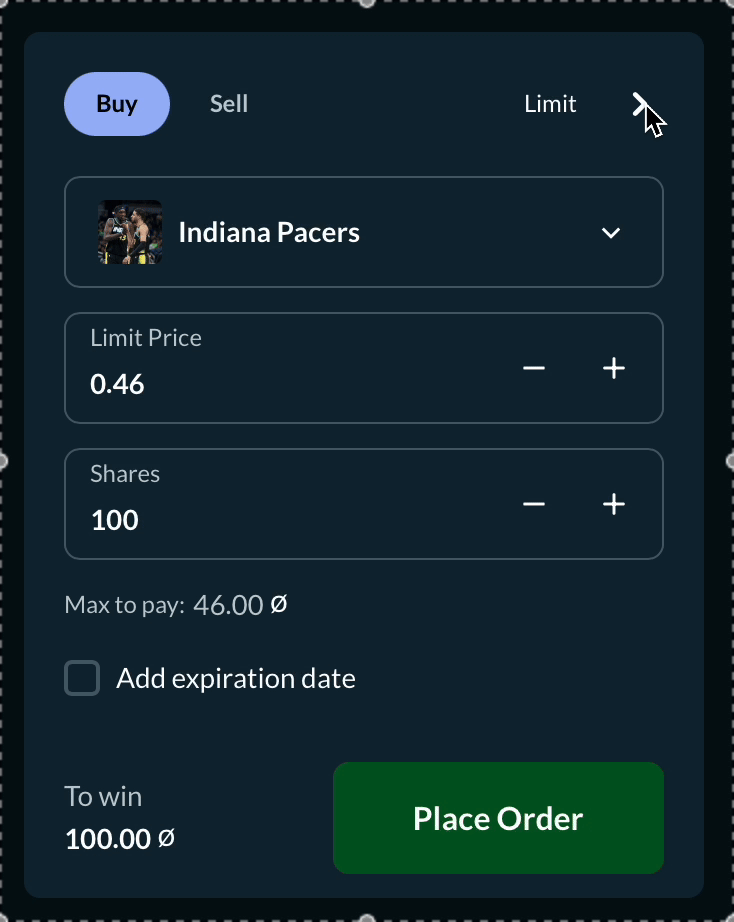

Saiba como funciona a negociação na Futuur. Toda operação acontece no **livro de ordens** do mercado. O [Formador de Mercado Automatizado (Automated Market Maker, ou AMM)](/pt-br/help/automated-market-maker) da Futuur participa desse livro como qualquer outro trader, colocando suas próprias ordens de compra e de venda.

## O que é um Livro de Ordens?

Um **livro de ordens** é um registro em tempo real das intenções de **compra** e **venda** de um mercado. É o formato mais tradicional usado em estruturas já consolidadas de negociação, como:

- **Bolsas de valores:** livros de ordens eletrônicos casam milhões de operações por segundo. Quando você lança uma ordem limitada para comprar ações da Apple a US\$ 180, por exemplo, ela fica na fila até que um vendedor aceite.
- **Corretoras de cripto:** utilizam o mesmo mecanismo para casar ofertas (bids) e pedidos (asks) de Bitcoin, Ethereum e milhares de tokens.
- **Mercado cambial (Forex)** e **futuros de commodities:** também rodam sobre livros de ordens, fornecendo transparência de oferta e demanda em mesas de trading globais.

Sempre que compradores e vendedores precisam se encontrar em tempo real, o livro de ordens é o quadro de avisos digital que mostra **quem está disposto a negociar a qual preço** e permite ao motor de casamentos uni‑los de forma eficiente. Cada linha do livro de ordens da Futuur é composta por:

| Coluna | Significado |
| --- | --- |
| **Tipo de Ordem (Trade)** | **Ofertas de Compra (Bids)** = alguém quer comprar nesse preço. **Ofertas de Venda (Asks)** = alguém quer vender nesse preço. |
| **Preço (Price)** | Preço pelo qual 1 cota desse resultado está listada |
| Cotas (Shares) | Quantidade de shares oferecidas a esse preço |
| **Montante (Amount)** | Valor total da soma de todas as shares listadas até esse preço |

As ordens são ranqueadas para que o *melhor bid* (maior preço de compra) e o *melhor ask* (menor preço de venda) fiquem próximos. Juntos, eles indicam **onde os traders enxergam o “preço justo”**.

> No exemplo acima:
>
> - **Melhor bid** = oferta de 7,08 ø para comprar 15,4 shares de “Indiana Pacers” a 0,46 ø por share.
> - **Melhor ask** = pedido de 5,58 ø para vender 11,4 shares de “Indiana Pacers” a 0,49 ø por share.
>
> **Para compradores:**
>
> - Qualquer *ordem a mercado* de até 5,58 ø será executada integralmente a 0,49 ø/share.
> - Uma ordem de até 15,93 ø será parcialmente executada a 0,49 ø/share (5,58 ø no total) e o restante a 0,50 ø/share.
> - Uma ordem de até 37,13 ø será executada em três níveis de preço: 0,49 ø/share (5,58 ø), 0,50 ø/share (10,35 ø) e 0,53 ø/share (restante).
> - E assim por diante, até que a ordem seja totalmente executada ou não existam mais Asks.
>
> **Para vendedores:**
>
> - Uma *ordem de venda a mercado* de até 7,08 ø será executada integralmente a 0,46 ø/share.
> - Uma ordem de até 8,75 ø será parcialmente executada a 0,46 ø/share (7,08 ø no total) e o restante a 0,44 ø/share.
> - Uma ordem de até 14,21 ø será executada em três níveis de preço: 0,46 ø/share (7,08 ø), 0,44 ø/share (1,67 ø) e 0,43 ø/share (restante).
> - E assim por diante, até que a ordem seja totalmente executada ou não existam mais Bids.

## Como o Livro de Ordens e o AMM funcionam juntos?

Existe um livro de ordens por mercado, e toda operação é o casamento de duas ordens dentro dele.

O [Automated Market Maker (AMM)](/pt-br/help/automated-market-maker) da Futuur é uma conta operada pela Futuur que coloca suas próprias ordens de compra e de venda no livro, em vários preços. Para você, elas aparecem como qualquer outra ordem. Muitas vezes é contra elas que você negocia quando nenhum outro usuário tem uma ordem a um preço melhor.

Quando você envia uma ordem:

1. **O motor de casamento olha as ordens do outro lado do livro**, começando pelo melhor preço.
2. **No mesmo preço, a ordem de outro usuário é executada antes da ordem do AMM.** Entre usuários, a ordem mais antiga é executada primeiro.
3. **Sua ordem é executada contra essas ordens, nos preços listados,** até ser concluída ou até não haver mais nada compatível.
4. **O livro de ordens e os preços do mercado são atualizados.**

**O que isso significa para você**

- Você sempre negocia a preços visíveis no livro. Não existe um preço separado ou escondido.
- Você pode colocar suas próprias ordens no livro e esperar que alguém as aceite (veja Ordem Limite abaixo).
- O AMM não promete executar qualquer ordem de qualquer tamanho. Ele só executa o que as ordens dele no livro cobrem.

## O que é uma Ordem a Mercado?

Uma **ordem a mercado** diz: *“Execute* ***agora*** *pelos melhores preços disponíveis.”*

- **Como é executada:** consome primeiro as ordens de melhor preço no livro, depois as seguintes, e assim por diante. Quanto mais você compra, maior pode ser o seu preço médio.
- **Nunca fica esperando no livro.** O que não puder ser casado na hora é cancelado, e você fica com o dinheiro ou as shares dessa parte.
- **Use quando:** rapidez é mais importante que preço exato.

**Exemplo:**

Você envia uma ordem a mercado de 30 ø para comprar shares de “Indiana Pacers”. O melhor Ask é 0,49 ø/share, com 5,58 ø disponíveis nesse preço; os primeiros 5,58 ø são executados ali. Os 10,35 ø seguintes são executados a 0,50 ø/share, e os 14,07 ø restantes a 0,53 ø/share. Seu preço médio fica entre 0,49 ø e 0,53 ø.

Se a sua ordem fosse maior do que tudo o que está à venda no livro, a parte que não pudesse ser casada seria cancelada.

## O que é uma Ordem Limite?

Uma **ordem limite** permite que você defina o preço *exato* que deseja. Ela *nunca* será executada a um preço pior.

- **Fica no livro por padrão:** sua ordem limite continua ativa até ser executada, você cancelá‑la ou o mercado fechar para apostas. Ordens ainda abertas quando o mercado fecha são canceladas.
- **Expiração personalizada:** você pode definir data e hora a partir das quais a parte não executada da ordem é cancelada automaticamente.
- **Execução parcial:** sua ordem pode ser preenchida em partes, conforme surgem contrapartes.

## O que é o Spread?

**Spread** = *melhor ask* − *melhor bid*.

- **Spread apertado** (ex.: 0,01 ø) → alta liquidez, forte consenso de preço.
- **Spread largo** (ex.: 0,15 ø) → mercado raso, maior incerteza.

Traders reduzem o spread postando ordens limite dentro da lacuna entre as pontas. Quanto menor o spread, menor o custo de negociar e mais nítidas ficam as previsões.

## Como faço uma aposta usando o Livro de Ordens?

1. **Abra qualquer mercado** e selecione a alternativa em que quer apostas (SIM/NÃO, por exmeplo).
2. Escolha **Mercado** ou **Limite** no seletor no canto superior direito.
3. **Digite a quantidade** (e o preço, se for limite).
4. *(Opcional)* defina **data de expiração** para ordens limite.
5. **Revise** o **preço médio por cota** (se mercado) ou o **máximo a pagar/mínimo a receber** (se limite).
6. Clique em **Place Bet** (mercado) ou **Place Order** (limite).
7. Acompanhe apostas ativas e ordens abertas na seção “Suas apostas neste mercado”. Você pode cancelar ou editar ordens limite a qualquer momento antes de elas serem casadas.

Exemplo de ordem a mercado:

Exemplo de ordem limite:

## O que acontece se o Livro de Ordens estiver vazio? Ainda posso negociar?

Depende do tipo de ordem.

- **Ordens a mercado** precisam de ordens do outro lado do livro. Se não houver nenhuma, sua ordem a mercado é cancelada e nada é cobrado. Se houver algumas, mas não o suficiente, a parte compatível é executada e o restante é cancelado.
- **Ordens limite** sempre funcionam: sua ordem entra no livro e espera até alguém aceitá-la, você cancelá-la, ela expirar ou o mercado fechar.

O AMM normalmente mantém ordens de compra e de venda no livro, então costuma haver contra o que negociar. Isso não é garantido. As ordens do AMM têm tamanho limitado, e a Futuur pode reduzi-las ou retirá-las em qualquer mercado.

Se uma ordem a mercado não for executada, ou for executada a um preço pior do que você esperava, coloque uma ordem limite no preço que você quer.
