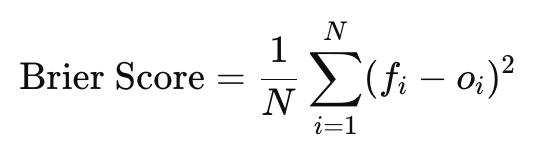
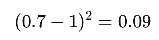
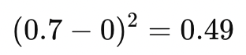

A Futuur não inventou os Mercados de Previsão — mas com certeza os tornou melhores e mais acessíveis para todos. Esta seção explica as ideias básicas, princípios e conceitos relacionados aos mercados de previsão em geral. Leia mais para entender seus objetivos, características e elementos fundamentais, antes de mergulhar na Futuur para colocar tudo em prática.

## O que é um mercado de previsão?

Um mercado de previsão é uma ferramenta de previsão que utiliza os princípios de um mercado financeiro para agregar informações e prever a probabilidade de eventos futuros.

Em um mercado de previsão, os participantes negociam contratos ou ações cujos pagamentos estão vinculados ao resultado de um evento futuro. Os preços dessas ações (também chamadas “shares”) atuam como previsões coletivas, refletindo a sabedoria coletiva e as crenças de todos os negociadores no mercado sobre a probabilidade de diferentes resultados ocorrerem.

A ideia central é que os mercados de previsão aproveitam a sabedoria das multidões e os incentivos à “revelação sincera” para produzir previsões precisas. Quando o evento se resolve, os negociadores que possuem ações do resultado realizado recebem pagamentos, enquanto as ações dos outros resultados tornam-se inúteis. Isso incentiva os negociadores a obter informações precisas e fazer negociações bem informadas, já que eles lucram com previsões precisas.

## Como funcionam os mercados de previsão?

Num mercado de previsão, os negociadores compram ações dos resultados que consideram mais prováveis e vendem ações dos resultados que consideram menos prováveis. À medida que negociam com base em suas próprias informações e incentivos, os preços das ações flutuam dinamicamente de acordo com as forças de oferta e demanda do mercado. Os preços de equilíbrio resultantes representam as crenças e informações agregadas de todos os participantes sobre as probabilidades dos vários resultados.

Aqui está uma visão geral de como isso funciona:

### Configuração do mercado

Um mercado de previsão é criado com um ou mais resultados relacionados a um evento futuro. Por exemplo, um mercado pode ser configurado para prever o vencedor de uma eleição futura, com resultados como "Candidato A vence" ou "Candidato B vence".

### Preços iniciais

O mercado começa com preços iniciais ou probabilidades atribuídas a cada resultado, geralmente com base em uma avaliação ou previsão inicial. Esses preços iniciais podem ser definidos pelos organizadores do mercado ou determinados por um mecanismo automatizado de formação de mercado.

### Negociação

Os participantes no mercado podem comprar ou vender ações representando os diferentes resultados. Quando um participante compra ações de um determinado resultado, ele está essencialmente apostando que esse resultado ocorrerá. Por outro lado, vender ações de um resultado implica a crença de que o resultado é menos provável de acontecer.

### Ajuste de preço

À medida que os participantes negociam ações, os preços dos diferentes resultados ajustam-se dinamicamente com base na oferta e demanda para cada resultado. Se mais pessoas estiverem comprando ações de um determinado resultado, o preço desse resultado aumentará, refletindo uma crença coletiva aumentada de que ele ocorrerá. Por outro lado, se mais pessoas estiverem vendendo ações de um resultado, seu preço cairá.

### Equilíbrio do mercado

O mercado continua a negociar até atingir um estado de equilíbrio, onde os preços dos diferentes resultados refletem a sabedoria ou previsão coletiva de todos os participantes no mercado.

### Resolução do mercado

Uma vez que o resultado real é conhecido (por exemplo, após a eleição), o mercado é resolvido. As ações do resultado que ocorreu são recompradas ao preço de 1 (ou 100%), enquanto as ações dos outros resultados tornam-se inúteis.

O princípio fundamental por trás dos mercados de previsão é que a atividade de negociação de muitos participantes, cada um com suas próprias informações e crenças, pode coletivamente agregar informações dispersas e fornecer previsões precisas sobre eventos futuros.

## Como é determinado o preço ou a probabilidade de um resultado em um mercado de previsão?

Em um mercado de previsão, existem duas abordagens principais para determinar os preços ou probabilidades dos diferentes resultados: a abordagem do [Livro de Ordens](/pt-br/help/order-book) e a abordagem do [Formador de Preços Automatizado (AMM)](/pt-br/help/automated-market-maker).

### Abordagem do Livro de Ordens

Essa abordagem é semelhante aos mercados financeiros tradicionais, onde compradores e vendedores enviam ordens para um livro de ordens, e os preços são determinados pela interseção da oferta e demanda. Ambas as abordagens visam incentivar a revelação de informações verdadeiras e agregar crenças dispersas em preços de mercado que podem fornecer estimativas precisas de probabilidade para resultados futuros. A Futuur adota uma abordagem híbrida que usa o AMM como mecanismo de segurança para mercados em que o Livro de Ordens seja insuficiente para garantir negociações imediatas.

- Os participantes enviam ordens de compra e venda de ações representando diferentes resultados.
- Um livro de ordens agrega essas ordens de compra e venda.
- O preço de mercado para cada resultado é determinado pela maior ordem de compra e pela menor ordem de venda que podem ser correspondidas no livro de ordens.
- À medida que mais ordens são enviadas, os preços ajustam-se dinamicamente com base na oferta e demanda para cada resultado.
- Os preços resultantes representam as probabilidades comercializadas coletivamente no mercado para os resultados.

### Abordagem do [Formador de Mercado Automatizado (AMM)](/pt-br/help/automated-market-maker)

Nesta abordagem, existe um mecanismo ou algoritmo de precificação automatizado predefinido que determina os preços dos resultados com base na atividade de negociação, em vez de um livro de ordens.

- O formador de mercado define uma curva ou função de precificação inicial que relaciona os preços dos resultados aos seus volumes ou quantidades de negociação.
- À medida que os participantes compram ou vendem ações de resultados, o AMM ajusta os preços de acordo com a função de precificação predefinida.
- Quanto mais ações de um resultado são compradas, mais alto seu preço se torna, refletindo a demanda aumentada e a crença de que o resultado ocorrerá.
- Por outro lado, vender ações de um resultado diminui seu preço, indicando uma percepção de probabilidade menor.
- O AMM garante que os preços de todos os resultados sempre somem 1 (ou 100%), representando uma distribuição de probabilidade adequada.

A abordagem do livro de ordens é mais descentralizada e reflete a negociação direta dos participantes, enquanto a abordagem do AMM depende de um mecanismo de precificação automatizado centralizado.

### Como calcular shares com o Formador de Mercado Automatizado (AMM) da Futuur?

Shares são calculadas considerando o investimento e a probabilidade. O cálculo é baseado em um modelo de formador de mercado automatizado (AMM) sensível à liquidez, projetado para adaptar dinamicamente os preços das shares com base nos parâmetros do mercado.

Aqui está uma versão simplificada do cálculo usando a abordagem da função de custo:

1\. Investimento: A quantidade de dinheiro que você deseja investir.

2\. Probabilidade: A probabilidade do resultado no qual você está apostando.

3\. Função de Custo (FC): Uma função matemática que determina o custo com base no número de shares em cada resultado.

Para dois resultados possíveis num mercado, se você tiver o Resultado 1 ($o1$) com 100 shares e o Resultado 2 ($o2$) com 110 shares, e quiser comprar mais 20 shares de $o2$, o valor que você precisa pagar é calculado usando a função de custo da seguinte forma:

$$
\text{Amount} = FC(100, 110) - FC(100, 130)
$$

Isso significa que você calcula a função de custo para as shares iniciais e subtrai a função de custo para o novo total de shares após a compra.

A função de custo (FC) é geralmente definida como:

$$
FC(q_1, q_2) = b \cdot \log\left(e^{\frac{q_1}{b}} + e^{\frac{q_2}{b}}\right)
$$

onde $q_1$ e $q_2$ são as quantidades dos dois resultados, e $b$ é uma constante que ajusta a sensibilidade do preço à quantidade de shares.

Para obter mais informações detalhadas sobre o modelo matemático e os algoritmos utilizados, você pode consultar a [seção dedicada ao AMM](/pt-br/help/automated-market-maker) em nossa Central de Ajuda ou o [artigo sobre AMM sensível à liquidez](https://www.cs.cmu.edu/~sandholm/liquidity-sensitive%20automated%20market%20maker.teac.pdf).

## Como é medida a precisão das previsões nos mercados de previsão?

A precisão de um mercado está relacionada a quão bem as previsões coletivas do mercado se alinham com os resultados reais. Vários métodos são usados para avaliar essa precisão:

### Brier Score

Essa métrica mede a precisão das previsões probabilísticas. Ela calcula a diferença média quadrática entre as probabilidades previstas e os resultados reais. Um Brier Score menor indica maior precisão na previsão. Por exemplo, se um mercado prevê que há 70% de chance de um evento acontecer e ele realmente ocorre, a pontuação será menor do que se a propabilidade prevista tivesse sido de 60%, refletindo a precisão mais alta da previsão de 70%.

### Calibração

Isso avalia se as probabilidades previstas refletem a verdadeira probabilidade dos resultados. Por exemplo, se eventos previstos para ocorrer com 70% de probabilidade realmente ocorrem 70% das vezes em muitas instâncias, as previsões estão bem calibradas.

### Resolução

Essa métrica mede quão bem o mercado diferencia entre eventos que ocorrem e não ocorrem. Um mercado com alta resolução fornece probabilidades distintas que correspondem bem aos resultados reais.

## O que é o Brier Score?

O Brier Score é uma métrica específica usada para medir a precisão das previsões probabilísticas em mercados de previsão. Veja como funciona em mais detalhes:

### Cálculo

A Pontuação Brier calcula a diferença média quadrática entre as probabilidades previstas e os resultados reais. Ela é dada pela fórmula:

onde:

*N* é o número de previsões.

𝑓𝑖 é a probabilidade prevista do evento ocorrer.

𝑜𝑖 é o resultado real (1 se o evento ocorrer, 0 se não ocorrer).

### Interpretação

A Pontuação Brier varia de 0 a 1, onde 0 indica precisão perfeita (todas as previsões estão corretas) e 1 indica a pior precisão possível (todas as previsões estão incorretas). Uma Pontuação Brier menor indica maior precisão na previsão.

Exemplo: Suponha que um mercado preveja que há 70% de chance de chover amanhã, e chove. O erro de previsão para este único evento seria:

Se não chover, o erro seria:

Ao calcular a média desses erros ao longo de muitas previsões, o Brier Score fornece uma medida abrangente de precisão.

## Quais são os valores típicos de Brier Score para previsões boas, ruins e excelentes?

Aqui está uma tabela que ajuda a interpretar os diferentes valores da Pontuação Brier:

| Faixa do Brier Score | Qualidade da Previsão | Descrição |
| --- | --- | --- |
| Abaixo de 0,1 | Excelente | Previsões são muito próximas dos resultados reais. |
| Entre 0,1 e 0,15 | Muito Boa | Previsões são geralmente precisas com pequenas discrepâncias. |
| Entre 0,15 e 0,2 | Boa | Previsões são razoavelmente precisas, mas com alguns erros. |
| Acima de 0,2 | Ruim | Previsões são significativamente imprecisas. |

## Quais fatores podem afetar a precisão das previsões nos mercados?

Vários fatores podem influenciar a precisão das previsões em um mercado:

### Disponibilidade de Informações

A qualidade e a atualidade das informações disponíveis para os participantes são cruciais. Quanto mais relevantes e atualizadas forem as informações, mais precisas tendem a ser as previsões. Por exemplo, se novas informações sobre uma eleição iminente são divulgadas, o mercado pode rapidamente ajustar suas previsões para refletir isso.

### Diversidade de Participantes

Um grupo diversificado de participantes traz uma ampla gama de perspectivas e conhecimentos. Essa diversidade ajuda a equilibrar os vieses e leva a previsões coletivas mais precisas. Por exemplo, ter participantes de diferentes regiões geográficas pode fornecer insights variados sobre eventos globais.

### Liquidez do Mercado

Maior liquidez, ou seja, mais atividade de compra e venda de ações, permite uma melhor descoberta de preços. Quando há mais transações, os preços (probabilidades previstas) refletem a verdadeira probabilidade dos eventos de forma mais precisa. Baixa liquidez pode levar a volatilidade e previsões menos confiáveis.

## Como os participantes podem melhorar a precisão de suas previsões?

Os participantes podem melhorar a precisão de suas previsões adotando várias estratégias:

- **Manter-se informado:** Acompanhar as últimas notícias e desenvolvimentos relacionados aos eventos que estão prevendo. Informações confiáveis e oportunas são fundamentais para fazer previsões precisas.
- **Considerar múltiplas fontes:** Consultar uma variedade de fontes de informação para obter uma visão abrangente. Isso ajuda a evitar o viés que pode surgir ao confiar em uma única fonte.
- **Estar ciente dos vieses:** Reconhecer e mitigar os vieses pessoais que podem afetar o julgamento. Por exemplo, decisões emocionais ou excesso de confiança podem levar a previsões imprecisas.
- **Engajar-se com outros:** Discutir previsões e insights com outros participantes do mercado. Isso pode fornecer novas perspectivas e ajudar a refinar previsões individuais. Ambientes colaborativos frequentemente levam a melhores resultados devido à inteligência coletiva do grupo.

## Existem limitações para a precisão dos mercados de previsão?

Sim, os mercados de previsão têm algumas limitações que podem afetar sua precisão:

### Comportamento de Manada

Às vezes, os participantes podem seguir a multidão em vez de tomar decisões independentes. Isso pode levar a previsões imprecisas se a multidão estiver errada.

### Assimetria de Informação

Alguns participantes podem ter acesso a mais ou melhores informações do que outros, criando um desequilíbrio. Isso pode tornar as previsões do mercado menos justas e menos precisas para aqueles que não têm as mesmas informações.

### Manipulação de Mercado

Indivíduos ou grupos podem tentar influenciar os preços do mercado para ganho pessoal, o que pode distorcer as previsões. Por exemplo, alguém pode espalhar informações falsas para afetar o resultado do mercado a seu favor.

Compreendendo esses fatores e limitações, os participantes podem navegar melhor pelos mercados de previsão e contribuir para previsões mais precisas.
