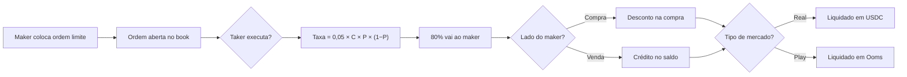

> 💡 A Futuur recompensa quem oferece liquidez em todos os mercados, de forma automática e instantânea. Quando um taker executa sua ordem em aberto, 80% da taxa volta para você como rebate de maker.

## Resumo

| Feature | Details |
| --- | --- |
| % de restituição | **80% da taxa do taker** |
| Momento do pagamento | **Instantâneo** — no momento em que o match acontece |
| Makers de compra | Aplicado como desconto na compra |
| Makers de venda | Adicionado como valor ao saldo da conta |
| Ativo de liquidação | USDC (dinheiro real) · Ooms (dinheiro de jogo) |
| Exibição no portfólio | Unificado em **USD** (dinheiro real) · **Ooms** (dinheiro de jogo) |
| Exibição por transação | Ativo real utilizado — USDC ou Ooms |
| Quem pode participar | Todos — sem inscrição, sem volume mínimo |

## Por que restituições para makers?

Mais liquidez beneficia todo mundo: spreads menores, menor impacto no preço, execuções mais confiáveis e resiliência em momentos de volatilidade. As restituições de maker incentivam cotações consistentes e competitivas, tornando o mercado melhor para todos.

## Como funciona

Quando um taker executa sua ordem em aberto, 80% da taxa do taker é creditada para você instantaneamente — sem espera, sem acúmulo, sem inscrição.

### O fluxo do match

## Onde acompanhar os valores

| Onde encontrar | Detalhes | Moeda exibida |
| --- | --- | --- |
| Minhas Posições → aba Transações | Por mercado · vinculado à operação original | Ativo real — USDC ou Ooms |
| **Portfolio** | Resumo agregado de todos os mercados | USD (dinheiro real) · Ooms (dinheiro de jogo) |
| Carteira | Extrato geral da conta · cada rebate como entrada própria | Ativo real — USDC ou Ooms |

> ℹ️ Regra prática: o Portfólio unifica o dinheiro real em USD para uma visão única; nos demais lugares, o ativo real é exibido.

## Elegibilidade

- ✅ Todos os mercados — políticos, esportes, cripto ou qualquer outra categoria
- ✅ Todos os usuários — sem volume mínimo, sem inscrição, sem whitelist
- ✅ Dinheiro real e fictício — mesmas regras, moedas diferentes (USDC ou Ooms)

🎯 **Como ganhar:** coloque uma ordem limite que fique aberta no book e seja executada por um taker. Só isso.

## Estrutura de taxas

A taxa do taker é calculada pela mesma fórmula em todos os mercados:

$$
taxa=0,05×C×P×(1−P)
$$

- **P** = preço da share (ex.: 50 centavos = 0,5)
- **C** = número de contratos

A taxa é máxima quando P = 0,50 e diminui simetricamente em direção a 0 e 1.

80% da taxa do taker vai para o maker como restituição — seja como desconto na compra (quando se trata de executar uma ordem de compra) ou como crédito na carteira da Futuur (quando foi executada uma ordem de venda). Em mercados de dinheiro real, a liquidação é em USDC; em mercados de dinheiro fictício, em Ooms.

### Exemplo de tabela de taxas (100 contratos)

| Preço (P) | Contratos (C) | Taxa total | Preço (P) | Contratos (C) | Taxa total |
| --- | --- | --- | --- | --- | --- |
| \$0.01 | 100 | \$0.0495 | \$0.55 | 100 | \$1.2375 |
| \$0.05 | 100 | \$0.2375 | \$0.60 | 100 | \$1.2 |
| \$0.10 | 100 | \$0.45 | \$0.65 | 100 | \$1.1375 |
| \$0.15 | 100 | \$0.6375 | \$0.70 | 100 | \$1.05 |
| \$0.20 | 100 | \$0.8 | \$0.75 | 100 | \$0.9375 |
| \$0.25 | 100 | \$0.9375 | \$0.80 | 100 | \$0.8 |
| \$0.30 | 100 | \$1.05 | \$0.85 | 100 | \$0.6375 |
| \$0.35 | 100 | \$1.1375 | \$0.90 | 100 | \$0.45 |
| \$0.40 | 100 | \$1.2 | \$0.95 | 100 | \$0.2375 |
| \$0.45 | 100 | \$1.2375 | \$0.99 | 100 | \$0.0495 |
| **\$0.50** | **100** | **\$1.25 ← máx** |   |   |   |

> 📌 P = 0,50 é o ponto de taxa máxima. Os valores acima estão em USD para mercados de dinheiro real e se aplicam de forma idêntica em Ooms nos mercados de dinheiro fictício.
