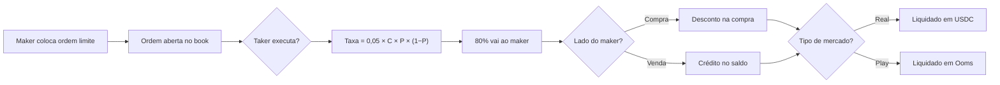

> 💡 A Futuur recompensa quem oferece liquidez em todos os mercados, de forma automática e instantânea. Quando um taker executa sua ordem em aberto, 80% da taxa volta para você como rebate de maker.

## Resumo

| Feature | Details |
| --- | --- |
| % de restituição | **80% da taxa do taker** |
| Momento do pagamento | **Instantâneo** — no momento em que o match acontece |
| Makers de compra | Aplicado como desconto na compra |
| Makers de venda | Adicionado como valor ao saldo da conta |
| Ativo de liquidação | USDC (dinheiro real) · Ooms (dinheiro de jogo) |
| Exibição no portfólio | Unificado em **USD** (dinheiro real) · **Ooms** (dinheiro de jogo) |
| Exibição por transação | Ativo real utilizado — USDC ou Ooms |
| Quem pode participar | Todos — sem inscrição, sem volume mínimo |

## Por que restituições para makers?

Mais liquidez beneficia todo mundo: spreads menores, menor impacto no preço, execuções mais confiáveis e resiliência em momentos de volatilidade. As restituições de maker incentivam cotações consistentes e competitivas, tornando o mercado melhor para todos.

## Como funciona

Quando um taker executa sua ordem em aberto, 80% da taxa do taker é creditada para você instantaneamente — sem espera, sem acúmulo, sem inscrição.

### O fluxo do match

## Onde acompanhar os valores

| Onde encontrar | Detalhes | Moeda exibida |
| --- | --- | --- |
| Minhas Posições → aba Transações | Por mercado · vinculado à operação original | Ativo real — USDC ou Ooms |
| **Portfolio** | Resumo agregado de todos os mercados | USD (dinheiro real) · Ooms (dinheiro de jogo) |
| Carteira | Extrato geral da conta · cada rebate como entrada própria | Ativo real — USDC ou Ooms |

> ℹ️ Regra prática: o Portfólio unifica o dinheiro real em USD para uma visão única; nos demais lugares, o ativo real é exibido.

## Elegibilidade

- ✅ Todos os mercados — políticos, esportes, cripto ou qualquer outra categoria
- ✅ Todos os usuários — sem volume mínimo, sem inscrição, sem whitelist
