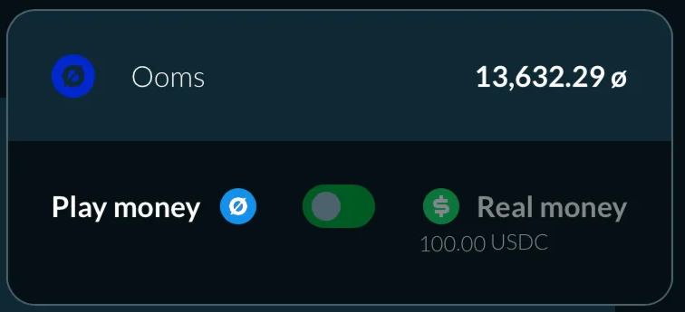
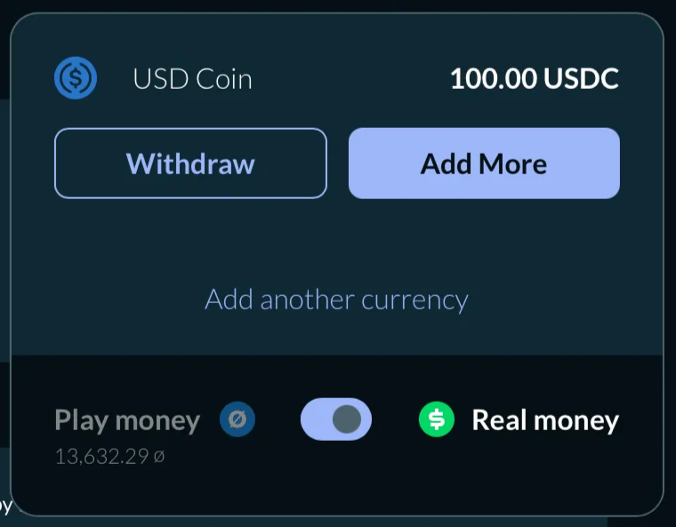

A Futuur tem uma abordagem única para o uso de múltiplas moedas em seus mercados. Nós oferecemos mercados que funcionam simultaneamente com moeda de jogo (Ooms) e dinheiro real (criptomoedas). Leia mais a seguir para entender como eles funcionam e qual é o melhor para você.

## O que são Ooms?

Os Ooms são a moeda de jogo da Futuur, representada pelo símbolo ø. Todos os previsores começam sua jornada na Futuur com 10.000ø, que podem usar para apostar em nossos mercados de dinheiro de jogo. Os Ooms medem a precisão de suas previsões ao longo do tempo e, à medida que você aumenta seu saldo em Ooms, aumenta também sua reputação como previsor.

## Qual é a diferença entre dinheiro de jogo (Ooms) e dinheiro real (cripto)?

Dinheiro de jogo e dinheiro real têm propósitos diferentes na Futuur.

### Dinheiro de Jogo

Os Ooms servem como um indicador de sua **reputação como previsor**, seu capital social. Por isso, eles não podem ser vendidos, comprados, depositados, sacados ou convertidos em qualquer outra moeda. Todos começam sua jornada com a mesma quantidade de Ooms (10.000), e o crescimento ou declínio em seus saldos só pode ser atribuído ao quão bem-sucedidas foram suas previsões. Os incentivos para usar a Futuur com dinheiro de jogo estão principalmente relacionados a:

- Provar quão bom você é em fazer previsões
- Competir com amigos e outros previsores
- Se divertir
- Se acostumar com a plataforma
- Construir um consenso de mercado que não é afetado pela riqueza de cada participante

### Dinheiro Real

Dinheiro real, por outro lado, oferece a possibilidade de ganhar dinheiro real com suas previsões. Todos começam sua jornada na Futuur com saldo zero em dinheiro real, então a alocação inicial depende totalmente de quanto querem depositar em suas carteiras. Uma vez feito o primeiro depósito em [qualquer uma das moedas que atualmente aceitamos](/pt-br/help/understanding-currencies), você pode usá-lo para fazer apostas em qualquer um de nossos mercados de dinheiro real e ser recompensado por previsões corretas na mesma moeda usada para sua aposta.

A dinâmica de participar nos mercados de dinheiro real (fazer apostas, vender posições, receber pagamentos quando os mercados são resolvidos, etc.) é a mesma dos mercados de dinheiro de jogo. A diferença fundamental é que o dinheiro que você ganha apostando com dinheiro real pode ser sacado da Futuur a qualquer momento para você usar na sua vida.

Portanto, além dos componentes divertidos e sociais dos mercados de dinheiro de jogo, os incentivos para usar a Futuur com dinheiro real estão relacionados a:

- Ser recompensado financeiramente por sua atividade como previsor
- Obter insights de pessoas que colocam dinheiro real em jogo e têm mais do que sua reputação a perder se não forem honestas e racionais em suas atividades de previsão

## Como eu seleciono entre dinheiro de jogo e dinheiro real?

Basta clicar no saldo da conta no cabeçalho, na parte superior da tela, e mudar o toggle entre Moeda de Jogo e Dinheiro Real.

Se você já tem saldo em qualquer moeda de dinheiro real e quer usá-lo para suas previsões, não se esqueça de selecionar qual moeda você quer usar naquele momento.

## Os preços de mercado são os mesmos para dinheiro de jogo e dinheiro real?

Não. Nossos mercados de dinheiro de jogo operam independentemente dos nossos mercados de dinheiro real, o que significa que eles podem gerar previsões diferentes.

Para traders experientes, uma diferença entre os dois pode indicar uma oportunidade de arbitragem!

## Todas as moedas de dinheiro real participam do mesmo pool de liquidez?

Sim, independentemente da moeda usada, todas as moedas de dinheiro real são combinadas no mesmo pool de liquidez para cada mercado de dinheiro real. Então, se você está apostando em USD Coin (USDC) e alguém mais aposta em qualquer outra moeda de dinheiro real no mesmo mercado, ambas as apostas impactarão os preços e aumentarão a liquidez geral naquele mercado específico.

## Estou exposto ao risco de volatilidade?

Não. Quando você aposta em uma determinada moeda, seu retorno é bloqueado naquela moeda. Por exemplo, se você apostar 10 USDC a 0,50/share, e sua previsão estiver correta, você ganhará 20 USDC quando o mercado for resolvido, mesmo que o preço do USDC tenha flutuado em relação a outras moedas nesse meio tempo.

## Quais moedas a Futuur aceita?

A Futuur suporta depósitos e saques em dinheiro real nas seguintes moedas:

### Criptomoedas (stablecoins)

- USD Coin (USDC)

Para mais informações sobre como fazer um depósito em cripto na Futuur, por favor visite a seção [Depósitos e Saques](/pt-br/help/deposits-and-withdrawals) da nossa Central de Ajuda, ou entre em contato com o suporte da Futuur em [support@futuur.com](mailto:support@futuur.com).

## Eu não possuo nenhuma criptomoeda. Ondo posso obtê-las?

Bem-vindo ao maravilhoso mundo do cripto! Criptomoedas construídas com tecnologia blockchain oferecem uma maneira inovadora de armazenar e transferir valor sem a necessidade de um intermediário. Para comprar USDC ou outros ativos cripto, recomendamos usar uma exchange confiável que opere em sua jurisdição.

Algumas dessas exchanges são: **[Binance](https://www.binance.com/)**, **[Coinbase](https://www.coinbase.com/)**, **[CEX.IO](https://cex.io/)**, **[Kraken](https://www.kraken.com/)**, **[Foxbit](https://foxbit.com.br/)**, e **[Mercado Bitcoin](https://www.mercadobitcoin.com.br/).**

## Qualquer pessoa pode usar dinheiro real na Futuur?

Não. Devido a restrições em nossa licença de jogos e de nosso provedor de serviços de pagamento, previsores de algumas regiões do mundo não têm permissão para usar dinheiro real na Futuur.

Por favor, consulte a [Seção Legal do nosso Centro de Ajuda](/pt-br/help/license-and-jurisdiction) para entender quais jurisdições não têm permissão para usar cada tipo de moeda na Futuur.
